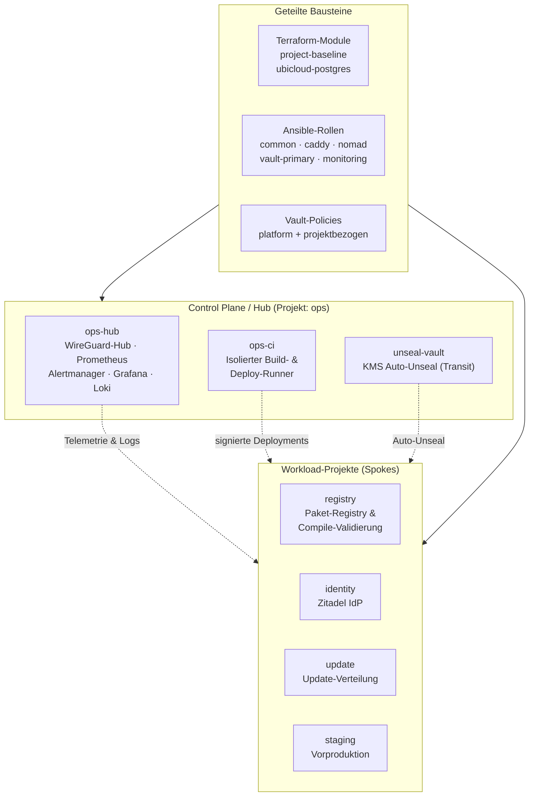
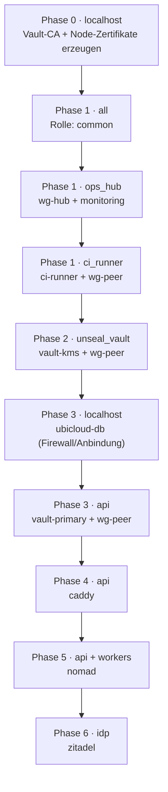
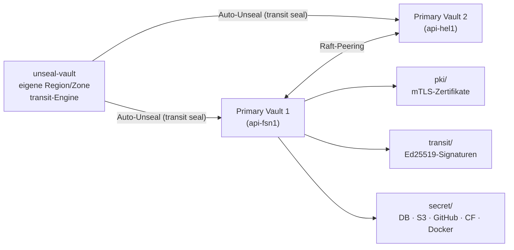
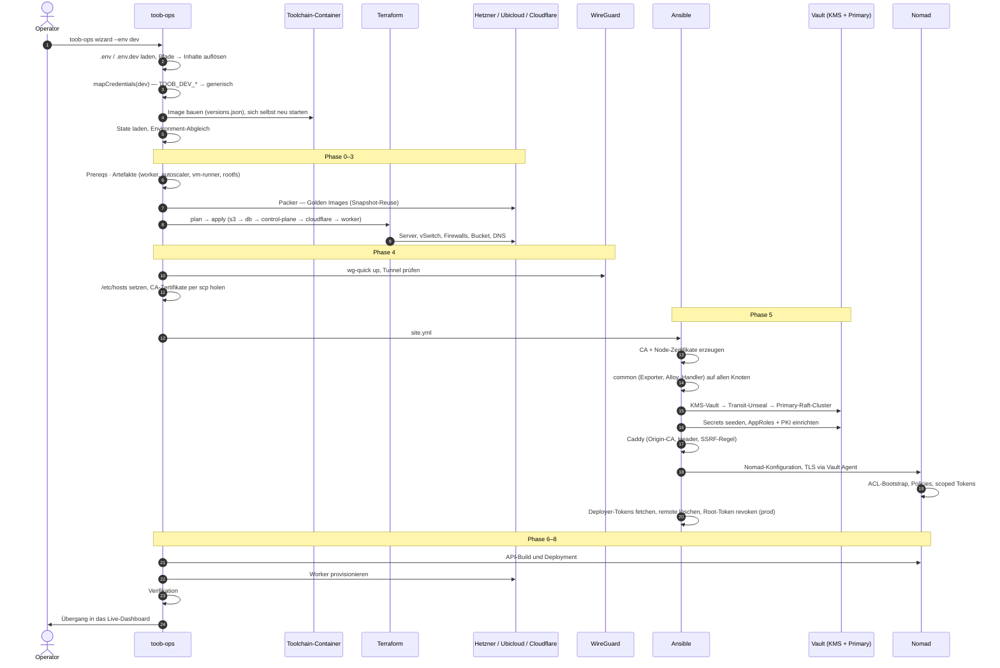

# Toob Platform — Architekturdokumentation (Verwaltungsebene)

> **Scope:** Diese Dokumentation beschreibt die **Platform-Ebene** von `toob-infra` — also die Schicht, die Infrastruktur *bereitstellt, konfiguriert, absichert und betreibt*. Die Fachlogik der Workloads (Registry-Control-Plane, Worker-Daemon, Compiler-Pipeline) ist bereits in `docs/compiler_arch_1.md`, `docs/worker_architecture.md` und `docs/worker_lifecycle_management.md` dokumentiert und wird hier nur so weit berührt, wie sie von der Platform-Ebene verwaltet wird.
>
> **Grundlage:** Statische Analyse des Repository-Standes (Go 1.26.3, Modul `github.com/Toob-Boot/Toob-Registry`). Stellen, an denen der Code nur teilweise vorlag, sind als *[unvollständig belegt]* markiert.

---

## Inhaltsverzeichnis

1. [Das mentale Modell in fünf Sätzen](#1-das-mentale-modell-in-fünf-sätzen)
2. [Leitprinzipien](#2-leitprinzipien)
3. [Ebenenmodell: Platform, Hub und Spokes](#3-ebenenmodell-platform-hub-und-spokes)
4. [Repository-Topografie](#4-repository-topografie)
5. [Umgebungs- und Netzwerktopologie](#5-umgebungs--und-netzwerktopologie)
6. [Der Orchestrator: `toob-ops`](#6-der-orchestrator-toob-ops)
7. [Infrastructure as Code (Terraform)](#7-infrastructure-as-code-terraform)
8. [Konfigurationsmanagement (Ansible)](#8-konfigurationsmanagement-ansible)
9. [Secrets- und Trust-Architektur (Vault)](#9-secrets--und-trust-architektur-vault)
10. [Workload-Orchestrierung (Nomad)](#10-workload-orchestrierung-nomad)
11. [Edge & Ingress (Cloudflare + Caddy)](#11-edge--ingress-cloudflare--caddy)
12. [Observability & Alerting](#12-observability--alerting)
13. [Identity Plane (Zitadel)](#13-identity-plane-zitadel)
14. [Release- und Deployment-Pfad](#14-release--und-deployment-pfad)
15. [Backup, Restore und Drills](#15-backup-restore-und-drills)
16. [Ende-zu-Ende-Bootstrap: der vollständige Ablauf](#16-ende-zu-ende-bootstrap-der-vollständige-ablauf)
17. [Befunde, Inkonsistenzen und Risiken](#17-befunde-inkonsistenzen-und-risiken)
18. [Glossar](#18-glossar)

---

## 1. Das mentale Modell in fünf Sätzen

Ein einziges Go-Binary (`toob-ops`) ist der Einstiegspunkt für den gesamten Lebenszyklus: Es startet sich auf Windows selbst in einem hermetischen Docker-Container mit versionsgepinnter Toolchain neu, lädt umgebungsspezifische Credentials, und arbeitet dann eine **resumable Zustandsmaschine aus neun Phasen** ab.

Diese Phasen provisionieren über **Terraform** die Cloud-Ressourcen, backen über **Packer** Golden Images, bauen über **WireGuard** einen VPN-Tunnel in das private Netz, konfigurieren über **Ansible** jeden Knoten, und übergeben schließlich an **Nomad**, das die eigentlichen Anwendungs-Workloads ausführt.

Das Vertrauensfundament ist **zweistufiges Vault**: Eine kleine, isolierte KMS-Instanz entsiegelt per Transit-Engine automatisch den primären Vault-Raft-Cluster, der wiederum sämtliche Secrets, mTLS-Zertifikate (PKI) und Signaturen (Transit) für alle anderen Komponenten ausstellt — kein Knoten hält dauerhafte statische Geheimnisse.

Nach außen terminiert **Caddy** mit Cloudflare-Origin-Zertifikaten hinter einem Cloudflare-Proxy, der als einziger legitimer Ursprung akzeptiert wird; nach innen ist alles nur über den VPN-Hub erreichbar.

Ein zentraler **Monitoring-Stack** auf dem Ops-Hub (Prometheus, Alertmanager, Grafana, Loki) sammelt Metriken und Logs aller Knoten, und jeder Alert besitzt ein hinterlegtes Runbook.

---

## 2. Leitprinzipien

| Prinzip | Umsetzung im Code |
|---|---|
| **Zero-Trust** | Worker- und Client-Knoten halten weder DB-, S3- noch Vault-Credentials. Authentifizierung ausschließlich per mTLS + kurzlebige Tokens. Privilegierte Operationen werden über die Control-Plane vermittelt. |
| **Fail-Closed** | Fehlende Konfiguration führt zum harten Abbruch, nicht zum stillen Fallback: `Validate()` prüft Pfade und Dateirechte (world-readable TLS-Key ⇒ Startabbruch), Vault-Renewal-Fehler erzwingen einen Neustart mit frischer SecretID. |
| **Single Source of Truth** | `deploy/versions.json` definiert *alle* Binary-Versionen (Nomad, Vault, Terraform, Go, …) und wird sowohl vom `Dockerfile.ops` als auch von `install-binaries.sh` gelesen. Analog: `compiler_manifest.json` für die Compiler-Umgebung. |
| **Path Autonomy (OPS-001)** | Keine absoluten Pfade in Terraform/Ansible/Nomad/Go. Der Repo-Root wird zur Laufzeit über `go.mod`-Suche ermittelt (`findRepoRoot()`). Das Verzeichnis kann frei umbenannt oder verschoben werden. |
| **Idempotenz & Resumability** | Jede Phase schreibt ihr Ergebnis in eine JSON-State-Datei; Wiederaufnahme ist der Normalfall. Ansible-Tasks prüfen vor jeder Aktion den Ist-Zustand (`stat` → `when`). |
| **Digitale Souveränität (EU)** | Hetzner (Falkenstein/Helsinki), Ubicloud, Cloudflare; bewusster Verzicht auf AWS/GCP/Azure KMS zugunsten einer regionalen Vault-Transit-Unseal-Instanz. |
| **Actions-frei** | GitHub dient nur als Code-Hosting und Webhook-Quelle. Builds und Releases laufen auf eigenen, isolierten Runnern — Schutz vor `pull_request_target`-Exploits und Repository-Würmern. |

---

## 3. Ebenenmodell: Platform, Hub und Spokes

Die Architektur ist als **Hub-and-Spoke** aufgebaut. Die Platform-Ebene ist der Hub; die fachlichen Systeme sind Spokes, die identische Bausteine wiederverwenden.



**Wichtige Konsequenz:** Ein Spoke bringt keine eigene Betriebsmechanik mit. Er komponiert die geteilten Terraform-Module und Ansible-Rollen und unterscheidet sich nur durch Variablen (Domain, Netz-CIDR, Nomad-Pool, Vault-Pfade). Das erklärt, warum `site.yml` Rollen konditional über Inventory-Gruppen aktiviert statt über separate Playbooks pro Projekt.

---

## 4. Repository-Topografie

```
toob-infra/
├── go.mod                      Modul github.com/Toob-Boot/Toob-Registry (Go 1.26.3)
├── justfile                    Operative Handgriffe: Plan-Gates, Logs, DB-Shell, Restore-Tests
├── .golangci.yml               depguard-Regeln: erzwingt Modulgrenzen (shared ↛ registry/platform/update)
├── .dockerignore               Verhindert Secret-Leaks in Image-Layer (deploy/vault/, registry/, .git)
│
├── docs/                       Architektur- und Betriebsdokumentation
│   ├── compiler_arch_1.md          Gesamtarchitektur & Domänenmodell (DE)
│   ├── worker_architecture.md      Worker-Laufzeit & Firecracker-Mechanik (DE)
│   ├── worker_lifecycle_management.md  Node-Lebenszyklus & 6 Job-Typen (DE)
│   ├── devops_worker_architecture.md   Sicherheitsarchitektur der Data-Plane (EN)
│   ├── release.md                  CLI-Release- & Self-Update-Pipeline (EN)
│   ├── authz.md                    3-Ebenen-Autorisierungsmodell (EN)
│   ├── runbooks/                   ~20 alertspezifische Runbooks + Prozess-Runbooks
│   └── security_audit_reports/     AiTM-Phishing-Simulation, externer Pentest-Scope
│
└── platform/
    ├── cmd/toob-ops/           Der Orchestrator (main.go, account_recovery.go, console_*.go)
    ├── internal/               engine · stages · dashboard · testrunner · topology
    └── deploy/
        ├── versions.json           SSOT für alle Binary-Versionen
        ├── Dockerfile.ops          Hermetischer Toolchain-Container
        ├── terraform/              modules/ + projects/{ops,registry,identity,update,staging}
        ├── ansible/                site.yml + roles/ (self-contained)
        ├── nomad/jobs/             Job-Spezifikationen
        ├── vault/policies/         Deklarative ACL-Policies
        ├── monitoring/             prometheus/rules/ + grafana/dashboards/
        ├── release/                sign.sh · verify.sh · deploy-nomad.sh · deploy-systemd.sh
        ├── packer/                 toob-base · toob-worker Golden Images
        ├── compiler/ · worker/     Build-Skripte der Data-Plane
        └── scripts/                break-glass.sh, WireGuard-Adminkeys, Patch-SLA
```

**Modulgrenzen werden statisch erzwungen.** `.golangci.yml` konfiguriert `depguard` mit drei Regeln: `shared/` darf weder `registry`, `platform` noch `update` importieren; `platform/` darf nicht auf `registry`/`update` zugreifen; `update/` nicht auf `registry`. Architekturverletzungen scheitern damit im Lint, nicht erst im Review.

---

## 5. Umgebungs- und Netzwerktopologie

Drei vollständig getrennte Umgebungen mit eigenen State-Dateien, eigenen Netz-Präfixen und eigenen Vault-Key-Pfaden:

| Umgebung | Netz-Präfix | Trigger-Branch | Ziel-Release-Repo | Vault-Signing-Key |
|---|---|---|---|---|
| `dev` | `10.1.0.0/16` | manuell | `Toob-CLI-Release-Test` | lokale/Mock-Transit-Keys |
| `staging` | `10.2.0.0/16` | `staging` | `Toob-CLI-Release-Test` | `…/staging-cli-signing-key` |
| `production` | `10.0.0.0/16` | `main` | `Toob-CLI-Release` | `…/cli-signing-key` |

Die Zuordnung IP ↔ Rolle liefert `internal/topology`. Ansible-Inventory-Gruppen:

```
ops_hub       WireGuard-Hub, zentrale Telemetrie
ci_runner     isolierter Build-/Deploy-Runner
bastion       VPN-Gateway (dev: 10.1.1.2)
unseal_vault  KMS-Vault (dev: 10.1.1.12)
api           Control-Plane-Knoten (dev: api-fsn1 = 10.1.1.10)
workers       Bare-Metal-/Ephemere Validierungs-Knoten
idp           Zitadel-Identity-Provider
```

Erreichbarkeit ist strikt zweigeteilt: Öffentlich ist ausschließlich der Cloudflare-Edge. Alles andere — Vault (`:8200`), Nomad (`:4646`), Grafana (`127.0.0.1:3000`), Prometheus (`127.0.0.1:9090`) — ist nur über den WireGuard-Tunnel erreichbar. Der Monitoring-Stack bindet bewusst auf Loopback; nur Loki lauscht auf der privaten IP, weil die Alloy-Agenten der anderen Knoten dorthin pushen.

---

## 6. Der Orchestrator: `toob-ops`

`platform/cmd/toob-ops` ist ein Cobra-CLI und der einzige unterstützte Weg, Infrastruktur zu verändern.

### 6.1 Kommandos

| Kommando | Zweck |
|---|---|
| `wizard` | Geführtes, resumables Deployment über alle neun Phasen. Flags: `--env`, `--resume`, `--dry-run`, `--yes` (nur `dev`), `--state-file`, `--build-dir`, `--deploy-dir`, `--ca-cert-path` |
| `status` | Live-Cluster-Dashboard. Baut bei Bedarf selbstständig VPN auf, synchronisiert CA-Zertifikate, lädt Tokens aus der Secrets-Datei |
| `destroy` | Teardown in **umgekehrter** Stage-Reihenfolge (Verify → Prereqs) mit doppelter Bestätigung, `--force` überspringt Prompts |
| `test` | E2E-/Integrationstests gegen eine laufende Umgebung, inkl. temporärer DB-Firewall-Freischaltung |
| `account-recover` | Vier-Schritt-Prozess zur Wiederherstellung privilegierter Identitäten (siehe §13) |

### 6.2 Hermetische Toolchain

Auf Windows startet sich `toob-ops` **selbst neu**: `runInDockerIfNeeded()` prüft die Docker-Verfügbarkeit, schreibt `deploy/Dockerfile.ops`, baut das Image `toob-ops-tooling`, und führt das Kommando dort erneut aus. Das Image installiert jede Version aus `versions.json` (Go, Terraform, Packer, Vault, Nomad, Ansible, Cosign, jq, AWS CLI, Docker CLI, Buildx, WireGuard-Tools, Firecracker/Jailer).

Beim Start werden gemountet: das Repo nach `/workspace`, der Docker-Socket, persistente Go-Caches, und — falls vorhanden — das Host-`~/.ssh` nach `/tmp/host-ssh` (read-only). Der Inner-Command kopiert die Keys nach `/root/.ssh` und setzt `0700`/`0600`, weil Ansible sonst die Schlüssel ablehnt.

Weitergereicht werden nur Umgebungsvariablen mit Präfix-Whitelist (`TOOB_`, `VAULT_`, `NOMAD_`, `AWS_`, `SEED_`, `CLOUDFLARE_`, `HCLOUD_`, `UBICLOUD_`, …).

> **Anmerkung:** Der Dockerfile-Inhalt existiert doppelt — einmal als String-Konstante in `main.go`, einmal als Datei unter `platform/deploy/Dockerfile.ops`. Die Datei-Variante liest bereits `versions.json`, die eingebettete Variante enthält hartcodierte Versionen (z. B. Ansible 14.1.0 vs. 13.7.0 in `versions.json`). Das ist eine Drift-Quelle, siehe §17.

### 6.3 Credential-Auflösung

Die Auflösungskette ist mehrstufig und bewusst umgebungsisolierend:

```
.env                              (allgemeine Defaults)
   ↓
.env.<env>                        (umgebungsspezifisch)
   ↓
resolveValue()                    Pfadwerte werden zu Dateiinhalten aufgelöst:
                                  SEED_GH_PRIVATE_KEY=/pfad/key.pem → PEM-Inhalt
                                  (Windows-Pfade werden im Container erkannt und
                                   unverändert durchgereicht)
   ↓
propagate*Credentials()           Spiegelt identische Werte:
                                  SEED_S3_* ↔ AWS_*, SEED_CF_ACCOUNT_ID ↔ CLOUDFLARE_ACCOUNT_ID
   ↓
mapCredentials(env)               TOOB_DEV_* / TOOB_STAGING_* / TOOB_PROD_*
                                  → generische Namen (HCLOUD_TOKEN, VAULT_ADDR, …)
```

Der Präfix-Mechanismus ist die zentrale Sicherung gegen Cross-Environment-Unfälle: Ein Skript, das `HCLOUD_TOKEN` liest, bekommt garantiert den Token der Umgebung, für die der Prozess gestartet wurde.

### 6.4 State-Maschine und Phasenmodell

**Zustandsdatei:** `deploy/.toob-ops-state.<env>.json` (Dry-Runs schreiben nach `.dryrun`). Sie hält `started_at`, `environment`, `completed_phases`, `current_phase`, `collected_values` (z. B. ermittelte IPs, Packer-Snapshot-ID) und `stage_results` (Status, Meldung, Logdatei-Pfad je Stage).

**Sicherung gegen Vermischung:** Stimmt `state.Environment` nicht mit `--env` überein, bricht der Wizard ab, bevor irgendetwas ausgeführt wird.

| # | Phase | Inhalt |
|---|---|---|
| 0 | `prereqs` | Tool-Verfügbarkeit, Credentials, Erreichbarkeit |
| 1 | `artifacts` | Build von `worker`, `autoscaler`, `vm-runner`, `rootfs` |
| 2 | `packer` | Golden Images (`toob-base`, `toob-worker`); Wiederverwendung vorhandener Snapshots |
| 3 | `terraform` | S3 → Database → Control-Plane → Cloudflare → Worker |
| 4 | `vpn` | WireGuard-Tunnel, `/etc/hosts`-Injektion, CA-Sync |
| 5 | `ansible` | Vollständige Knoten-Konfiguration (siehe §8) |
| 6 | `deploy` | API-Build und Nomad-Deployment |
| 7 | `workers` | Worker-Provisionierung |
| 8 | `verify` | Health-Checks und Abnahme |

Nach erfolgreichem Wizard-Lauf geht der Prozess **nahtlos in das Status-Dashboard über** — VPN steht, CA-Zertifikate sind synchron, Tokens sind geladen.

### 6.5 Dynamische Datenbank-Freischaltung

Ein wiederkehrendes Muster: Der Runner besitzt keine statisch freigeschaltete IP. `ensureDBFirewallRule()` ermittelt die eigene öffentliche IP (drei redundante Dienste), trägt sie als `/32` in die Ubicloud-Postgres-Firewall ein und liefert eine `cleanup`-Closure zurück, die die Regel danach wieder entfernt. Behandelt werden dabei explizit die Fälle „Regel existiert bereits" (`409` bzw. `400` mit „already taken").

Als Sicherheitsnetz für vergessene oder abgebrochene Cleanups läuft zusätzlich der zentrale Pruner `cleanup-db-firewall.py` (§8.4).

---

## 7. Infrastructure as Code (Terraform)

```
deploy/terraform/
├── modules/
│   ├── project-baseline/     Netz, Firewall, Basis-Ressourcen je Projekt
│   └── ubicloud-postgres/    Managed PostgreSQL inkl. Firewall-Regeln
└── projects/
    ├── ops/ · registry/ · identity/ · update/ · staging/
```

**Provider:** Hetzner Cloud (`hcloud`) für Server, vSwitches, Firewalls; S3-kompatibler Provider gegen Hetzner Object Storage (`https://fsn1.your-objectstorage.com`); Cloudflare für DNS und Proxy; Ubicloud für PostgreSQL.

**State:** Remote in PostgreSQL (pg-Backend) oder in einem versionierten, privaten S3-Bucket. Datenbankgestützte State-Locks verhindern konkurrierende Applies.

**Plan-Gate:** Der `justfile` erzwingt das Zwei-Schritt-Muster. `plan-infra` erzeugt Pläne für alle fünf Module (`s3`, `cloudflare`, `database`, `control-plane`, `worker`), `apply-infra` wendet ausschließlich zuvor erzeugte `tfplan`-Dateien an. Ein `terraform apply` ohne vorherigen Plan ist über die Toolbox nicht möglich.

**Object Storage:** Versionierung ist aktiviert (Schutz vor versehentlichem Löschen, Audit-Trail); CORS erlaubt GET/PUT nur von autorisierten Origins.

---

## 8. Konfigurationsmanagement (Ansible)

`site.yml` ist streng nach Abhängigkeiten geordnet — jede Phase setzt voraus, dass die vorherige abgeschlossen ist.



### 8.1 `ansible.cfg` — bewusste Härtungen gegen Container-Eigenheiten

`pipelining = True` vermeidet TTY-/PTY-Allokation und damit Hänger; SSH-Multiplexing (`ControlMaster`/`ControlPersist`) ist **explizit deaktiviert**, weil UNIX-Sockets im Overlay-Dateisystem des Containers blockieren; `scp_extra_args = -O` erzwingt das Legacy-SCP-Protokoll statt SFTP-under-the-hood (OpenSSH ≥ 9.0); Keepalives und `retries = 3` überstehen VPN-Aussetzer.

### 8.2 Rolle `common` (jeder Knoten)

- **Node Exporter** inklusive Textfile-Collector unter `/var/lib/prometheus/node-exporter`.
- **Failure-/Recovery-Handler:** Jede kritische systemd-Unit deklariert `OnFailure=notify-failure@%n`. Das Skript schreibt eine `.prom`-Datei mit `systemd_service_failed{unit="…"} 1`; `ExecStartPost` ruft nach erfolgreichem Start `notify-recovery.sh` auf, das die Datei löscht. Ein Ausfall wird so ohne zusätzlichen Agenten zu einer Prometheus-Metrik.
- **Grafana Alloy** → Loki: journald mit Relabeling auf `unit`, plus Nomad-Task-Logs aus `/opt/nomad/data/alloc/*/alloc/logs/*` mit Regex-Extraktion von `alloc_id`, `task_name` und `stream`.
- **CA-Verteilung** (Vault-CA, Ubicloud-CA) nach `/etc/ssl/certs` und `/usr/local/share/ca-certificates` mit anschließendem `update-ca-certificates`.
- Swap deaktivieren, `/etc/hosts`-Mapping für `vault.the-toob.com` und `api.global.nomad`.

### 8.3 Weitere Rollen im Überblick

| Rolle | Aufgabe |
|---|---|
| `wg-hub` / `wg-peer` | WireGuard-Overlay: Hub auf `ops_hub`, Peers auf allen anderen Knoten |
| `vault-kms` | KMS-Vault mit Transit-Engine für Auto-Unseal |
| `vault-primary` | Vault-Raft-Cluster auf den API-Knoten, Secret-Seeding, AppRole-/PKI-Setup |
| `ubicloud-db` | Firewall- und Verbindungsintegration der Managed-PostgreSQL |
| `caddy` | Ingress, TLS, Security-Header, SSRF-Härtung |
| `nomad` | Server-/Client-Konfiguration, TLS-Rotation, ACL-Bootstrap |
| `monitoring` | Compose-Stack, Alertmanager-Routing, Backup- und TTL-Exporter-Timer |
| `ci-runner` | Unprivilegierter Deploy-Wrapper, ephemere Vault-Tokens |
| `zitadel` | Identity-Provider |

### 8.4 SSRF- und Firewall-Härtung

Die Caddy-Rolle installiert `toob-api-hardening.service`: eine idempotente `iptables`-Regel, die Zugriffe auf `169.254.169.254` (Cloud-Metadata-Endpoint) für alle Nicht-Root-UIDs verwirft. Damit kann eine SSRF-Lücke in der API keine Instanz-Credentials abgreifen.

Der zentrale DB-Firewall-Pruner (`cleanup-db-firewall.py`, OPS-094) läuft periodisch auf dem Unseal-Vault-Knoten, listet alle aktiven Hetzner-Server (paginiert), vergleicht sie mit den `/32`-Regeln der Ubicloud-Firewall und entfernt verwaiste Einträge. Drei Sicherungen verhindern dabei Selbstaussperrung:

1. Liefert die Hetzner-API **0 aktive Server**, bricht das Skript ab (Netzwerkfehler ≠ „alles löschen").
2. Mehr als **20 Löschkandidaten** ⇒ Abbruch.
3. Mehr als **50 %** aller Regeln als Kandidaten ⇒ Abbruch.

Zusätzlich existiert eine statische Whitelist (`STATIC_WHITELIST_IPS`). Ergebnis und Zeitstempel werden als Prometheus-Metriken geschrieben; der Alert `DBFirewallCleanupStale` feuert nach 30 Minuten ohne Erfolg.

---

## 9. Secrets- und Trust-Architektur (Vault)

### 9.1 Zweistufiges Vault



Der bewusste Verzicht auf AWS/GCP/Azure KMS zugunsten einer **zweiten, regional getrennten Vault-Instanz** ist die Kernentscheidung für Souveränität: kein Lizenzkostenanteil, vollständig selbst gehostet, ausschließlich europäische Infrastruktur. Dokumentierte Alternativen: Scaleway KMS (Frankreich, SecNumCloud) und Securosys CloudHSM (Schweiz, via PKCS#11).

### 9.2 Nur vier sicherheitsrelevante Umgebungsvariablen

Die Anwendung selbst kennt nur `VAULT_ADDR`, `VAULT_ROLE_ID`, `VAULT_SECRET_ID`, `VAULT_CA_CERT`. **Alle** weiteren Geheimnisse — Datenbank-URL, GitHub-App, GitHub-OAuth, Webhook-HMAC, Cloudflare, S3-Keys, OAuth-AES-Key, Docker Hub — werden zur Laufzeit aus Vault gelesen.

### 9.3 Zertifikatsverteilung über Vault Agent

Auf jedem Nomad-Knoten läuft ein Vault Agent mit AppRole-Auth (`api-node-agent` bzw. `nomad-node-pki`). Das Template rendert ein **JSON-Bundle** aus `pki/issue/nomad-cluster` mit CA, Zertifikat und Key. Der `command`-Hook ruft `unpack-nomad-tls.sh`, das die drei Bestandteile per Python atomar (`.tmp` → `os.replace`) mit korrekten Rechten (`0644`/`0600`) schreibt, Ownership setzt, Nomad reloaded und einen Rotations-Zeitstempel als Prometheus-Metrik ablegt. Der Alert `NomadTLSRotationFailed` feuert, wenn dieser Zeitstempel älter als 20 Stunden ist — also vier Stunden vor Ablauf des Zertifikats.

Derselbe Agent rendert auf API-Knoten zusätzlich `/etc/docker-auth.json` aus `secret/dockerhub`, sodass Nomad private Images ziehen kann, ohne dass Credentials in einer Job-Spezifikation stehen.

### 9.4 Bootstrapping neuer Knoten (Wrapped SecretIDs)

Golden Images enthalten **keine** Geheimnisse. Beim Scale-Up erzeugt der Autoscaler eine *wrapped* SecretID (TTL 5 Minuten, einmalig konsumierbar), übergibt sie per cloud-init-Metadaten, und der bootende Knoten tauscht sie gegen die echte SecretID, loggt sich per AppRole ein und zieht sein mTLS-Zertifikat aus der PKI-Engine. Abgefangene Metadaten sind wertlos, weil das Wrapper-Token bereits verbraucht ist.

### 9.5 Token-Hygiene

- **Deployer-Tokens** (Nomad + Vault) werden erzeugt, per `fetch` abgeholt und anschließend auf dem Zielknoten gelöscht (`state: absent`).
- Der **Nomad-Bootstrap-Token** wandert nach `secret/platform/nomad-bootstrap` und wird lokal geschreddert.
- In **Produktion** wird der Vault-Root-Token am Ende der Nomad-Rolle revoked und `vault-keys.json` mit `shred -vfz -n 5` vernichtet.
- Ein **Token-TTL-Exporter** läuft alle fünf Minuten und exportiert die Restlaufzeit für `autounseal`, `nomad_server` und `vault_agent` als Metrik; der Alert `TokenTTLLow` (CRITICAL) feuert unter 24 Stunden.

---

## 10. Workload-Orchestrierung (Nomad)

**Server/Client-Topologie:** Der erste API-Knoten ist Server *und* Client (`bootstrap_expect = 1`), alle übrigen sind reine Clients. Gossip ist verschlüsselt (`NOMAD_GOSSIP_KEY`), HTTP und RPC laufen über mTLS aus der Vault-PKI. Die Konfiguration entsteht aus Jinja2-Templates (`server.hcl.j2`, `client.hcl.j2`) statt aus fehleranfälligen Regex-Ersetzungen — eine explizit dokumentierte Refaktorierung (BEF-012).

**ACL-Modell:** Nach der Leader-Wahl wird `nomad acl bootstrap` ausgeführt und der Token per Regex geparst. Anschließend werden drei Policies mit minimalen Rechten registriert:

| Policy | Rechte | Verwendung |
|---|---|---|
| `prometheus` | agent/node/service: `read` | Service-Discovery-Scraping |
| `autoscaler` | agent/node/namespace: `write` | Knoten drainen und purgen |
| `deployer` | namespace `*`, node, agent: `write` | Deployments durch den CI-Runner |

Der Prometheus-Token wird direkt in das Monitoring-Verzeichnis geschrieben, der Autoscaler-Token nach Vault gepatcht.

**Docker-Härtung:** `allow_privileged = false`; das Seccomp-Profil `seccomp-api.json` liegt unter `/opt/toob-registry/`. `raw_exec` ist auf Servern aktiviert, auf Clients über die Variable `nomad_raw_exec_enabled` steuerbar.

---

## 11. Edge & Ingress (Cloudflare + Caddy)

**Origin Cloaking:** Cloudflare läuft in *Full (Strict)*. Caddy terminiert TLS mit **Cloudflare-Origin-CA-Zertifikaten**, die ausschließlich vom Cloudflare-Proxy-Netz akzeptiert werden. Wer die Bare-Metal-IP kennt und direkt HTTPS spricht, scheitert bereits am TLS-Handshake. Nebeneffekt: Diese Zertifikate sind bis zu 15 Jahre gültig — kein ACME-Renewal, keine DNS-API-Key-Exposition, keine WAF-Interferenz mit HTTP-01-Challenges.

**Slowloris-Schutz:** Globale Timeouts (`read_body 10s`, `read_header 5s`, `idle 5m`) plus `request_body max_size` (6 MB API, 2 MB Identity).

**Trusted Proxies:** Vollständige Liste der Cloudflare-IPv4-/IPv6-Ranges. Nur dahinter wird `CF-Connecting-IP` als echte Client-IP übernommen — Voraussetzung dafür, dass das Rate-Limiting nicht durch gefälschte Header umgangen werden kann.

**Zwei Caddyfile-Varianten:**

- **Standard-API** (`Caddyfile.j2`): HSTS mit Preload, `X-Frame-Options: DENY`, `nosniff`, restriktive CSP (`default-src 'none'`), `-Server`. `/metrics*` wird mit 403 blockiert. Das Admin-Dashboard erhält eine gelockerte CSP für HTML-Rendering. Reverse-Proxy mit `/ready`-Healthcheck und `lb_policy first` (Failover, kein Round-Robin).
- **Identity** (`Caddyfile-identity.j2`): Zusätzlich ein Matcher, der `/ui/console*`, `/ui/admin*` und `/console*` für alle IPs **außerhalb** von `10.9.0.0/16` und `10.20.0.0/16` mit 403 beantwortet — die Admin-Konsole ist ausschließlich über VPN erreichbar (IDP-003). Ebenso blockiert: Selbstregistrierung (IDP-004), Passwort-Endpunkte (IDP-010), Self-Service-Recovery (IDP-020).

---

## 12. Observability & Alerting

### 12.1 Stack

Ein Docker-Compose-Stack auf dem Ops-Hub: Prometheus (30 Tage Retention), Grafana (GitHub-OAuth mit Org-Beschränkung und rollenbasiertem `role_attribute_path`), Alertmanager, Loki, sowie Blackbox-, Postgres- und Cloudflare-Exporter. Alle Ports außer Loki binden auf `127.0.0.1`.

### 12.2 Scrape-Strategie

| Job | Ziel | Auth |
|---|---|---|
| `toob-api` | `:8443` (interne mTLS-API) | Client-Zertifikat aus Vault-PKI |
| `vault` | `/v1/sys/metrics` | Bearer-Token aus Vault-Agent-Sink |
| `nomad` | `:4646/v1/metrics` | Nomad-ACL-Token + mTLS |
| `nomad-node-exporter` | Nomad Service Discovery | Relabeling auf `toob-worker-*`, Port-Rewrite auf `:9100` |
| `blackbox-public` | `https://<domain>/health` über CF | — |
| `blackbox-origins` | `http://<private-ip>:8080/ready` | — |
| `blackbox-vaults` | `/v1/sys/seal-status`, Regex auf `"sealed": false` | — |

Die drei Blackbox-Jobs bilden eine Kaskade: Öffentlicher Probe fehlgeschlagen, aber Origin-Probe grün ⇒ das Problem liegt bei Cloudflare oder DNS, nicht in der Anwendung.

### 12.3 Alert-Routing

```
Watchdog / WatchdogHeartbeatStale  →  BetterStack-Heartbeat (group_wait 0s, repeat 1m)
severity: critical                 →  Discord (Titel 🚨, @here-Mention)
severity: warning                  →  Discord (Titel ⚠️)
```

**Inhibit-Regel:** Ist `InstanceDown` aktiv, werden alle Folge-Alerts derselben Instanz (`SystemdServiceFailed`, `APIHighErrorRate`, `NomadJobFailed`, `VaultSealedExternal`, …) unterdrückt. Ein ausgefallener Knoten erzeugt einen Alert, nicht zwölf.

**Dead-Man's-Switch:** Der `Watchdog`-Alert feuert dauerhaft und wird an einen BetterStack-Heartbeat weitergereicht. Bleibt der Ping aus, ist der Monitoring-Stack selbst ausgefallen — das Runbook formuliert es unmissverständlich: *„You are currently blind to all system failures."*

### 12.4 Runbooks

Jeder Alert besitzt ein Runbook unter `docs/runbooks/` mit identischer Struktur: **Symptoms → Impact → Troubleshooting & Resolution** mit konkreten Kommandos. Abgedeckt sind unter anderem `VaultSealed` (inkl. manuellem PGP-Recovery-Pfad), `PostgresDown`, `TokenTTLLow`, `AutoscalerIneffective`, `NomadTLSRotationFailed`, `BackupStale`, `VersionDivergence`, `DiskSpaceFillingUp`, `SSLCertExpiringSoon`.

Ergänzend existieren **Prozess-Runbooks**: `account_recovery.md`, `break_glass_drill.md`, `security_patching_sla.md`.

---

## 13. Identity Plane (Zitadel)

Die Identity-Ebene folgt einem eigenen Kontroll-Katalog (`IDP-*`), der konsequent auf **phishing-resistente** Authentifizierung setzt.

| Kontrolle | Inhalt |
|---|---|
| IDP-003 | Admin-Konsole nur über VPN (Caddy-Matcher, 403 für externe IPs) |
| IDP-004 | Ausschließlich einladungsbasierter Zugang; Registrierungs-Endpunkte blockiert |
| IDP-010/011 | Passwortlos per Passkey/WebAuthn; TOTP- und SMS-Fallbacks für privilegierte Rollen **verboten** |
| IDP-013/015 | DPoP-Token-Binding nach RFC 9449, Step-Up-Prompts über `WWW-Authenticate` |
| IDP-020/021 | Kein Self-Service-Recovery für privilegierte Konten; stattdessen der Vier-Schritt-Prozess |
| IDP-031/033/040 | 72-h-Einladungen, initiale Rolle immer `viewer`, Rollenerhöhung nur mit Owner-Freigabe und frischem Step-Up (< 300 s) |
| IDP-060/061 | Support-Impersonation: Pflichtbegründung, max. 4 h, nur lesend, Eintrag im Kunden-Audit-Log; keine Standing Grants |
| IDP-072 | Anomalie-Alarm `ANOMALY_AITM_PROXY_SUSPECTED` nach wiederholten Assertion-Fehlern |
| IDP-090 | Patch-SLA: CRITICAL binnen 24 h, HIGH binnen 72 h, Zero-Downtime-Rolling-Upgrade mit automatischem Rollback |

### 13.1 Privileged Account Recovery (IDP-021)

Implementiert in `platform/cmd/toob-ops/account_recovery.go` als vier explizite, protokollierte Schritte:

```
1. Out-of-Band-Anfrage      verschlüsselter Anruf / signierte PGP-Mail / persönliches Ticket
                            (Standard-Mail und Web-Reset sind ausgeschlossen)
2. Human Verification       Abgleich mit dem Vertrags-Kontakt: Name, Vertrags-ID, Telefonnummer
                            → --verified-by <operator> --contract-id <id>
3. 24-h-Veto-Fenster        Alle Org-Owner werden per E-Mail, Webhook und SMS benachrichtigt.
                            Jeder Owner kann abbrechen → INCIDENT_ACCOUNT_RECOVERY_VETOED
4. Dual-Factor Re-Keying    Alle Sessions und Tokens werden revoked; der Nutzer registriert
                            ZWEI neue phishing-resistente Authentikatoren. Keine Rollen-Degradierung.
```

### 13.2 Empirischer Nachweis der Passkey-Wirksamkeit

Der Audit-Bericht `aitm_phishing_simulation.md` dokumentiert eine kontrollierte Adversary-in-the-Middle-Simulation über eine getippte Domain. Ergebnis: Das privilegierte Konto mit WebAuthn-Passkey war **nicht angreifbar** — die Signatur band sich an den Proxy-Origin und wurde vom echten Server wegen Relying-Party-Mismatch verworfen. Das Read-Only-Konto mit Passwort + TOTP wurde in Echtzeit **erfolgreich gephisht**. Das ist der belastbare Grund, warum IDP-011 TOTP-Fallbacks für privilegierte Rollen kategorisch ausschließt.

### 13.3 Break-Glass-Drill (IDP-023)

Halbjährlich, gemeinsam mit dem WireGuard-Hub-Recovery-Drill: Hardware-Key aus dem feuerfesten Safe holen, `IAM_OWNER`-Login durchführen, verifizieren dass der CRITICAL-Alert **binnen 60 Sekunden** in `#security-alerts` ankommt, sofort ausloggen, Key zurücklegen, Zeiten protokollieren. Die Begründung im Runbook ist knapp und richtig: *„An unpracticed emergency path is no emergency path."*

---

## 14. Release- und Deployment-Pfad

### 14.1 Warum kein GitHub Actions

GitHub bleibt Code-Hosting, PR-Plattform und Webhook-Quelle. Ausgeführt wird nichts dort. Der Angriffsvektor „kompromittierter Workflow ändert den Release-Prozess" existiert damit nicht. Stattdessen: HMAC-SHA256-verifizierte Webhooks (`X-Hub-Signature-256`) an den eigenen `toob-ci`-Daemon.

### 14.2 Der isolierte CI-Runner (`ops-ci`)

- Systembenutzer `toob-ci` in der `docker`-Gruppe, Workspace `/var/lib/toob-ci` (`0750`).
- `toob-ci-deploy` ist ein **unprivilegierter Wrapper** (BEF-015/OPS-034): Er holt sich über AppRole (`role-id`/`secret-id` aus dem Workspace) ein **ephemeres** Vault-Token, statt ein statisches zu halten, und führt das Deploy-Skript per `sudo -u toob-ci` aus. Root und Docker-Socket bleiben Image-/Rootfs-Builds vorbehalten.
- **Immutable-Digest-Gate (OPS-062):** Bei `TOOB_ENV=production` wird jede Image-Referenz ohne `@sha256:` abgelehnt. Tag-basierte Deployments in Produktion sind unmöglich.

### 14.3 Modulare Release-Skripte

| Skript | Aufgabe |
|---|---|
| `sign.sh` | Cosign-Signatur von Container-Images über Vault Transit |
| `verify.sh` | Signaturprüfung mit Retry für Propagationsverzögerung |
| `deploy-nomad.sh` | DB-Migration und API-Deployment in Nomad |
| `deploy-systemd.sh` | Zero-Downtime-Rolling-Deployment der systemd-Spoke-Dienste |

**Zero-Exposition-Signing:** Private Schlüssel existieren nie im Build-Environment. Die Build-VM liefert nur SHA-256-Hashes; `toob-ci` reicht sie über mTLS an `transit/sign/toob-registry-ed25519`; Vault signiert intern und gibt die Signatur zurück.

**Clean-Git-Gate:** `just deploy <version>` verweigert den Dienst, wenn `git diff-index --quiet HEAD` fehlschlägt — kein Deployment aus einem verschmutzten Arbeitsverzeichnis.

---

## 15. Backup, Restore und Drills

| Objekt | Mechanismus | Frequenz |
|---|---|---|
| Nomad Raft | `nomad operator snapshot save` → S3 (`toob-vault-backups-<env>`) | täglich, 30 Tage lokale Retention |
| Vault Raft | Snapshot-Skript mit AppRole-Auth | täglich |
| PostgreSQL | Ubicloud-Managed-Backups | providerseitig |
| **Restore-Test** | `toob-vault-restore-test.service` (OPS-020) | **monatlich** |

Jeder Backup-Lauf schreibt eine Prometheus-Textfile-Metrik (`toob_backup_last_success_timestamp`, `toob_backup_status`). Der Alert `BackupStale` feuert nach **26 Stunden** — ein bewusst gewähltes Fenster, das eine verspätete, aber erfolgreiche Ausführung toleriert.

Bemerkenswert: Der Restore wird **automatisiert getestet**, nicht nur das Backup. Ein Backup, dessen Wiederherstellung nie erprobt wurde, ist eine Vermutung. Ergänzend erzwingt `just test-restore-raft` / `just test-restore-db` manuelle Validierungsläufe.

---

## 16. Ende-zu-Ende-Bootstrap: der vollständige Ablauf



---

## 17. Befunde, Inkonsistenzen und Risiken

Die Architektur ist durchdacht und an vielen Stellen überdurchschnittlich sauber — Zero-Trust ist hier keine Folienaussage, sondern im Code durchgesetzt. Die folgenden Punkte sind Beobachtungen aus der statischen Analyse, nach Dringlichkeit geordnet.

### 🔴 Kritisch

**1. Produktiv aussehende Credentials im Klartext in `.env.dev` und `.env.staging`.**
Beide Dateien enthalten vollständige, unmaskierte Zugangsdaten: Hetzner-Cloud-Token, Ubicloud-API-Token, S3-Access-/Secret-Key, Cloudflare-API-Token mit Zone- und Account-ID, Docker-Hub-PAT, Nomad-Gossip-Key, GitHub-App-Secrets, Grafana-Admin-Passwort und Webhook-Secret.

`.gitignore` enthält zwar `.env.*`, aber die Dateien lagen in der übergebenen Sammlung vor — sie wurden also mindestens außerhalb des Repos weitergegeben. **Empfehlung: sämtliche genannten Credentials rotieren**, unabhängig davon, ob sie je in Git gelandet sind. Danach `git log --all -- '.env*'` prüfen, ob sie historisch doch einmal committed wurden.

**2. Dieselben Credentials für `dev` und `staging`.**
Hetzner-Token, Ubicloud-Token und -Projekt-ID, AWS-/S3-Keys, Cloudflare-Token, Zone- und Account-ID, GitHub-App und Docker-Hub-Zugang sind in beiden Dateien identisch. Der Präfix-Mechanismus (`TOOB_DEV_*` / `TOOB_STAGING_*`) suggeriert eine Trennung, die auf Credential-Ebene nicht existiert. Ein kompromittierter Dev-Zugang öffnet damit auch Staging und potenziell Produktionsressourcen im selben Cloud-Projekt.

**3. Wiederverwendetes, persönlich wirkendes Passwort.**
Derselbe Wert dient als `GRAFANA_ADMIN_PASSWORD` **und** als `SEED_WEBHOOK_SECRET` — in beiden Umgebungen. Das Webhook-Secret ist der einzige Schutz davor, dass beliebige Dritte Release- und Validierungs-Jobs auslösen können. Beide Werte sollten unabhängig, zufällig und hinreichend lang sein.

**4. `SEED_GH_CLIENT_ID` und `SEED_GH_CLIENT_SECRET` sind identisch.**
In beiden `.env`-Dateien tragen die zwei Felder denselben 40-Zeichen-Wert. Das ist mit hoher Wahrscheinlichkeit ein Copy-Paste-Fehler; entweder ist der OAuth-Flow aktuell defekt oder die Client-ID wurde versehentlich als Secret hinterlegt.

**5. Private Schlüssel auf dem Desktop.**
`SEED_GH_PRIVATE_KEY`, `SEED_CF_ORIGIN_CERT` und `SEED_CF_ORIGIN_KEY` verweisen auf `C:\Users\<user>\Desktop\…`, einer davon auf eine Datei mit dem Suffix „ - Kopie". Diese Schlüssel gehören in einen Passwort-Manager oder direkt nach Vault; der Wizard kann sie von dort seeden.

### 🟠 Hoch

**6. Die Vault-Root-CA entsteht in `/tmp` ohne Passphrase.**
`site.yml` Phase 0 erzeugt `vault-ca.key` in `/tmp/toob-ca/` — unverschlüsselt, mit 3650 Tagen Gültigkeit, auf der Operator-Maschine (bzw. im Container). Wer diese Datei erlangt, kann beliebige Vault-Server-Zertifikate ausstellen. Optionen: Übergang zu einer Offline-Root-CA mit kurzlebiger Intermediate, oder mindestens Ablage in einem persistenten, verschlüsselten Pfad mit passphrasengeschütztem Key.

**7. Nomad-Server als Single Point of Failure.**
`bootstrap_expect = 1` bedeutet: Fällt `api-fsn1` aus, gibt es keine Scheduling-Entscheidungen mehr. Für `dev` ist das vertretbar; `docs/devops_worker_architecture.md` §9.A benennt den 3-Knoten-Vault-HA-Cluster bereits als Empfehlung (P1-11) — dasselbe gilt für Nomad. Für Produktion sollten drei Server über verschiedene Availability Zones laufen.

**8. Docker-Socket-Mount in den Toolchain-Container.**
`runInDockerIfNeeded()` startet mit `--privileged` und mountet `/var/run/docker.sock`. Für Firecracker/KVM und Image-Builds ist das nötig, verleiht dem Container aber effektiv Root-Rechte auf dem Host. Konsequenz: Der Container darf nur aus vertrauenswürdigen Quellen gebaut werden — was durch `versions.json` und den lokalen Build bereits weitgehend gegeben ist, aber dokumentiert werden sollte.

### 🟡 Mittel

**9. Doppelter Dockerfile mit Versions-Drift.**
`platform/deploy/Dockerfile.ops` liest `versions.json`; die String-Konstante `dockerfileContent` in `main.go` enthält hartcodierte Versionen. Beispiel: Ansible `14.1.0` (eingebettet) gegen `13.7.0` (Manifest), Nomad `2.0.3` in beiden, aber ohne Kopplung. Empfehlung: die Konstante entfernen und die Datei per `go:embed` einbinden.

**10. `justfile` enthält hartcodierte Produktions-IPs.**
`vault-status`, `backup-status` und `db-shell` sprechen `10.0.1.10/11/12` an. In `dev` (Topologie `10.1.x`) laufen diese Rezepte damit ins Leere oder — schlimmer — gegen die Produktion. Die IPs sollten aus `internal/topology` bzw. der Umgebungsvariable abgeleitet werden.

**11. `mock-digest`-Fallback im `plan-app`-Rezept.**
Schlägt `docker inspect` fehl, wird der String `mock-digest` als Image-Digest weitergereicht. Für ein reines `nomad job plan` ist das folgenlos, kaschiert aber einen realen Fehlerzustand. Ein sauberer Abbruch wäre konsistenter mit dem sonst durchgehaltenen Fail-Closed-Prinzip.

**12. `insecure_skip_verify: true` im Blackbox-Vault-Modul.**
Das `http_vault_unsealed`-Modul überspringt die Zertifikatsprüfung. Da die Vault-CA ohnehin auf allen Knoten verteilt wird, ließe sich hier stattdessen `ca_file` setzen.

**13. `host_key_checking = False` in `ansible.cfg`.**
Für dynamisch erzeugte Cloud-VMs pragmatisch, öffnet über den VPN-Tunnel aber theoretisch MITM. Da die Kommunikation ohnehin durch WireGuard geschützt ist, ist das Restrisiko klein — eine Notiz in der `ansible.cfg` wäre trotzdem hilfreich.

**14. `ignore_errors: yes` bei der CA-Verteilung.**
In der `common`-Rolle scheitert das Kopieren von `vault-ca.pem` und `ubicloud-ca.pem` still. Ein Knoten kann so ohne CA weiterlaufen und erst später mit schwer diagnostizierbaren TLS-Fehlern auffallen. Besser: `failed_when` mit klarer Bedingung, oder ein expliziter Verifikations-Task am Ende der Rolle.

### 🔵 Niedrig / Bekannte Lücken

**15. Compatibility-Matrix-Generator noch nicht DB-gestützt.**
`docs/worker_lifecycle_management.md` §7.8 markiert das selbst: Der alte Generator arbeitete mit lokalen JSON-Dateien und liegt unter `_archived_scripts/`. Neue Matrix-Kombinationen müssen derzeit manuell angelegt werden.

**16. Caddy-Pfad-Matcher mit Wildcard in der Pfadmitte.**
Ausdrücke wie `/v2/users/*/password` sollten gegen die eingesetzte Caddy-Version verifiziert werden — falls das Matching nicht wie erwartet greift, wären die Passwort-Endpunkte entgegen IDP-010 erreichbar. Ein kurzer Integrationstest (`curl` gegen die Route, erwartet 403) würde das dauerhaft absichern.

**17. Inkonsistente Dokumentationssprache.**
`CONTRIBUTING.md` legt Englisch für Registry-Code und Manifeste fest, erlaubt Deutsch nur in teaminternen Spezifikationen. Die `docs/`-Dateien mischen beides, teils innerhalb einer Datei (z. B. eine deutsche Zeile in der englischen Threat-Tabelle von `devops_worker_architecture.md`). Für externe Contributor lohnt eine klare Trennung: `docs/` englisch, `docs/internal/` deutsch.

**18. Verwaiste `_archived_*`-Verzeichnisse.**
`.dockerignore` referenziert `_archived_scripts/` und `_archived_workflows/`. Sofern diese nur historisch relevant sind, gehören sie in einen Git-Tag statt in den Arbeitsbaum.

---

## 18. Glossar

| Begriff | Bedeutung |
|---|---|
| **Control Plane** | Vertrauenswürdige Ebene mit Zugriff auf DB, S3, Vault, GitHub; führt alle privilegierten Operationen aus |
| **Data Plane** | Zustandslose Worker-Knoten ohne dauerhafte Secrets; führen untrusted Code in Firecracker-VMs aus |
| **Spoke** | Fachliches Workload-Projekt (registry, identity, update, staging), das geteilte Platform-Bausteine komponiert |
| **Ops-Hub** | Zentraler Knoten mit WireGuard-Hub und Telemetrie-Stack |
| **Golden Image** | Per Packer vorgebackenes VM-Image mit Toolchain, Kernel und Binaries — enthält keine Secrets |
| **Wrapped SecretID** | Einmalig konsumierbares Vault-Token (TTL 5 min) zum sicheren Bootstrapping neuer Knoten |
| **Transit Seal** | Vault-Mechanismus, bei dem eine zweite Instanz den Master-Key ver-/entschlüsselt (Auto-Unseal) |
| **Origin Cloaking** | Caddy akzeptiert nur Cloudflare-Origin-Zertifikate; Direktzugriffe auf die IP scheitern am Handshake |
| **Plan-Gate** | Erzwungene Trennung von `terraform plan` und `apply` über den `justfile` |
| **Dead-Man's-Switch** | Dauerhaft feuernder Watchdog-Alert; ausbleibender Heartbeat signalisiert Ausfall des Monitorings |
| **Step-Up** | Erneute, frische Authentifizierung (< 300 s) vor privilegierten Aktionen |
| **DPoP** | Demonstrating Proof-of-Possession (RFC 9449) — bindet ein Token an einen privaten Schlüssel |
| **AiTM** | Adversary-in-the-Middle — Echtzeit-Phishing über einen Reverse-Proxy |
| **Path Autonomy** | Prinzip, dass das Repository frei umbenannt/verschoben werden kann (OPS-001) |