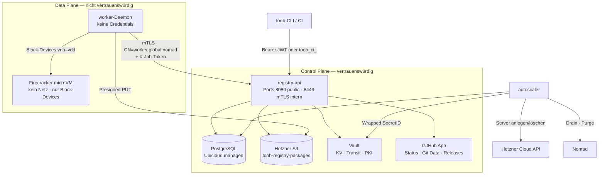
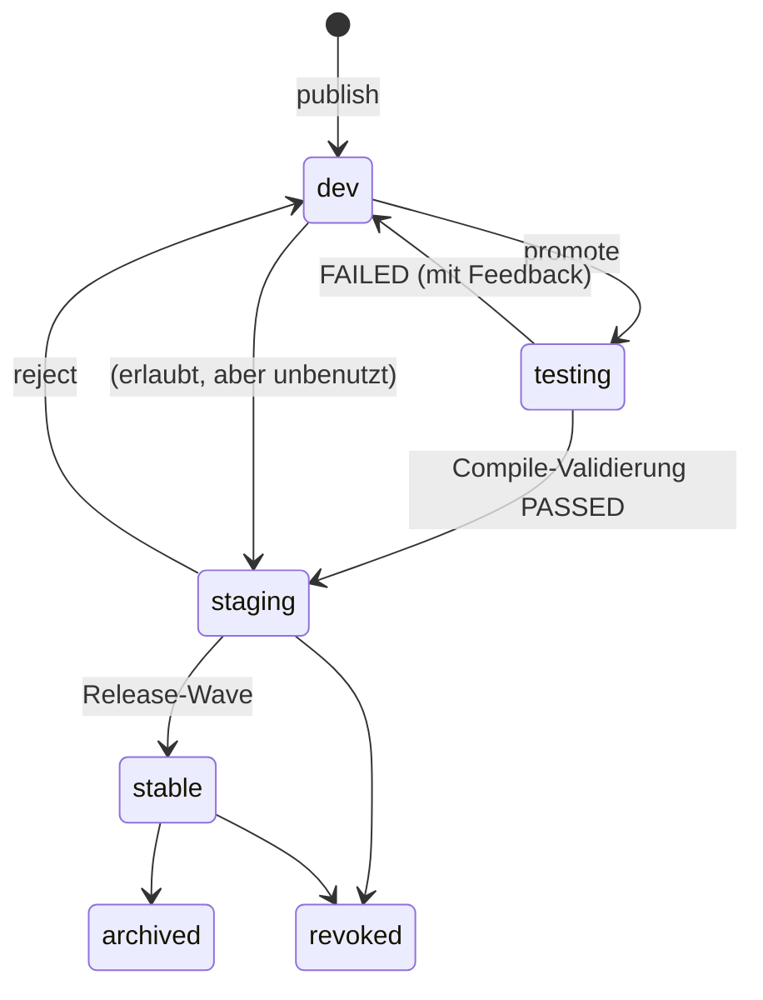
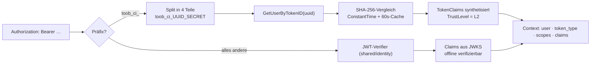
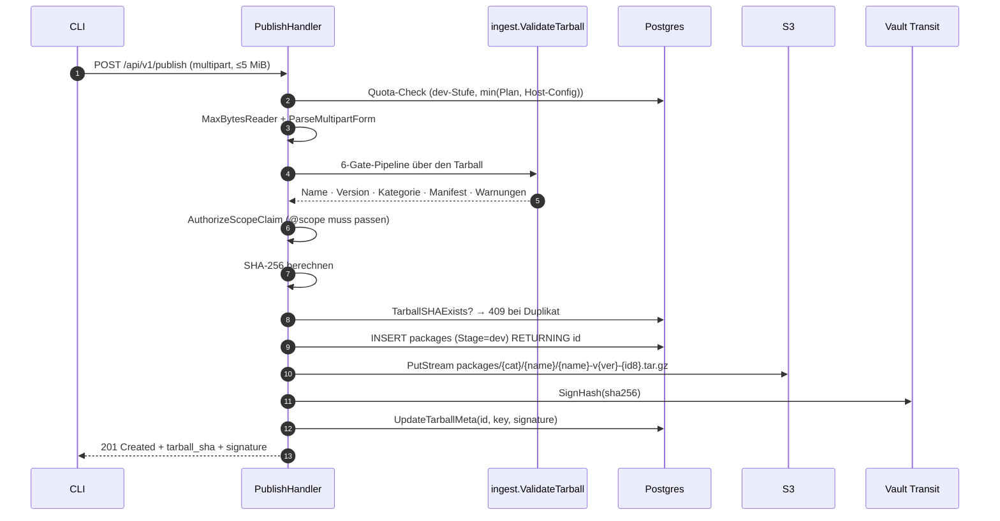
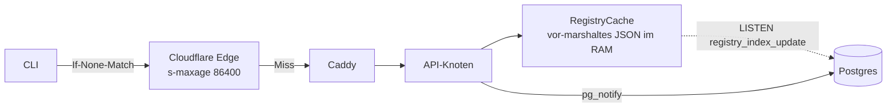
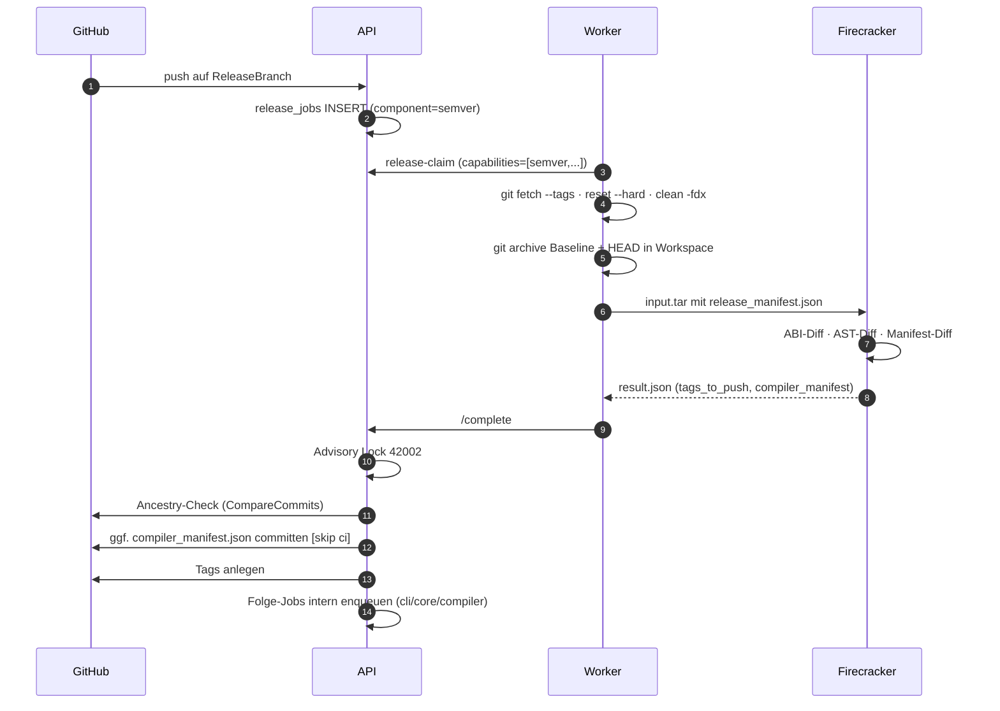

# Toob Registry — Architekturdokumentation (Workload-Ebene)

> **Scope:** Dieses Dokument beschreibt den Spoke **`registry`** — die fachliche Control- und Data-Plane für Paketverwaltung, Compile-Validierung und Ökosystem-Releases. Die verwaltende Platform-Ebene (`toob-ops`, Terraform, Ansible, Vault, Nomad, Monitoring) ist in `toob-platform-architektur.md` beschrieben.
>
> **Grundlage:** Ausschließlich statische Analyse des Codes und der Migrationen. Ältere `docs/`-Dateien wurden bewusst **nicht** als Quelle verwendet; wo Code und Altdokumentation auseinandergehen, gilt der Code. Stellen, die im übergebenen Stand nicht vollständig belegt sind, sind als *[nicht belegt]* markiert.

---

## Inhaltsverzeichnis

1. [Das mentale Modell](#1-das-mentale-modell)
2. [Prozesslandschaft: fünf Binaries](#2-prozesslandschaft-fünf-binaries)
3. [Control Plane vs. Data Plane](#3-control-plane-vs-data-plane)
4. [Infrastruktur-Fußabdruck des Spokes](#4-infrastruktur-fußabdruck-des-spokes)
5. [Datenmodell](#5-datenmodell)
6. [Deferred Name Claiming — die zentrale Invariante](#6-deferred-name-claiming--die-zentrale-invariante)
7. [Authentifizierung und Autorisierung](#7-authentifizierung-und-autorisierung)
8. [Der Publish-Pfad](#8-der-publish-pfad)
9. [Lifecycle und Job-Queues](#9-lifecycle-und-job-queues)
10. [Worker-API — der Zero-Trust-Vertrag](#10-worker-api--der-zero-trust-vertrag)
11. [Der VM-Runner und das SemVer-Orakel](#11-der-vm-runner-und-das-semver-orakel)
12. [Autoscaler](#12-autoscaler)
13. [Read-Pfad, Cache und CDN](#13-read-pfad-cache-und-cdn)
14. [Webhooks und Release-Pipeline](#14-webhooks-und-release-pipeline)
15. [Mirror-Pusher und Core-SDK-Sync](#15-mirror-pusher-und-core-sdk-sync)
16. [Sicherheits-Scanning im Überblick](#16-sicherheits-scanning-im-überblick)
17. [Middleware-Kette und Betriebsverhalten](#17-middleware-kette-und-betriebsverhalten)
18. [Migrationen und Schema-Evolution](#18-migrationen-und-schema-evolution)
19. [Integrationstest-Harness](#19-integrationstest-harness)
20. [Befunde, Inkonsistenzen und Risiken](#20-befunde-inkonsistenzen-und-risiken)
21. [Glossar](#21-glossar)

---

## 1. Das mentale Modell

Die Registry ist ein **Paket-Index für Embedded-Bausteine** (Chips, Treiber, Krypto, Architekturen, Toolchains, Integrationen) mit einer fünfstufigen Promotionspipeline, bei der jeder Schritt zwischen `dev` und `stable` durch automatisierte Compile-Validierung in einer wegwerfbaren Firecracker-microVM abgesichert ist.

Der API-Server ist die einzige Komponente mit Zugriff auf Datenbank, S3, Vault und GitHub. Worker-Knoten besitzen **keine** dieser Credentials — sie erhalten pro Job ein einmaliges Token und lassen jede privilegierte Operation (Presigned-URL-Ausstellung, Signatur, DB-Schreibvorgang, Commit-Status) vom Server ausführen.

Paketnamen werden **nicht beim Upload beansprucht**, sondern erst beim Übergang nach `staging`. Bis dahin dürfen beliebig viele Publisher dieselbe `name@version` privat entwickeln; der Erste, der die Validierung besteht, gewinnt den Namen, alle anderen werden automatisch mit Feedback nach `dev` zurückgesetzt.

Ein monoton wachsender **Revisionszähler** ersetzt die Versionierung des Index selbst; CLIs synchronisieren differenziell („gib mir alles seit Revision N") und bestätigen den Sync, was gleichzeitig das Adressbuch für gezielte Sicherheits-Advisories liefert.

Neben Paketen verwaltet dieselbe Instanz die **Ökosystem-Releases** (CLI, Core SDK, Compiler) inklusive eines SemVer-Orakels, das ABI-, AST- und Manifest-Diffs auswertet und Tags automatisch setzt.

---

## 2. Prozesslandschaft: fünf Binaries

| Binary | Rolle | Deployment |
|---|---|---|
| `cmd/server` | API-Server, Control Plane. Zusätzlich Subkommando `migrate` für DB-Migrationen | Nomad `registry-api` (Docker, `readonly_rootfs`, `cap_drop=ALL`, Seccomp) und `registry-migrate` (Batch, Prestart) |
| `cmd/worker` | Zero-Trust-Daemon auf Bare-Metal-Knoten, startet Firecracker-VMs | Nomad `registry-worker` (System-Job, `raw_exec`, User `toob-worker`) |
| `cmd/autoscaler` | Kapazitätssteuerung: provisioniert und entsorgt Worker-VMs bei Hetzner | Nomad `registry-autoscaler` (Count 1, `raw_exec`) |
| `cmd/vmrunner` | PID 1 **innerhalb** der microVM (`//go:build linux`) | In `rootfs.ext4` eingebacken |
| `cmd/validator` | Standalone-Validierung eines Registry-Verzeichnisses gegen einen Diff | CLI / Debugging |
| `cmd/registry-verify` | Diagnose-CLI: `list-compilers`, `test-build` (nur dev/staging) | Entwickler-Werkzeug |

### 2.1 Lebenszyklus des API-Servers

`run()` in `cmd/server/main.go` baut die Prozessstruktur in fester Reihenfolge auf:

1. Config laden (Host-ENV + Vault-KV), Logger konfigurieren (JSON in Produktion)
2. `signal.NotifyContext` für SIGINT/SIGTERM — ein Kontext für alle Hintergrund-Goroutinen
3. Postgres-Pool (`MaxConns` aus Vault oder ENV)
4. `app.Wire()` — der Dependency-Container
5. **Cache-Sync-Listener** (Postgres `LISTEN registry_index_update`)
6. Drei Hintergrund-Reaper:
   - `runPublishJobReaper` — alle 2 min, `maxAge` 10 min, 3 Retries
   - `runReleaseJobReaper` — alle 2 min, `maxAge` 20 min, 3 Retries
   - `runAuditLogRetention` — täglich, Retention 2 Jahre
7. Öffentlicher HTTP-Server (Default `127.0.0.1:8080`)
8. **Interner mTLS-Server** auf `:8443`, sofern alle drei Worker-TLS-Pfade gesetzt sind — sind sie *teilweise* gesetzt, bricht der Start fail-closed ab

**Graceful Shutdown** ist bewusst zweistufig: Nach dem Signal wird `handler.IsShuttingDown` gesetzt (`/ready` liefert ab sofort 503, damit der Load Balancer den Knoten ausrotiert), dann **15 Sekunden Drain**, dann `srv.Shutdown` mit 10-Sekunden-Deadline, dann bis zu 3 Sekunden Wartezeit, bis die gepufferten Download-Zähler geflusht sind.

---

## 3. Control Plane vs. Data Plane



**Der Vertrauensbruch verläuft exakt an der mTLS-Grenze.** Der Worker kennt nur seine Client-Zertifikate und pro Job ein `X-Job-Token`. Er kann keine Presigned-URL selbst erzeugen, keine Signatur berechnen und keine Datenbankzeile schreiben — er fragt für jede dieser Operationen beim Server an, der die Anfrage gegen den Job-Kontext prüft.

---

## 4. Infrastruktur-Fußabdruck des Spokes

`platform/deploy/terraform/projects/registry/main.tf` komponiert drei Module:

| Modul | Konfiguration |
|---|---|
| `project-baseline` | Netz `10.0.0.0/16`, Subnetz `10.0.1.0/24`, Servertyp `cx23`, zwei Knoten: `api-fsn1` = `10.0.1.10` (Falkenstein), `api-hel1` = `10.0.1.11` (Helsinki) |
| `ubicloud-postgres` | `toob-registry-db`, Größe `standard-2`, 64 GB Storage, **HA nur bei `environment == "production"`** |
| `object-storage` | Bucket `${name_prefix}-packages`, CORS erlaubt nur `registry.the-toob.com` und `staging.registry.the-toob.com` |

Der Terraform-State liegt im S3-Backend (`backend "s3" {}` — partiell konfiguriert, Werte kommen aus `toob-ops`). Alle sensiblen Variablen (`hcloud_token`, `s3_*`, `cloudflare_api_token`) sind mit `sensitive = true` markiert und haben leere Defaults, werden also zur Laufzeit injiziert.

**Nomad-Jobs** (`registry/deploy/nomad/jobs/`):

- `registry-api` — Service, `count = 2` (Default), `spread` über Datacenter, `constraint meta.pool == "api"`, Rolling Update mit `auto_revert`, `min_healthy_time 15s`. Docker-Härtung: `readonly_rootfs`, `pids_limit 100`, `cap_drop = ["ALL"]`, `no-new-privileges`, Seccomp-Profil. mTLS-Bundle und CA kommen per Vault-Agent-Template aus `pki/issue/nomad-cluster`.
- `registry-migrate` — Batch, `restart attempts = 0, mode = fail`. Migrationen laufen also **nie** automatisch erneut.
- `registry-worker` — System-Job auf `meta.pool == "worker"`, `raw_exec` als `toob-worker`, `kill_timeout 5m` (VMs dürfen auslaufen).
- `registry-autoscaler` — Count 1, Credentials für Hetzner/DB/Nomad per Vault-Template ins `secrets/env`.

---

## 5. Datenmodell

### 5.1 Pakete und Stufen



Die erlaubten Übergänge sind **doppelt** durchgesetzt: einmal in Go (`domain.Stage.CanTransitionTo`) und einmal als PL/pgSQL-Trigger auf `packages` (Migration 020). Ein direkter SQL-Sprung `dev → stable` scheitert mit `Invalid package stage transition from dev to stable` — der Integrationstest LIFE-13 prüft genau das.

`packages` speichert kategorie-spezifische Felder **nicht** als typisierte Spalten, sondern im `manifest`-JSONB. Getrennt gehalten werden nur die Felder, nach denen abgefragt oder sortiert wird: `name`, `version`, `category`, `subcategory`, `stage`, `staging_status`, `staging_feedback`, `publisher_id`, `revision`, `path`, `tarball_key`, `tarball_sha`, `signature`, Zeitstempel und `download_count`. Dazu eine generierte `search_vector`-Spalte (`name` Gewicht A, `category` B, `description` C) mit GIN-Index und ein `pg_trgm`-Index auf `name`.

**Kategorien:** `chip`, `driver`, `crypto`, `arch`, `toolchain`, `integration`, `soc`, `port`. Die Zuordnung Manifest-Dateiname → Kategorie ist in `domain.ManifestFilenames` zentralisiert und wird sowohl vom Ingestion-Validator als auch vom VM-Runner benutzt.

### 5.2 Revisionen statt SemVer für den Index

`revisions` ist ein monoton wachsender `BIGINT` mit `format_version`, `commit_sha` und einem `changelog`-JSONB. Der CLI-Sync ist differenziell: `GET /api/v1/registry/sync?since=N&limit=M` liefert alle Revisionen danach, mit `has_more`-Flag durch das Abfragen von `limit+1` Zeilen.

`format_version` wird separat über `POST /api/v1/admin/bump-format-version` erhöht und dient als Schema-Version des Index-Formats.

### 5.3 Kompatibilitätsmatrix

`matrix_entries` hält verifizierte Build-Kombinationen mit dem kanonischen Schlüssel:

```
chip=esp32c6@1.1.0::cli=v0.6.0::core=0.0.1::compiler=v0.1.2
```

`env_hash` ist ein 12-stelliger SHA-256-Präfix des Kombinationsschlüssels (schnelle Lookups ohne Volltextvergleich). Der `matrixgen.Generator` bildet das kartesische Produkt aus stabilen Chips × CLI × Core-SDK × Compiler, filtert per `semver.Compare` gegen `min_core_sdk` / `min_compiler` des Chips, legt fehlende Kombinationen als `PENDING` an und stellt für jede einen Publish-Job ein. Ausgelöst wird er asynchron nach Release, nach CLI-Webhook-Publish und nach erfolgreichem Release-Job.

### 5.4 Ökosystem-Releases

`ecosystem_releases` (Komponenten `cli`, `core_sdk`, `compiler`, `registry`) trägt vier unabhängige Lebenszyklus-Flags:

- `published` — CLI-Releases starten als **Draft** (`false`) und werden erst durch das GitHub-`release`-Webhook auf `true` gesetzt
- `yanked` + `yanked_reason` — Download liefert `410 Gone`
- `deprecated` + `deprecation_warning` — Download liefert Header `X-Toob-Warning` und `Warning: 299`
- `download_count`

`compiler_versions` ergänzt für jeden Compiler die Firecracker-Rootfs-Metadaten (`rootfs_sha256`, `rootfs_s3_key`, `rootfs_size`, `cli_version`, `core_version`, `protocol_version`, `is_active`).

### 5.5 Identität

Nach den Migrationen 030–036 ist `users` ein **Read-Only-Spiegel von Zitadel**: `api_key_hash`, `github_id`, `github_login` und `role` wurden entfernt; es bleiben `id` (Zitadel Subject), `username`, `display_name`, `plan_tier`, `plan_overrides`, `suspended_at`. Dasselbe gilt für `organizations` (mit `zitadel_org_id`, `synced_at`) und `organization_members` — hier entziehen die Migrationen der DB-Rolle `api` explizit `INSERT/UPDATE/DELETE` und geben sie der Rolle `sync`.

`tenants` (Migration 036) bindet die Tenant-ID direkt an die Zitadel-Org-ID und aktiviert Row Level Security mit einer Policy gegen `current_setting('app.tenant_id')`.

---

## 6. Deferred Name Claiming — die zentrale Invariante

Das ist die konzeptionell interessanteste Entscheidung des Systems und wird durch **zwei partielle Unique-Indizes** (Migration 011) getragen:

```sql
-- Index 1: pro Publisher eindeutig, solange privat
CREATE UNIQUE INDEX idx_packages_publisher_name_ver_dev
    ON packages (name, version, publisher_id)
    WHERE stage IN ('dev', 'testing');

-- Index 2: global eindeutig, sobald öffentlich — der eigentliche "Claim"
CREATE UNIQUE INDEX idx_packages_unique_name_ver_claimed
    ON packages (name, version)
    WHERE stage IN ('staging', 'stable');
```

Konsequenz: Alice und Bob dürfen beide `race-driver@1.0.0` in ihrem privaten `dev`-Bereich halten und beide zur Validierung einreichen. Wer zuerst besteht, wird nach `staging` befördert. Der Zweite läuft beim `UPDATE ... SET stage='staging'` in eine Unique-Verletzung (`23505`), die der Server abfängt:

```go
if errors.Is(err, sharederrors.ErrUniqueViolation) {
    _ = h.packages.RevertToDevWithFeedback(ctx, job.PackageID,
        "name and version claimed by another publisher while in testing")
    writeJSON(w, http.StatusConflict, map[string]string{"status": "name_claimed", ...})
}
```

Der Verlierer erhält `409` mit `status: "name_claimed"`, sein Paket landet automatisch wieder in `dev` und die Begründung steht in `staging_feedback`, wo sie über `/packages/mine` sichtbar wird. Die Datenbank ist hier die Autorität — es gibt keinen Application-Level-Lock, der wegrationalisiert werden könnte.

---

## 7. Authentifizierung und Autorisierung

### 7.1 Zwei Token-Typen



Legacy-Session-Keys mit Präfix `toob_v1_` werden **nicht mehr akzeptiert** (AUTH-002) — sie fallen in den JWT-Zweig und scheitern dort.

Der **Verifikationscache** ist bewusst zweigenerationell: `cacheCurrent` und `cachePrevious`, jeweils mit 60-Sekunden-TTL pro Eintrag. Erreicht `cacheCurrent` 2500 Einträge, wird es zu `cachePrevious` rotiert und neu angelegt. Das begrenzt den Speicher ohne periodischen Sweeper und ohne dass gültige Einträge abrupt verschwinden.

`last_used_at` wird höchstens alle 5 Minuten pro Token aktualisiert — synchron, mit eigenem 3-Sekunden-Kontext, mit der expliziten Begründung, dass der Overhead einer Goroutine bei dieser Frequenz nicht gerechtfertigt ist.

### 7.2 Scopes mit Präfix-Semantik

`RequireScope("publish:promote")` wird erfüllt durch den Token-Scope `publish`, weil `hasScope` Präfix-Matching mit `:` als Trenner macht. Der Wildcard `*` erfüllt alles. JWT-Sessions bekommen implizit `["*"]`, CI-Tokens ihre gespeicherte Liste.

`RequireSessionToken()` blockiert `token_type == "ci"` — administrative Aktionen erfordern eine interaktive Session, ein CI-Token reicht nicht.

### 7.3 Der PolicyEngine

`authz.PolicyEngine` implementiert `domain.Authorizer` mit sechs Methoden. Die auffälligste Eigenschaft: **es gibt keinen Admin-Bypass** (AUTH-003). Ein Nutzer ohne Organisationsmitgliedschaft wird abgelehnt, unabhängig von seiner globalen Rolle. Die Tests prüfen das explizit („admin without org membership should be denied deleting org").

Org-Rollen: `owner` (alles), `maintainer` (Mitglieder verwalten, aber keine Rollen vergeben und keine Owner entfernen), `member` (nur publizieren und lesen). Der Handler ergänzt eine Invariante, die der PolicyEngine nicht kennt: **der letzte Owner kann sich nicht selbst entfernen** (`409 Conflict`, „transfer ownership first").

`AuthorizeDataRead` implementiert IDP-011 über TrustLevel: `L1` (Passwort + TOTP) sieht nur aggregierte Statistiken; granulare Gerätedaten, SBOM-Digests, Erase-Counts und Audit-Logs erfordern `L2`+ (Passkey). Abgelehnte L1-Zugriffe werden mit `slog.Warn` und `SECURITY:`-Präfix protokolliert.

---

## 8. Der Publish-Pfad



### 8.1 Die sechs Gates

`ingest.ValidateTarball` läuft über `archiveutil.SafeWalk` und prüft in dieser Reihenfolge:

| Gate | Prüfung | Limit |
|---|---|---|
| 1 | Pfad-Traversal, absolute Pfade, Pfadtiefe | max. 8 Ebenen |
| 2 | Symlinks, Hardlinks, Devices | vollständig abgelehnt |
| 3 | Namenszeichen, Dateiendungen | Allowlist `.c .h .json .ld .cmake .toml .md .csv .overlay .snippet .txt .s .cfg` plus Basenamen `LICENSE`, `Kconfig`; max. 128 Zeichen pro Komponente |
| 4 | Größen | 1 MiB/Datei, 128 Dateien, 20 MiB dekomprimiert gesamt |
| 5 | Manifest | genau eines, Tiefe ≤ 2, Name gegen `(@scope/)?[a-z0-9-]`, Version strikt `X.Y.Z` ohne führende Nullen, Autor Pflicht |
| 6 | Binär-Heuristik | > 80 % Nicht-ASCII in `.c/.h/.S/.ld` ⇒ Ablehnung |

Der `PublishHandler` puffert den Tarball vollständig im Speicher, weil er ihn zweimal liest (Validierung, dann SHA + Upload) — bei 5 MiB Hard-Limit vertretbar.

### 8.2 Zwei-Phasen-Publish

Bemerkenswert ist die Reihenfolge: Der DB-Insert kommt **vor** dem S3-Upload, weil die UUID aus `RETURNING id` in den S3-Key eingeht:

```
packages/{category}/{name}/{name}-v{version}-{uuid[:8]}.tar.gz
```

Damit können zwei Publisher dasselbe `name@version` in `dev` halten, ohne dass sich ihre S3-Objekte überschreiben — die Voraussetzung dafür, dass Deferred Name Claiming überhaupt funktioniert. Anschließend werden Key und Signatur nachgetragen. Schlägt Upload, Signatur oder Metadaten-Update fehl, räumt der Handler das S3-Objekt kompensierend wieder ab.

Heuristik-Warnungen aus der Validierung werden in das gespeicherte Manifest unter `ingestion_warnings` einsortiert, damit sie beim Staging-Review sichtbar bleiben.

### 8.3 Promote als eine Transaktion

`PublishJobStore.PromoteAndEnqueue` erledigt in **einer** Transaktion:

1. Idempotenz-Prüfung (existiert bereits ein `QUEUED`/`COMPILING`-Job? → diesen zurückgeben)
2. Name und Version aus `packages` lesen und in die Job-Zeile denormalisieren
3. Kombinierte `testing`+`staging`-Quote zählen — **innerhalb** der Transaktion, gegen TOCTOU
4. `UPDATE packages SET stage='testing' WHERE id=$1 AND stage='dev'` — der Stage-Guard ist Teil der WHERE-Klausel
5. Job einfügen
6. `NOTIFY publish_job_updates`

Es gibt keinen Zwischenzustand, in dem ein Paket in `testing` steht, ohne dass ein Job dazu existiert.

---

## 9. Lifecycle und Job-Queues

Drei Queues, alle nach demselben Muster:

| Queue | Zweck | Claim-Filter | Reaper |
|---|---|---|---|
| `validation_jobs` | Community-PRs gegen den Registry-Baum | FIFO | 10 min / 3 Retries |
| `publish_jobs` | Compile-Validierung eines hochgeladenen Pakets | Capability-Match auf `compiler:` / `core_sdk:` | 10 min / 3 Retries |
| `release_jobs` | SemVer-Orakel, Compiler-, CLI-, Core-Builds | `component = ANY(capabilities)` | 20 min / 3 Retries |

### 9.1 Claim-Muster

Alle drei nutzen `SELECT … FOR UPDATE SKIP LOCKED` — mehrere Worker können gefahrlos parallel pollen. Beim Claim wird ein 32-Byte-Zufallstoken erzeugt, dessen **SHA-256** in der Zeile landet; der Klartext geht einmalig an den Worker.

`publish_jobs` sortiert zusätzlich nach Dringlichkeit:

```sql
ORDER BY
  (CASE WHEN reference_context->>'combination_key' IS NULL
         OR reference_context->>'combination_key' = ''
        THEN 0 ELSE 1 END) ASC,
  id ASC
```

Echte Publisher-Jobs kommen also immer vor Matrix-Auffüll-Jobs — die Matrix-Generierung kann die Queue nicht verstopfen.

### 9.2 Liveness statt Wanduhr

Der Publish-Reaper reklamiert einen Job nicht nur nach Alter, sondern auch dann, wenn der zugehörige Worker keinen Heartbeat mehr sendet:

```sql
started_at < $1
OR (started_at < now() - INTERVAL '15 seconds' AND NOT EXISTS (
    SELECT 1 FROM system_status
    WHERE component = 'worker:' || worker_id
      AND last_heartbeat >= now() - INTERVAL '30 seconds'))
```

Ein abgestürzter Worker gibt seine Jobs damit nach ~30 Sekunden frei statt nach 10 Minuten. Der Release-Reaper nutzt `COALESCE(last_heartbeat, started_at)`, damit lange, aber gesunde Compiler-Builds nicht abgeräumt werden.

Jobs, die das Retry-Limit reißen, werden endgültig auf `FAILED` gesetzt **und** ihr Paket wird von `testing` nach `dev` zurückgesetzt — die `RETURNING`-Klausel liefert dafür die betroffenen `package_id`s.

### 9.3 SSE-Streaming mit einer einzigen DB-Verbindung

`GET /api/v1/publish/jobs/{id}/stream` liefert Server-Sent Events. Kritisch dabei ist der `jobNotifier`: **alle** gleichzeitigen SSE-Streams teilen sich genau eine Postgres-`LISTEN`-Verbindung. Der Notifier hält `map[jobID]map[chan *PublishJob]bool`, startet den Listener per `sync.Once` beim ersten Subscribe und reconnected bei Verbindungsverlust nach 5 Sekunden. Ohne diese Bündelung würde jeder verbundene CLI-Client eine Pool-Verbindung dauerhaft belegen.

Weitere Schutzmaßnahmen: harte Obergrenze `maxStreamDuration = 15 min`, 15-Sekunden-Keepalive-Kommentare, `X-Accel-Buffering: no` gegen Proxy-Pufferung, und die Compress-Middleware überspringt SSE.

---

## 10. Worker-API — der Zero-Trust-Vertrag

Der interne Router (`NewInternalRouter`) hängt hinter zwei Schichten: TLS mit `RequireAndVerifyClientCert` und der Middleware `RequireWorkerMTLS`, die die Kette gegen den CA-Pool erneut prüft **und** verlangt:

```go
if leaf.Subject.CommonName != "worker.global.nomad" {
    // 403 — verhindert Lateral Movement mit einem gültigen API- oder Autoscaler-Zertifikat
}
```

Ein API-Knoten-Zertifikat aus derselben PKI reicht also nicht, um Worker-Endpunkte anzusprechen.

### 10.1 Endpunkte

| Endpunkt | Zweck |
|---|---|
| `POST /worker/claim` | Nächsten Validierungsjob holen; setzt GitHub-Status auf `pending` |
| `POST /worker/jobs/{id}/upload-request` | Presigned S3-PUT-URLs für validierte Pakete |
| `POST /worker/jobs/{id}/complete` | Ergebnis melden; Server verifiziert Checksummen, signiert, ingestiert, setzt Commit-Status |
| `POST /worker/publish-claim` | Compile-Job holen (mit Capabilities) |
| `POST /worker/publish-jobs/{id}/complete` | Promotion nach `staging` oder Rückfall nach `dev` |
| `POST /worker/release-claim` | Release-Job holen; liefert dynamische Credentials im `Env`-Feld |
| `POST /worker/release-jobs/{id}/complete` | Tags setzen, Assets hochladen, Mirror pushen |
| `POST /worker/release-jobs/{id}/upload-request` | Presigned URLs für Release-Artefakte |
| `POST /worker/release-jobs/{id}/log-chunk` | Build-Log-Streaming (≤ 256 KB/Chunk) |
| `POST /worker/heartbeat` | Liveness; **Antwort enthält `cancel_jobs`** |
| `GET /worker/packages/{id}/download` | Paket-Tarball streamen |
| `GET /worker/rootfs/{version}` | Presigned GET + SHA-256 + Größe des Compiler-Rootfs |

Der Heartbeat ist bidirektional: Der Server nutzt die Antwort, um dem Worker mitzuteilen, welche seiner laufenden Jobs abgebrochen wurden. Der Daemon führt dafür `activeJobs map[int64]context.CancelFunc` und cancelt gezielt.

### 10.2 Ingestion nach erfolgreichem Validierungsjob

`ingest.IngestPackage` ist die Stelle, an der ein vom Worker hochgeladenes Artefakt vertrauenswürdig wird:

1. Objekt aus S3 lesen, in eine **temporäre Datei** streamen (kein OOM bei 50 MB), dabei per `io.MultiWriter` SHA-256 mitrechnen
2. Größenlimit über `io.LimitReader(obj, maxTarballSize+1)` — ein Byte mehr als erlaubt genügt zur Erkennung
3. Checksumme gegen die vom Worker gemeldete vergleichen → `409` bei Abweichung
4. `ValidateAndScanTarball` — Validierung **und** Security-Scan in einem einzigen Durchlauf
5. Typosquat-Prüfung gegen alle existierenden Namen (Levenshtein ≤ 2, bei Namen < 5 Zeichen ≤ 1) → Warnung
6. Signatur über Vault Transit
7. `PublishPackage` direkt in Stufe `staging`

### 10.3 Job-Token-Hygiene

`ValidateJobToken` verlangt neben dem Token-Hash auch den passenden Status (`RUNNING` bzw. `COMPILING`). Nach `Complete` wird das Token auf `NULL` gesetzt — ein zweiter Aufruf mit demselben Token liefert `401`.

Release-Jobs haben eine bewusste Ausnahme: Sie akzeptieren das Token auch bei bereits terminalen Jobs, sofern `finished_at > NOW() - INTERVAL '5 minutes'`. Damit werden Netzwerk-Retries eines `/complete`-Aufrufs idempotent statt zu einem Fehlschlag; der Handler erkennt den terminalen Zustand und gibt ihn unverändert zurück.

---

## 11. Der VM-Runner und das SemVer-Orakel

### 11.1 Ausführungsmodell

`cmd/vmrunner` ist PID 1 in der microVM. Es gibt **kein Netzwerk** — die gesamte Ein- und Ausgabe läuft über vier Block-Devices:

```
/dev/vda  rootfs     read-only   vm-runner-Binary, busybox, Toolchains, Core SDK
/dev/vdb  snapshot   read-only   aktueller Registry-Zustand (ext4 aus dem Public Mirror)
/dev/vdc  input      read-only   Tar mit pr.diff bzw. package.tar.gz, allowed_domains.json, job_context.json
/dev/vdd  output     read-write  result.json und erzeugte Paket-Tarballs
```

Der Ablauf: PATH dynamisch aus allen vorgebackenen Toolchain-`bin/`-Verzeichnissen zusammenbauen, `TOOB_COMPILER_DIR` auf das eingebackene Core SDK zeigen lassen (kein `git clone` in der luftdichten VM), Mounts setzen, Input entpacken, Registry-Snapshot nach `tmpfs` kopieren, Diff anwenden oder Paket einsetzen, `validate.RunAll`, bei Publish-Jobs zusätzlich Compile-Validierung, Ergebnis-Tarballs schreiben.

Beendet wird über `syscall.Reboot(LINUX_REBOOT_CMD_POWER_OFF)` — ein `exit()` aus PID 1 löst Kernel-Panic aus, das ist im Code explizit kommentiert.

Die Compile-Validierung härtet den Compiler-Präfix aus dem Chip-Manifest gegen Command Injection:

```go
if strings.Contains(prefix, "/") || strings.Contains(prefix, "\\") || strings.Contains(prefix, ".") {
    return fmt.Errorf("invalid compiler prefix %q: directory separators and dots are forbidden for security", prefix)
}
matched, _ := regexp.MatchString(`^[a-zA-Z0-9_-]+$`, prefix)
```

Für Krypto-Pakete werden zusätzlich **Known-Answer-Tests** kompiliert und ausgeführt (`kat_runner` aus dem Manifest, Default `kat_test.c`) — ein durchgefallener KAT lässt den Job scheitern.

### 11.2 Das SemVer-Orakel

`cmd/vmrunner/semver.go` bestimmt für drei Subsysteme automatisch den Versionssprung, indem es Baseline-Tag und HEAD vergleicht:

**Core SDK — zwei Ebenen.** Ebene 1 baut beide Stände nativ und diffed die exportierten Symbole per `nm --defined-only -g` (bevorzugt `riscv32-esp-elf-nm`): entferntes Symbol ⇒ MAJOR, neues Symbol ⇒ MINOR. Ebene 2 diffed die Header: gelöschte Datei ⇒ MAJOR, neue Datei ⇒ MINOR, geänderte `typedef`/`struct`/`enum`-Zeilen (normalisiert und sortiert) ⇒ MINOR.

**CLI — Go-AST-Analyse.** `parseInterface` parst `ports.go` und verlangt, dass **jedes** exportierte Struct-Feld ein `port:"required"`- oder `port:"optional"`-Tag trägt; fehlt es, bricht die Analyse mit Fehler ab. Die Regeln:

| Änderung | Bump |
|---|---|
| Struct entfernt · Required-Feld entfernt oder hinzugefügt · Typ geändert · optional → required | MAJOR |
| Wire-Format-Name (`json`-Tag) geändert · JSON-Optionen geändert | MAJOR |
| Exportierte Konstante oder Type-Alias entfernt oder Wert geändert | MAJOR |
| Optionales Feld entfernt oder hinzugefügt · Struct/Konstante/Alias hinzugefügt | MINOR |

Der schärfste Riegel: Bei MAJOR **muss** `ProtocolVersion` in `ports.go` erhöht worden sein, sonst bricht das Orakel mit `[FATAL] BREAKING changes detected, but ProtocolVersion in ports.go was not incremented!` ab.

**Compiler — sieben Dimensionen** aus `compiler_manifest.json`: Protokollversion (MAJOR), eingebettete CLI-Version (erbt den CLI-Bump), Core-SDK-Version (MAJOR/MINOR ⇒ MINOR, PATCH ⇒ PATCH), Base-Image, System-Pakete, Python-Pakete und Registry-Ref (je MINOR).

Dazu eine bewusste Entkopplung: Hat sich **ausschließlich** die eingebettete CLI-Version geändert, ist der Sprung nicht MAJOR und wurde im selben Lauf kein CLI-Code angefasst, wird der Compiler-Build zurückgestellt (`bump = BumpNone`, Meldung „decoupled, compiler build deferred"). Ein CLI-Patch löst also keine Compiler-Release-Kaskade aus.

Das Orakel gibt neben den Bumps eine **modifizierte `compiler_manifest.json`** zurück, die der Server anschließend selbst committet.

---

## 12. Autoscaler

### 12.1 Kapazitätsbewusste Skalierung

Der Autoscaler zählt nicht einfach Jobs, sondern gruppiert sie nach benötigten Fähigkeiten und Priorität — in einer einzigen SQL-Abfrage über `json_agg` und drei `UNION ALL`-Zweige:

| Quelle | Capabilities | Priorität |
|---|---|---|
| `validation_jobs` (QUEUED) | `""` (beliebiger Worker) | 1 |
| `release_jobs` (QUEUED) | `component` | 1 |
| `publish_jobs` ohne `combination_key` | `compiler:X,core_sdk:Y` | 2 |
| `publish_jobs` mit `combination_key` (Matrix) | `compiler:X,core_sdk:Y` | 3 |

Die Skalierungsentscheidung ist **prädiktiv**, nicht schwellenwertbasiert:

```
T_wait  = (Anzahl Jobs der Gruppe × Ø-Buildzeit) / passende aktive Worker
T_boot  = 30 s
Scale-Up ⇔ T_wait > T_boot
```

Die Ø-Buildzeit kommt aus den letzten 10 abgeschlossenen `validation_jobs` (`COALESCE(AVG(duration), 45.0)`). Existiert kein passender Worker, wird `T_wait = 99999` gesetzt — es lohnt sich also immer, den ersten Knoten für eine Fähigkeit zu starten. Bei mehreren Kandidaten gewinnt die niedrigere Prioritätszahl, bei Gleichstand die längere Wartezeit.

Vor dem Skalieren prüft der Autoscaler, ob bereits ein Server mit denselben Capabilities gebootet, aber noch nicht in Nomad angekommen ist — dazu vergleicht er das Hetzner-Label `capabilities` (über `sanitizeLabelValue` auf 63 Zeichen und erlaubte Zeichen normalisiert) gegen den Zielwert. Zusätzlich eine Cooldown-Sperre von 2 Minuten.

### 12.2 Sichere Ablösung

Scale-Down läuft asynchron in einer Goroutine, damit der Hauptloop nicht blockiert. Ein Knoten kommt nur infrage, wenn er länger als `IdleTimeout` untätig ist **und** `canScaleDownNode` bestätigt, dass keine wartende Job-Gruppe zu seinen Capabilities passt. Der Ablauf: Nomad-Drain (Deadline 10 min, `MarkEligible: false`) → Allocations pollen bis alles beendet ist → Hetzner-Server löschen → Nomad-Node purgen.

Der `drainingNodes`-Set wird **vor** dem Start der Goroutine unter Lock gesetzt, damit die nächste Iteration denselben Knoten nicht ein zweites Mal abräumt.

### 12.3 Zombie-Reaper

Ein eigenständiger Mechanismus fängt den Fall ab, dass eine VM provisioniert wurde, aber nie in Nomad erschienen ist — etwa weil der Worker-Daemon in `Validate()` an Dateirechten scheiterte. Server mit Präfix `toob-worker-`, die älter als 15 Minuten sind und in keinem Nomad-Node auftauchen, werden gelöscht. Ohne diesen Reaper würden fehlgeschlagene Bootstraps unbegrenzt Kosten verursachen.

### 12.4 Bootstrapping über Wrapped SecretIDs

Beim Scale-Up erzeugt der Autoscaler eine *wrapped* SecretID (`X-Vault-Wrap-TTL: 900`) und übergibt sie in den cloud-init-Metadaten. Das `user_data.yaml.tmpl` legt darüber hinaus fest:

- SMT deaktivieren (Cross-Hyperthread-Seitenkanäle)
- `iptables`/`ip6tables`-REJECT auf `169.254.169.254` und `fe80::a11:254` für alle Nicht-Root-UIDs
- ACL auf `/dev/kvm` für den `toob-worker`-Nutzer statt Gruppenmitgliedschaft
- Vault Agent mit AppRole-Auth und `unpack-nomad-tls.sh` (atomares Schreiben per `os.replace`)
- Nomad-Client mit `meta.pool = "worker"` und optionalen `meta.capabilities`
- Grafana Alloy für journald und Nomad-Task-Logs

---

## 13. Read-Pfad, Cache und CDN

### 13.1 Vier Cache-Ebenen



`RegistryCache.Get()` gibt den Payload-Slice **ohne defensive Kopie** zurück — mit explizitem Warnkommentar, dass der Aufrufer ihn nicht mutieren darf. Das spart unter Last erhebliche GC-Last auf dem heißesten Endpunkt. `Update()` kopiert dagegen beim Schreiben, damit der Builder das gecachte Array nicht nachträglich beschädigen kann.

Die Invalidierung ist horizontal skalierend: Jeder API-Knoten hält eine eigene `LISTEN`-Verbindung auf `registry_index_update`; ein Schreibvorgang auf irgendeinem Knoten sendet `pg_notify`, worauf alle Knoten ihren Index lokal neu bauen. Bei Verbindungsverlust wird nach 1–5 Sekunden neu verbunden.

Der ETag ist `W/"rev-{revision}"`; passt `If-None-Match`, antwortet der Server mit `304` ohne Body. Nach Release, Revoke und Archive wird zusätzlich `PurgeEverything` gegen die Cloudflare-API gefeuert (Fehler werden nur geloggt, nicht propagiert).

### 13.2 Paket-Downloads

`GET /api/v1/package/{name}/{version}/download` läuft unter `OptionalAuth` — anonyme Downloads sind für `stable` erlaubt, `dev`/`staging` erfordern Berechtigung. Abgelehnt wird mit **einheitlichem `404`** statt `403`, um Namensraum-Probing zu verhindern.

Der Zähler ist bewusst „best effort": ein gepufferter Kanal mit Kapazität 256; ist er voll, wird das Inkrement stillschweigend verworfen, statt den Redirect zu blockieren. Der Hintergrund-Worker flusht beim Shutdown die Restwarteschlange mit je 2 Sekunden Timeout und signalisiert über `Done()`.

Ausgeliefert wird per `302` auf eine Presigned-URL mit 15 Minuten Gültigkeit.

### 13.3 Ökosystem-Downloads

`ReleaseDownloadHandler` prüft mehrstufig: Komponente gegen eine aus `subsystem.AllComponents()` generierte Whitelist, Version gegen `^[a-zA-Z0-9][a-zA-Z0-9.\-+]*$`, Dateiname auf `/`, `\` und `..`. Danach:

- `yanked` ⇒ `410 Gone` mit Begründung
- `!published` ⇒ `404` (CLI-Draft noch nicht freigegeben)
- Neuerer Patch in derselben `major.minor`-Reihe vorhanden ⇒ Header `X-Toob-Warning` und `Warning: 299 - "Deprecation Warning"`

Die Veraltungsprüfung nutzt eine gezielte SQL-Abfrage (`LatestPatchInMinor`) statt alle Releases zu laden.

Eine subtile Abbildung: Der S3-Ordner heißt `core`, die DB-Komponente `core_sdk` — `s3ComponentFolder()` übersetzt zwischen beiden, damit Upload- und Download-Pfade übereinstimmen.

---

## 14. Webhooks und Release-Pipeline

### 14.1 Signaturprüfung

`VerifyWebhookSignature` verlangt `X-Hub-Signature-256` mit `sha256=`-Präfix, liest den Body bis 10 MB, berechnet HMAC-SHA256 und vergleicht mit `hmac.Equal` (konstante Zeit). Danach wird der Body per `io.NopCloser(bytes.NewReader(body))` neu verpackt, damit der Handler ihn erneut lesen kann.

### 14.2 Pull-Request-Events

Zwei Vorfilter greifen, bevor überhaupt eine VM gestartet wird:

1. **Opt-in-Zwang.** Ein PR von einem in der Registry unbekannten GitHub-Nutzer wird mit `403` und dem Hinweis abgelehnt, sich erst per `toob login` zu registrieren. Damit werden keine Accounts implizit angelegt.
2. **Pfad-Guard.** Die Dateiliste des PR wird über die GitHub-API geholt (paginiert, max. 100 Seiten = 10 000 Dateien, darüber Abbruch) und gegen `allowedPathPrefixes` geprüft: `chips/`, `drivers/`, `crypto/`, `arch/`, `toolchains/`, `integrations/`. `isAllowedPath` normalisiert Backslashes, lehnt absolute Pfade und `..` ab und arbeitet anschließend auf `path.Clean`.

Bei `synchronize` (Force-Push) werden vorherige Jobs desselben PR zuerst abgebrochen, damit keine Rechenzeit auf veraltete Commits verschwendet wird.

### 14.3 Push-Events und die Tag-Sperre

Nur Pushes auf `refs/heads/{ReleaseBranch}` lösen aus, und zwar ausschließlich einen `semver`-Job. **Tag-Pushes werden ausdrücklich ignoriert:**

> „tag pushes are ignored; releases must be triggered by the internal SemVer oracle"

Damit kann niemand durch manuelles Tag-Setzen einen Release erzwingen. Zusätzlich filtert der Handler Bot-Commits über `[skip ci]` im Commit-Text und die Absenderadresse `registry-bot@the-toob.com` — sonst würde der eigene Manifest-Commit des Orakels eine Endlosschleife erzeugen.

### 14.4 Der Release-Ablauf



**Der Ancestry-Check** ist die interessanteste Absicherung: Vor dem Taggen vergleicht der Server den Job-Commit mit dem aktuellen Branch-Head. Ist der Branch `ahead`, ist der Job veraltet und wird abgelehnt — „refusing to tag to prevent reverse-diff". Ohne diese Prüfung könnten out-of-order abgearbeitete Jobs einen Rückwärts-Diff als Release taggen.

**Abhängigkeits-Gate für Compiler-Jobs:** Beim Claim liest der Server `compiler/compiler_manifest.json` am Ziel-Tag und prüft, ob die darin referenzierte CLI-Version bereits `published` ist. Falls nicht, wird der Job mit erhöhtem `retry_count` zurück in die Queue gelegt. Nach 60 Versuchen (≈ 5 Minuten bei 5-Sekunden-Poll) scheitert er endgültig statt unbegrenzt zu pollen.

**Atomarität beim CLI-Release:** Cross-Kompilierung für `windows/amd64`, `linux/amd64`, `darwin/arm64` mit `-trimpath` und eingebetteten `-ldflags` (Registry-URL und Signatur-Public-Key). Assets werden in ein GitHub-**Draft**-Release geladen; schlägt auch nur ein Upload fehl, wird das gesamte Draft-Release gelöscht — kein halbfertiges Release bleibt zurück. Bei Retries wird ein bestehendes Release desselben Tags vorher aufgeräumt.

Jedes Asset wird beim Upload per `io.TeeReader` gehasht, über Vault Transit signiert, und die Signatur landet sowohl als `.sig` in S3 als auch als Release-Asset auf GitHub.

---

## 15. Mirror-Pusher und Core-SDK-Sync

### 15.1 Paket-Mirror ohne Git-Binary

`mirror.Pusher` arbeitet vollständig über die **GitHub Git Data API** — kein lokales Repository, kein Festplatten-I/O, kein `git`-Binary:

1. `GetRef("heads/main")` → aktueller Commit
2. `GetCommitTreeSHA` → Basis-Tree
3. Für jede Datei aus jedem Paket-Tarball: `CreateBlob`
4. `CreateTree` mit `base_tree` → inkrementell, nur geänderte Pfade
5. Ist der neue Tree-SHA identisch mit dem Basis-Tree, wird abgebrochen — kein Leer-Commit
6. `CreateCommit` + `UpdateRef` mit `"force": false` — ausschließlich Fast-Forward

Die Extraktion ist limitiert: 10 MB pro Datei, 200 Dateien pro Paket, 5000 Dateien pro Push.

Der Push läuft asynchron in einer Goroutine mit `context.Background()`, damit die Antwort auf `/admin/release` nicht darauf wartet; der Aufrufer bekommt `mirror_status: "queued"`.

### 15.2 Core-SDK-Sync über ein Manifest

`handleCoreJobCompletion` synchronisiert Quellcode in ein öffentliches Repository. Welche Pfade dabei überschrieben werden dürfen, steht **nicht im Code**, sondern in `mirror_manifest.json` im Monorepo (`managed_prefixes`, `managed_files`). Fehlt oder ist die Datei fehlerhaft, bricht der Sync ab — es gibt keinen stillen Fallback.

Der Algorithmus: bestehenden Tree rekursiv laden, alle Einträge unter verwalteten Pfaden **verwerfen**, neue Blobs aus dem Tarball hinzufügen, unverwaltete Dateien unangetastet lassen. Damit können im Public-Repo eigenständige Dateien (README, CI-Konfiguration, Issue-Templates) leben, ohne bei jedem Sync überschrieben zu werden.

Abgesichert durch einen Postgres-Advisory-Lock (`42003`), sodass parallele Core-Releases nicht ineinanderlaufen.

---

## 16. Sicherheits-Scanning im Überblick

`validate.SecurityScan` und `ingest.validateAndScanTarball` teilen sich dieselben Regelsätze.

**Fatal (Job scheitert):**

| Muster | Begründung |
|---|---|
| `system()`, `exec*()`, `popen()` | Shell-Injection-Vektor |
| `dlopen()` | dynamisches Nachladen |
| `fork()` | Prozess-Spawning |
| `#include <sys/socket.h>`, `<netinet/in.h>`, `<arpa/inet.h>` | Netzwerkcode in einem HAL |
| `__attribute__((constructor))` / `((destructor))` | Code, der ohne Aufruf ausgeführt wird |
| Binärendungen `.o .so .elf .bin .a .dylib .dll .exe .ko .out` | keine Binaries in Community-PRs |

**Warnung (Job läuft weiter, Meldung wird gespeichert):**

- Inline-Syscalls: `int 0x80`, `svc #0`, `ecall`, `syscall`
- Shannon-Entropie > 7,0 bits/Byte bei Dateien ≥ 256 Bytes (Obfuskation/verschlüsselte Nutzlast)
- Base64-ähnliche Zeichenketten ≥ 256 Zeichen
- `system()` zusammen mit `stdlib.h` — Heuristik
- Inline-Assembler außerhalb von `arch`-Paketen
- Typosquatting: Levenshtein-Distanz ≤ 2 zu einem existierenden Paketnamen

Der Scanner behandelt **Lesefehler als fatal** — ein `bufio.Scanner`-Fehler wird nicht ignoriert, damit sich der Scan nicht durch überlange Zeilen umgehen lässt (Puffer auf 1 MB angehoben).

Zusätzlich prüft `validate.IntegrityCheck` Toolchain-URLs gegen eine Domain-Allowlist. Die Normalisierung ist gegen Subdomain-Hijacking gehärtet: `my-toolchains.corp` wird zu `my-toolchains.corp/`, sodass `my-toolchains.corp.attacker.com` nicht mehr matcht — der Test `TestIsAllowedToolchainURL` deckt genau diesen Fall ab. Hostnamen werden case-insensitiv verglichen, Pfadpräfixe case-sensitiv.

---

## 17. Middleware-Kette und Betriebsverhalten

Reihenfolge in `buildMiddlewareChain` (äußerste zuerst durchlaufen):

```
RateLimiter → Timeout(30s) → MaxBodySize → Compress → Recovery → Metrics → Logging → Handler
```

**RateLimiter.** 50 Requests/Sekunde, Burst 100, pro IP. `getIP` vertraut `CF-Connecting-IP` und `X-Forwarded-For` **nur**, wenn `RemoteAddr` aus dem Loopback- oder einem privaten Bereich stammt (`10/8`, `172.16/12`, `192.168/16`, `fc00::/7`) — hinter Caddy also korrekt, direkt exponiert nicht spoofbar. Die Visitor-Map ist auf 100 000 Einträge gedeckelt; darüber greift `evictBadly`: erst alle Einträge älter als 1 Minute löschen, bleibt die Map über 80 000, die ältesten nach `lastSeen` sortiert entfernen.

**MaxBodySize.** Standard 256 KB, dynamisch 10 MB für `/api/v1/publish`, `*/complete` und `*/webhook`.

**Timeout.** Setzt eine Write-Deadline von 30 Sekunden — außer für Pfade mit Suffix `/stream`, damit SSE nicht abreißt.

**Compress.** gzip Level 4 aus einem `sync.Pool`. `Flush()` leert zuerst den gzip-Puffer, dann den darunterliegenden Writer, damit SSE trotz Kompression fließt.

**Recovery.** Fängt Panics ab und liefert nur dann `500`, wenn noch kein Header geschrieben wurde — sonst wäre die Antwort bereits im Fluss.

Alle Wrapper implementieren `Unwrap() http.ResponseWriter`, damit `http.NewResponseController` und `http.Flusher` durch die gesamte Kette hindurch funktionieren.

**Metriken.** Der Router normalisiert dynamische Pfadsegmente zu Templates (`/api/v1/package/{name}/{version}`), sodass Paketnamen und Versionen nicht als Label-Kardinalität in Prometheus landen. Der Integrationstest HEALTH-06 prüft explizit, dass keine rohen Segmente in `/metrics` auftauchen.

**404-Normalisierung.** Ein eigener `notFoundResponseWriter` puffert 404-Bodies, um Gos Standard-`404 page not found` durch eine JSON-Antwort zu ersetzen, ohne Handler-eigene JSON-404s zu überschreiben.

---

## 18. Migrationen und Schema-Evolution

36 Migrationen, per `go:embed` eingebettet, ausgeführt über `DB.Migrate`:

- Advisory Lock `42001` verhindert konkurrierendes DDL bei parallelen Instanzen
- `schema_migrations`-Tabelle verhindert Wiederholungen
- Jede Migration läuft in einer eigenen Transaktion samt Versionseintrag
- Der Unlock läuft über einen separaten 3-Sekunden-Kontext, damit er auch nach Abbruch noch durchgeht

Die Migrationen selbst sind durchgängig idempotent geschrieben (`IF NOT EXISTS`, `DO $$ … EXCEPTION WHEN duplicate_column`), also auch bei manuell vorgezogenem Schema unschädlich.

**Meilensteine:**

| # | Inhalt |
|---|---|
| 001 | Basisschema: Revisionen, Publisher, Pakete, Matrix, Ökosystem |
| 005 | Job-Token für Zero-Trust-Worker |
| 010 | `testing`-Stufe und `publish_jobs` |
| 011 | **UUID-PK statt zusammengesetztem Schlüssel, Deferred Name Claiming** |
| 016 | Aktive Klartext-Job-Tokens beim Umstieg auf Hashing invalidiert |
| 020 | Stage-Transition-Trigger als DB-Invariante |
| 021–024 | Release-Jobs, Yanking, Audit-Log, Deprecation |
| 025/026 | `port`-Kategorie hinzugefügt und wieder zurückgenommen |
| 030 | `publishers` → `users` inklusive aller referenzierenden Spalten |
| 033–036 | Zitadel-Spiegelung, Entfernung des Legacy-Identitätsschemas, Org-Bindung von CI-Tokens, Tenant-RLS |

Migration 016 verdient eine Anmerkung: Sie invalidiert bewusst laufende Jobs, weil der Vergleich zwischen Klartext- und gehashten Tokens sonst zu Kollisionen im Übergang geführt hätte. Ein sauberer Bruch statt einer Kompatibilitätsschicht.

---

## 19. Integrationstest-Harness

Unter `registry/test/integration/` liegt ein eigenständiges, phasenbasiertes Test-Framework — kein Unit-Test-Ersatz, sondern ein End-to-End-Läufer gegen eine echte Umgebung.

**Aufbau:**

- `TestMain` lädt `.env.dev` (bis zu drei Verzeichnisebenen aufwärts), holt fehlende Werte aus Vault (`secret/database`), erzwingt IPv4 über eine eigene `DialFunc` (dokumentiert gegen „flaky IPv6 connection timeouts in dual-stack environments") und lässt sich von Vault ein Worker-mTLS-Zertifikat mit 24 h TTL ausstellen.
- `SuiteContext` ist ein thread-sicherer Zustandsbeutel, der Tokens, Job-IDs, Org-IDs und Paket-SHAs zwischen den Phasen weiterreicht.
- `orchestrator_test.go` führt 14 Phasen **streng sequenziell** aus und bricht nach Phase 0–2 hart ab, wenn eine davon scheitert.

**Bemerkenswert:** `ResetDatabase` terminiert zunächst alle anderen Sessions per `pg_terminate_backend`, wartet eine Sekunde, setzt `lock_timeout = '1s'` und wiederholt jedes `TRUNCATE` bis zu fünfmal. Scheitert es dennoch, ruft `DiagnoseLocks` alle aktiven Locks und Queries ab und hängt sie an die Fehlermeldung — Debugging eines blockierten Test-Setups ohne manuelle DB-Sitzung.

Der `PublicClient` dumpt bei jedem Assertion-Fehler den vollständigen Request (`httputil.DumpRequestOut`) samt Response, korreliert über eine generierte `X-Request-ID`, und dekomprimiert gzip transparent anhand der Magic Bytes.

Implementiert sind die Phasen 0–6 (Harness, Smoke, Auth, Orgs, Publish, Lifecycle, Worker-API). Die Phasen 7–13 sind Stubs mit `t.Skip`.

---

## 20. Befunde, Inkonsistenzen und Risiken

Die Registry ist an vielen Stellen bemerkenswert sorgfältig gebaut — die Transaktionsgrenzen sitzen richtig, die Sicherheitsgrenze zwischen Control und Data Plane ist konsequent durchgezogen, und Fehlerpfade räumen auf. Die folgenden Punkte fallen bei der Codeanalyse trotzdem auf.

### 🔴 Kritisch

**1. `domain.HasPermission` ist ein Stub — sämtliche Admin-Endpunkte antworten mit 403.**

```go
func HasPermission(user *User, perm Permission) bool {
	if user == nil || !user.IsActive() { return false }
	switch perm {
	case PermPackagePublish:
		return true
	default:
		return false     // ← alles andere
	}
}
```

`routes_admin.go` gated jede Admin-Route über `middleware.RequirePermission(...)` mit Berechtigungen wie `PermAdminDashboard`, `PermRegistryRelease`, `PermAdminRelease`. Da `HasPermission` für alle diese Werte `false` liefert, sind Staging-Review, Release, Revoke, Archive, Matrix-Update, Cache-Purge, Mirror-Push, Plan-Verwaltung und die gesamte Release-Administration **derzeit für niemanden erreichbar**.

Die Ursache ist erkennbar die Zitadel-Migration: Migration 034 hat die Spalte `users.role` entfernt, `domain.User` hat kein `Role`-Feld mehr, und damit ist auch die Tabelle `domain.RolePermissions` (die `RoleCore`, `RoleOperator`, `RoleReleaseManager` sauber ausmodelliert) toter Code. Der Integrationstest ADM-13 in Phase 01 erwartet `200` auf `/api/v1/admin/status` und müsste an dieser Stelle fehlschlagen.

Die Berechtigung müsste aus den JWT-Claims kommen (`TokenClaims.GovernanceRole` existiert bereits und wird in den Tenant-Isolationstests verwendet). Bis dahin ist die Admin-Fläche funktional stillgelegt.

**2. Der Autoscaler benötigt einen Vault-Token, den seine Nomad-Job-Spezifikation nicht setzt.**

`Start()` ruft direkt beim Hochlauf `fetchWorkerRoleIDUUID` auf, das `X-Vault-Token: a.cfg.VaultToken` sendet. `LoadConfig` liest diesen Wert aus `VAULT_TOKEN`. Das Template in `registry-autoscaler.nomad.hcl` schreibt aber nur `HCLOUD_TOKEN`, `DATABASE_URL`, `NOMAD_*` und `VAULT_ADDR` — kein `VAULT_TOKEN`. Schlägt der Abruf fehl, kehrt `Start()` zurück und der Autoscaler skaliert nie.

Möglich ist, dass Nomad über die `vault { policies = [...] }`-Stanza `VAULT_TOKEN` automatisch injiziert; das war in Nomad 1.x das Standardverhalten. Bei der hier eingesetzten Version *[nicht belegt]* sollte das verifiziert werden — am besten durch einen expliziten Log-Check beim Start („Successfully fetched Worker RoleID UUID from Vault").

**3. Hartkodierter Fallback-Gossip-Key.**

```go
NomadGossipKey: envutil.GetStr("NOMAD_GOSSIP_KEY", "securegossipkey1234567890123456789012=="),
```

Fehlt die Variable, werden Worker-VMs mit diesem öffentlich im Repository stehenden Schlüssel provisioniert und könnten dem Cluster beitreten. Der Default sollte durch einen harten Startabbruch ersetzt werden — konsistent zu `DATABASE_URL` und `HCLOUD_TOKEN`, die genau so behandelt werden.

### 🟠 Hoch

**4. macOS-Toolchain-Prüfsummen sind Platzhalter.**

In `toolchains/riscv32-esp-elf/toolchain_manifest.json` und `registry.json` steht für beide Darwin-Plattformen:

```
"darwin_amd64": "e3b0c44298fc1c149afbf4c8996fb92427ae41e4649b934ca495991b7852b855"
"darwin_arm64": "e3b0c44298fc1c149afbf4c8996fb92427ae41e4649b934ca495991b7852b855"
```

Das ist der SHA-256 der **leeren Zeichenkette**. Die Integritätsprüfung für macOS-Toolchain-Downloads ist damit wirkungslos beziehungsweise schlägt garantiert fehl. (Der Wert ist zudem 63 statt 64 Zeichen lang, was `validSHA256` in `IntegrityCheck` bereits ablehnen würde.)

**5. `min_compiler` und die verfügbaren Compiler-Versionen sind unvereinbar.**

`chips/esp32c6/chip_manifest.json` fordert `"min_compiler": "14.2.0"`, während `registry.json` als Ökosystem-Compiler `v1.1.16` und `v1.1.15` führt. `matrixgen` vergleicht per `semver.Compare("v1.1.16", "v14.2.0")` und filtert konsequent **alle** Kombinationen heraus. Für esp32c6 entstehen damit keine Matrix-Einträge.

Vermutlich wurde `min_compiler` versehentlich auf die GCC-Version (14.2.0) statt auf die Toob-Compiler-Version gesetzt — `min_core_sdk` verwendet mit `core/v0.1.0` korrekt das Toob-Schema.

**6. Kategorie-Pfade laufen zwischen VM-Runner und Registry-Baum auseinander.**

`vmrunner/main.go::determinePackagePath` bildet `integration` auf `filepath.Join("integration", name)` ab, der Registry-Baum und die Webhook-Allowlist verwenden aber `integrations/`. Ein Integration-Paket würde in der VM also am falschen Ort einsortiert. Analog: `determinePackagePath` kennt `port → ports/`, während `handler.isValidCategory` (Worker-Upload-Pfad) `CategoryPort` **nicht** enthält, sodass Port-Pakete dort mit `400` abgewiesen würden. Migration 026 hat die Port-Subkategorien zwar entfernt, `domain.CategoryPort` und `port_manifest.json` existieren aber weiterhin.

**7. Asymmetrische Größenlimits zwischen den beiden Eingangswegen.**

Direktes Publish: 5 MiB (`maxMultipartSize`), Validierung mit 20 MiB Dekomprimierungsbudget. Worker-Ingestion nach PR-Validierung: 50 MiB (`maxTarballSize`). Ein Paket, das über den PR-Pfad hereinkommt, darf also zehnmal größer sein als eines über `toob publish`. Das ist möglicherweise beabsichtigt (Community-PRs enthalten ganze Chip-Ports), sollte aber dokumentiert oder angeglichen werden.

### 🟡 Mittel

**8. `registry.json` und `version_index.json` sind gegenüber den Manifesten veraltet.**

Die Datei führt für esp32c6 `sources.platform`, `sources.config` und die alte Treiberliste — im aktuellen `chip_manifest.json` fehlen `platform` und `config`, dafür ist der Slot-Treiber `esp_mmu_remap` hinzugekommen. Ebenso: `registry.json` nennt die Toolchain-Version `esp-14.2.0_20251107`, `version_index.json` dagegen `1.0.1`, und beide verweisen auf URLs für `13.2.0_20230928`.

Da die Datenbank inzwischen die Wahrheit hält und `BuildRegistryIndex` den Index zur Laufzeit erzeugt, sind diese Dateien reine Altlast. Sie sollten entweder aus dem Repository entfernt oder als generierte Artefakte gekennzeichnet werden — sonst besteht Verwechslungsgefahr mit dem echten Index.

**9. Der Billing-Webhook verifiziert keine Signatur.**

```go
func (h *BillingHandler) Webhook(w http.ResponseWriter, r *http.Request) {
	// TODO: Verify signature and process billing events
	writeJSON(w, http.StatusOK, map[string]string{"status": "received"})
}
```

Registriert unter `POST /api/v1/billing/webhook` **ohne** Auth-Middleware. Solange nichts verarbeitet wird, ist das harmlos; sobald Logik dazukommt, ist es eine offene Tür. `Upgrade` liefert außerdem eine fest verdrahtete Mock-Checkout-URL.

**10. `DevicesHandler` ist nicht verdrahtet und liefert Mock-Daten.**

`NewDevicesHandler` wird ausschließlich in Tests verwendet; in `routes_*.go` taucht `/v1/management/devices` nicht auf. Der Handler gibt hartkodierte Beispielgeräte samt SBOM-Digest zurück. Die dahinterliegende TrustLevel-Logik (IDP-011) ist gut getestet, aber derzeit ohne produktive Route.

**11. Ownership-Verletzung bei PR-Ingestion wird nur geloggt.**

```go
if exists {
    if ownerID == "" || ownerID != pub.ID {
        slog.Info("Community PR contribution detected for package: permitting staging validation", ...)
    }
}
```

Anders als `PromoteRequest`, das mit `403` blockiert, lässt die Ingestion einen fremden Beitrag zu einem bereits beanspruchten Paketnamen durch. Der Unique-Index fängt das anschließend ab, aber als generischer `500 Publish failed` statt als aussagekräftiger `409`. Ein früher Ownership-Check würde die bessere Fehlermeldung liefern.

**12. Der SSE-Ausschluss in der Compress-Middleware ist ein exakter String-Vergleich.**

```go
if r.Header.Get("Accept") == "text/event-stream" {
```

Ein Client, der `text/event-stream, */*;q=0.8` sendet — das tun einige Browser und HTTP-Bibliotheken — fällt durch das Raster und bekommt eine gzip-komprimierte SSE-Antwort. Funktional geht das gut, weil `compressResponseWriter.Flush()` den gzip-Puffer mitleert, ist aber unnötig fragil. `strings.Contains` wäre robuster.

**13. Der synthetische `commit_sha` beim Release.**

`AdminPackageHandler.Release` erzeugt

```go
releaseContent := fmt.Sprintf("release:%s:%d", usr.Username, time.Now().UnixNano())
```

und speichert dessen SHA-256 als `commit_sha` der Revision. Der Wert ist nicht reproduzierbar und hat mit einem Git-Commit nichts zu tun; er wird anschließend von `RegistryHandler.Revision` signiert und als Sync-Anker ausgeliefert. Funktional korrekt, aber der Spaltenname führt in die Irre — `content_hash` oder `revision_digest` wäre ehrlicher.

**14. Ungenutzte Store-Methoden.**

`AdvisoryStore.Active`, `RevisionStore.SaveSnapshot` und `RevisionStore.Snapshots` sind implementiert und im Code als `TODO: Not yet wired` markiert. Damit existiert die Tabelle `revision_snapshots` (und der dazugehörige Audit-Trail-Gedanke), wird aber nie befüllt.

**15. `registry-verify` hat leere Hilfsfunktionen.**

`loadEnvFiles`, `mapCredentials`, `runInDockerIfNeeded` und `ensureVPNForStatus` sind in `cmd/registry-verify/main.go` als No-Ops implementiert. Die Kommandos behaupten in ihrer Hilfe „Requires VPN connectivity", stellen sie aber nicht her und melden auch nicht, wenn sie fehlt — der Fehler tritt erst als Timeout beim HTTP-Request auf. `selectEnvironment` gibt zudem stumm `"dev"` zurück.

### 🔵 Niedrig

**16. Lücken in der Migrationsnummerierung.** `migrations.go` springt von 013 auf 016; die Dateien 014 und 015 existieren nicht. Da die Ausführung über die Position im `All`-Slice läuft, ist das technisch folgenlos, erschwert aber die Zuordnung von `schema_migrations.version` zu Dateinamen.

**17. Ein Test ohne Assertions.** `TestGenerator_Generate_SemVerEdgeCases` schreibt die erzeugten Kombinationsschlüssel per `fmt.Printf` heraus und prüft nichts. Der Kommentar im Test dokumentiert die offene Frage („Wait! In normalization: …"). Genau dieser Fall — `main`/`latest` neben echten Semver-Versionen — ist der interessante, weil `semver.IsValid("vmain")` false liefert und der Filter dann durchlässt.

**18. Uneinheitliche Sichtbarkeit zwischen Metadaten und Download.** `PackageHandler.Get` nutzt `ByNameVersion`, das auf `staging`/`stable` eingeschränkt ist — ein Besitzer erhält für sein eigenes `dev`-Paket `404`. `DownloadHandler` nutzt dagegen `ByNameVersionAnyStage` plus Autorisierung und liefert es aus. Der Download eines Pakets ist damit möglich, dessen Metadaten nicht abrufbar sind.

**19. `/metrics` auf dem internen Listener ist nicht CN-beschränkt.** `RequireWorkerMTLS` liegt nur vor `/api/v1/worker/`; `/metrics` hängt direkt am Mux. Da der TLS-Layer trotzdem ein gültiges Zertifikat der `nomad-cluster`-PKI verlangt, ist das vermutlich beabsichtigt (Prometheus scrapt mit eigenem Zertifikat), sollte aber als bewusste Entscheidung kommentiert werden.

**20. Fehlende Bereinigung im Testpfad.** Mehrere Integrationstests räumen ihre Artefakte direkt per SQL ab (`DELETE FROM packages WHERE …`) statt über die API — was den Stage-Transition-Trigger umgeht und den Test von Implementierungsdetails abhängig macht.

---

## 21. Glossar

| Begriff | Bedeutung |
|---|---|
| **Deferred Name Claiming** | Ein Paketname wird erst beim Übergang nach `staging` global beansprucht, nicht beim Upload |
| **Job-Token** | 32 Byte Zufall, als SHA-256 gespeichert, autorisiert alle Worker-Aufrufe zu genau einem Job und wird beim Abschluss invalidiert |
| **Capability** | Fähigkeitsstring eines Workers, z. B. `compiler:v1.0.0` oder `semver`; steuert Claim-Filter und Autoscaling |
| **Combination Key** | Kanonischer Schlüssel einer Build-Kombination: `chip=X@V::cli=…::core=…::compiler=…` |
| **SemVer-Orakel** | Der Release-Job, der aus ABI-, AST- und Manifest-Diffs den Versionssprung ableitet und Tags setzt |
| **Release Wave** | Atomare Beförderung aller akzeptierten Staging-Pakete nach `stable` in genau einer Revision |
| **Yank** | Ein Ökosystem-Release wird zurückgezogen; Download liefert `410 Gone` |
| **Revoke** | Ein Paket wird aus Sicherheitsgründen entfernt; erzeugt Advisory und benachrichtigt alle betroffenen Publisher |
| **Advisory** | Sicherheitsmeldung zu einem widerrufenen Paket, in-band beim nächsten Sync ausgeliefert |
| **Sync-Log** | Aufzeichnung, welcher Nutzer welche Revision synchronisiert hat — Adressbuch für gezielte Advisories |
| **Reaper** | Hintergrundprozess, der hängengebliebene Jobs anhand von Alter und Heartbeat zurücksetzt |
| **Zombie-VM** | Hetzner-Server, der provisioniert wurde, aber nie in Nomad erschien |
| **TrustLevel** | L1 = Passwort+TOTP (nur aggregierte Daten), L2 = Passkey, L3 = zwei Passkeys |