# Toob Identity — Datenmodell

Stand: 2026-09-04. Gegenstück zu [identity_login.md](identity_login.md): dort die Abläufe, hier die
**Strukturen**. Alles aus dem Code, nicht aus dem Plan — was gebaut, aber nicht verdrahtet ist, ist
als solches markiert.

---

## 1. Drei Speicher, eine Identität

Der Identity-Service hält seine Daten an drei Orten, und keiner davon kennt die anderen direkt.
Verbunden sind sie ausschließlich über **Zeichenketten**: die URN, die Tenant-ID und die
Zitadel-Org-ID.

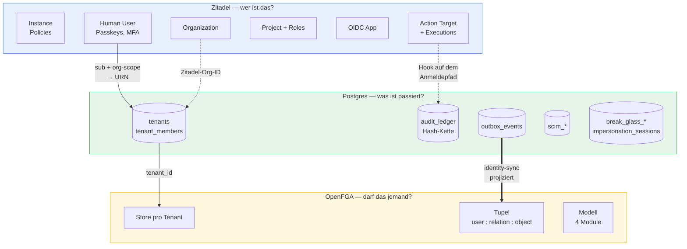

| | Zitadel | Postgres | OpenFGA |
|---|---|---|---|
| Beantwortet | Authentifizierung | Was geschah, wer gehört wozu | Autorisierung |
| Schlüssel | `sub`, Org-ID | `tenant_id`, URN | `tenant:<id>`, `user:<id>` |
| Quelle der Wahrheit für | Anmeldung, MFA, Token | Mitgliedschaft, Audit, SCIM | abgeleitete Berechtigung |
| Schreibt hinein | Zitadel selbst, `zitadel-provision` | `identity-api` | **nur** `identity-sync` |

**Merksatz:** Postgres ist die Quelle, OpenFGA die Projektion. Wer eine Mitgliedschaft ändert,
schreibt nach Postgres — nie direkt nach FGA (§6).

---

## 2. Der Klebstoff: URN, Tenant-ID, Org-ID

Drei Bezeichner, die durchgängig benutzt werden. Sie zu verwechseln ist der häufigste Fehler.

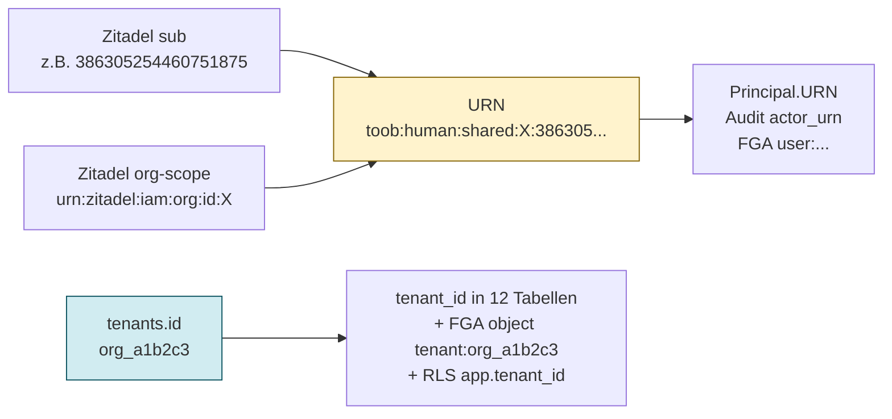

### 2.1 URN-Formate

`identity/principal/urn.go` — sechs Formen, alle mit dem Präfix `toob:`:

```
toob:human:<cell>:<orgId>:<userId>                    Mensch
toob:sa:<cell>:<orgId>:<saId>                         Service-Account
toob:workload:github:<owner>/<repo>:<workflow>        CI-Workload
toob:workload:svc:<cell>:<serviceName>                interner Dienst
toob:workload:tenant:<cell>:<orgId>:<workloadID>      Kunden-Workload
toob:device:<cell>:<tenantId>:<deviceId>              Feldgerät
toob:bootstrap:device:<cell>:<tenantId>:<deviceId>    Werks-Bootstrap (einmalig)
```

`<cell>` ist die Zelle (`shared`, `cell-eu-shared-01`, …), `<orgId>` die **Zitadel**-Org-ID aus dem
Token-Scope. Der Verifier baut die URN, wenn `sub` nicht schon eine ist.

### 2.2 Die zwei „Org"-Begriffe

Das ist keine Redundanz, sondern zwei verschiedene Dinge mit unglücklich gleichem Namen:

| | Zitadel-Organisation | Toob-Tenant |
|---|---|---|
| Woher | `urn:zitadel:iam:org:id:X` im Token-Scope | `tenants.id`, von `POST /api/v1/tenants` erzeugt |
| Landet in | `Principal.OrgID`, URN-Segment | `tenant_id`-Spalte, FGA-Objekt, RLS-Variable |
| Verbunden? | **Nein.** Nichts im Code bildet das eine auf das andere ab | |

`orgs.CreateOrganization` (unaufgerufen, siehe [identity_login.md §2.4](identity_login.md)) wäre die
Stelle, die beide erzeugt und verknüpft.

---

## 3. Zitadel — das Instanzmodell

Alles, was `zitadel-provision` deklariert und gegen die laufende Instanz abgleicht. Kein ORM, keine
eigene Tabelle: das sind Objekte in Zitadels API.

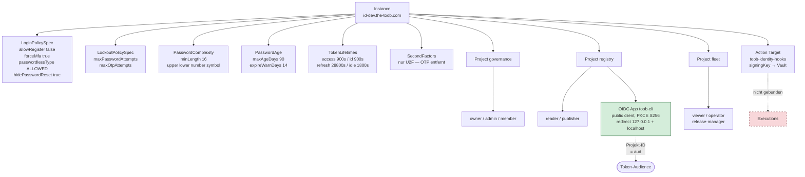

### 3.1 Die Policy-Structs

`identity/internal/zitadel/policies.go`. **Jeder Struct wird in beide Richtungen benutzt** — zum
Schreiben marshalled und aus dem Read-Back unmarshalled. Das ist die ganze Konstruktion: Zitadel
akzeptiert unbekannte Feldnamen, ignoriert sie und antwortet 200, also ist ein falscher JSON-Tag
sonst lautlos wirkungslos.

```go
type LoginPolicySpec struct {          // PUT/GET /admin/v1/policies/login  — FULL REPLACE
    AllowUsernamePassword      bool   `json:"allowUsernamePassword"`
    AllowRegister              bool   `json:"allowRegister"`
    AllowExternalIDP           bool   `json:"allowExternalIdp"`
    ForceMFA                   bool   `json:"forceMfa"`
    ForceMFALocalOnly          bool   `json:"forceMfaLocalOnly"`
    PasswordlessType           string `json:"passwordlessType"`
    HidePasswordReset          bool   `json:"hidePasswordReset"`
    IgnoreUnknownUsernames     bool   `json:"ignoreUnknownUsernames"`
    AllowDomainDiscovery       bool   `json:"allowDomainDiscovery"`
    DisableLoginWithEmail      bool   `json:"disableLoginWithEmail"`
    DisableLoginWithPhone      bool   `json:"disableLoginWithPhone"`
    MFAInitSkipLifetime        string `json:"mfaInitSkipLifetime"`
    PasswordCheckLifetime      string `json:"passwordCheckLifetime"`
    ExternalLoginCheckLifetime string `json:"externalLoginCheckLifetime"`
    SecondFactorCheckLifetime  string `json:"secondFactorCheckLifetime"`
    MultiFactorCheckLifetime   string `json:"multiFactorCheckLifetime"`
}
```

`SecondFactors` fehlt hier bewusst: der GET meldet sie, der PUT kann sie nicht setzen (ein PUT nur
mit U2F kam mit weiterhin aktivem OTP zurück). Eigene Endpunkte, eigener Teil der Spec.

Die vier weiteren Structs mit ihren **gemessenen** Pfaden — die alten waren teils falsch:

| Struct | Pfad (PUT) | Pfad (GET) |
|---|---|---|
| `LockoutPolicySpec` | `/admin/v1/policies/password/lockout` | `/admin/v1/policies/lockout` ⚠️ verschieden |
| `PasswordComplexitySpec` | `/admin/v1/policies/password/complexity` | dito |
| `PasswordAgeSpec` | `/admin/v1/policies/password/age` | dito |
| `TokenLifetimeSpec` | `/admin/v1/settings/oidc` | dito (**nicht** `/policies/oidc` → 404) |

Zahlenfelder kommen als JSON-**Strings** (`json:"maxPasswordAttempts,string"`).

### 3.2 Projekt- und Rollenkatalog

`zitadel.PermissionCatalog()` — das ist der grobe Rollenkatalog *in Zitadel*, nicht zu verwechseln
mit dem feingranularen `shared/policy.PermissionCatalog` (§7.3):

```go
type RoleSpec struct { Key, DisplayName, Group string }
type ProjectSpec struct { Name string; Roles []RoleSpec }
```

| Projekt | Rollen (`key` / `group`) |
|---|---|
| `governance` | `owner`/executive, `admin`/administrator, `member`/member |
| `registry` | `reader`/read_only, `publisher`/developer |
| `fleet` | `viewer`/read_only, `operator`/operations, `release-manager`/security |

Das Projekt **`registry` trägt die Sign-in-App**, und **seine ID ist die Token-Audience** — eine
Tatsache über Zitadel, keine Wahl: es setzt Projekt- und Client-Kennungen in `aud`, nie einen von
uns gewählten Namen.

### 3.3 Sign-in-App und Hook-Target

```go
type OIDCAppSpec struct {              // public client, kein Secret-Feld — mit Absicht
    Name         string                //  "toob-cli", der Adoptionsschlüssel
    RedirectURIs []string              //  http://127.0.0.1/callback, http://localhost/callback
}
type AppReport struct { AppID, ClientID, Audience string; Adopted, Created bool }

type HookTargetSpec struct { Name, Endpoint, Timeout string }
type HookReport    struct { /* signingKey wird einmalig ausgegeben → Vault */ }
```

Beide **adoptieren vor dem Anlegen**: eine zweite App bedeutet eine zweite Client-ID, und jede
bestehende Session refresht gegen die erste.

Ablageorte in Vault:

```
secret/data/identity/oidc-client   → client_id, audience
secret/data/identity/zitadel-hooks → signingKey  (nur beim Anlegen ausgegeben)
```

---

## 4. OpenFGA — das Autorisierungsmodell

Vier Module, in dieser Reihenfolge geladen (`policy/model/fga.mod`, Schema 1.2). Sie lösen Typen
über Dateigrenzen hinweg auf, also ist die Reihenfolge Teil des Modells.

```
core.fga → registry.fga → fleet.fga → marketplace.fga
```

Das Modell ist **eingebettet** (`go:embed`), nicht von Platte gelesen: die Binärdatei, die ein Modell
in einen Store schreibt, muss das Modell tragen, aus dem sie gebaut wurde.

### 4.1 core — Plattform und Mandant

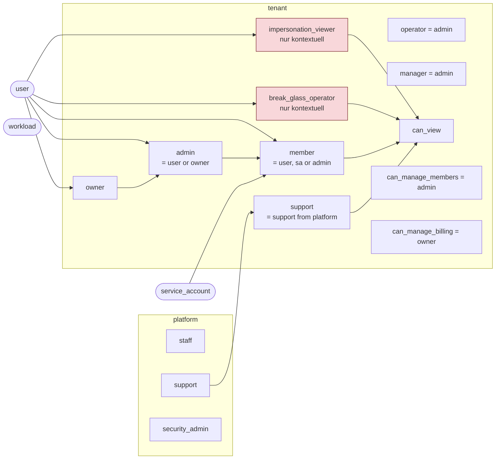

Die zwei roten Relationen sind **contextual-only**: im Modell als `[user]` deklariert, weil ein
kontextuelles Tupel wie jedes andere gegen das Modell validiert wird — aber sie dürfen **nie in den
Store geschrieben** werden. Durchgesetzt in `shared/policy`:

```go
var contextualOnlyRelations = map[string]bool{
    "break_glass_operator": true,
    "impersonation_viewer": true,
}
```

`ValidateMembershipRole` weist sie zurück, und dadurch bleiben genau **drei zuweisbare Rollen**
übrig, abgeleitet statt aufgezählt:

```go
var membershipRoleRank = map[string]int{"member": 1, "admin": 2, "owner": 3}
```

Ein unbekannter Wert rankt **unter** jedem bekannten — Unsicherheit löst nicht Richtung Privileg auf.

### 4.2 registry

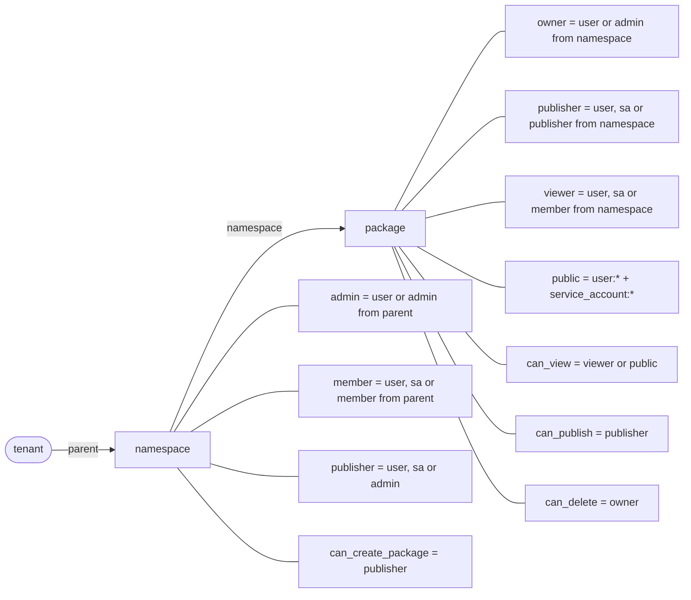

`public: [user:*, service_account:*]` ist das Wildcard-Tupel — so wird ein Paket öffentlich lesbar,
ohne jeden Leser einzeln einzutragen.

### 4.3 fleet

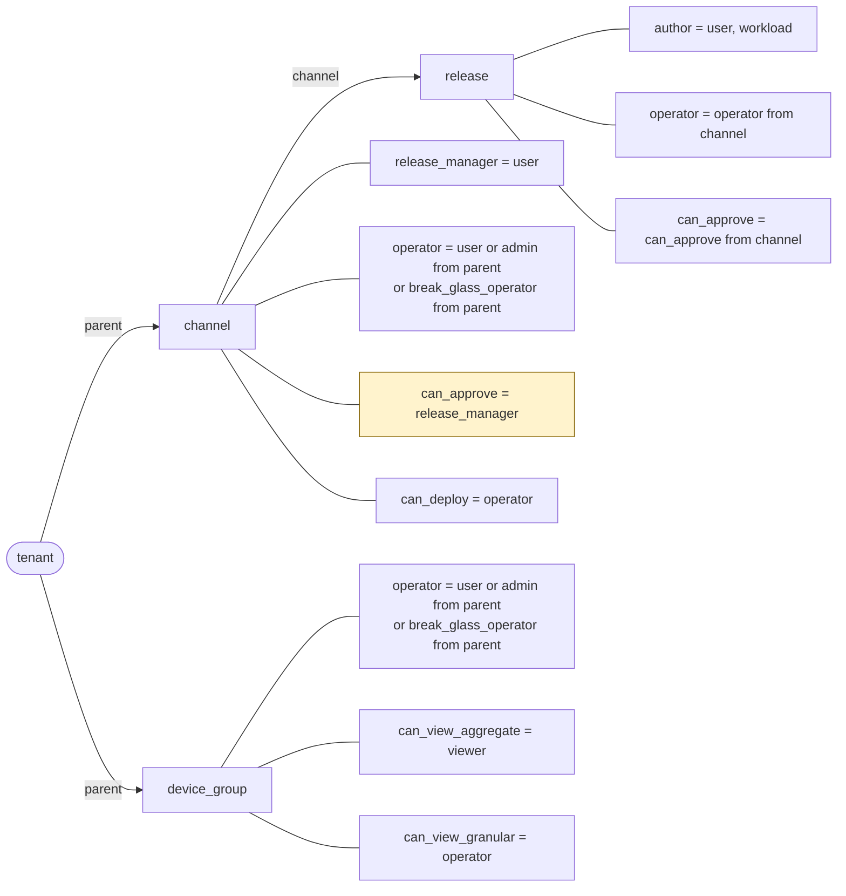

Der wichtige Schnitt: **Break-Glass erreicht `operator`, nicht `release_manager`.** Ein Notfallzugang
darf ein Rollout anhalten oder zurückrollen — aber `can_approve` bleibt beim Vier-Augen-Gate
(ADR 0012).

`device_group` unterscheidet `can_view_aggregate` (Kennzahlen) von `can_view_granular`
(Einzelgerät) — zwei verschiedene Datenschutzstufen auf demselben Objekt.

### 4.4 marketplace

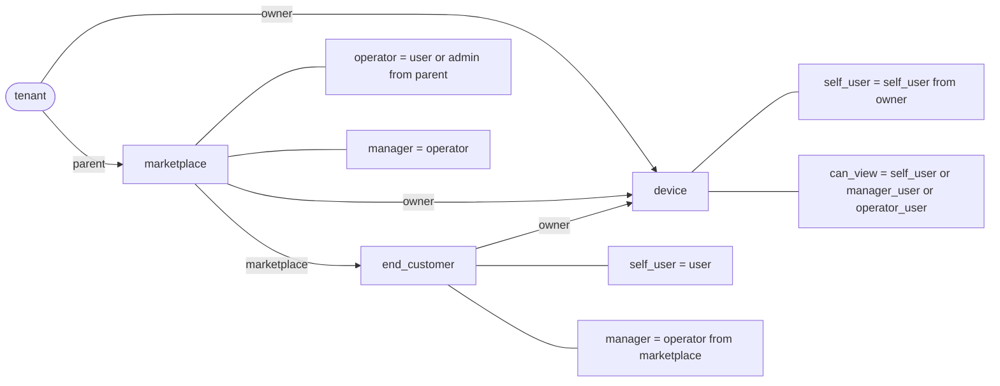

`device.owner` ist eine **Union über drei Typen** — ein Gerät gehört einem Endkunden, einem
Marktplatz oder direkt einem Mandanten, und `self_user`/`manager`/`operator` folgen dem Eigentümer.
So bekommt der Endkunde Zugriff auf sein Gerät, ohne dass jemand ihn einzeln eintragen muss.

### 4.5 Das Tupel und die Store-Auflösung

```go
type TupleKey struct {
    User     string `json:"user"`      // "user:usr_123"
    Relation string `json:"relation"`  // "admin"
    Object   string `json:"object"`    // "tenant:org_a1b2"
}
func (t TupleKey) Validate() error { return spolicy.ValidateTuple(t.User, t.Relation, t.Object) }
```

Das Vokabular kommt aus Konstanten, nicht aus String-Literalen:

```go
const (
    TenantObjectType  = "tenant"
    MemberSubjectType = "user"
)
```

Vorher stand `"organization:"` in einem Paket und `"tenant:"` im anderen — ein Typ, den das Modell
nicht kennt, und OpenFGA wies jeden Write ab. Die Tests nicht, weil sie durch Mocks schrieben, die
aufzeichneten, was man ihnen gab.

**Ein Store pro Tenant** (ADR 0003). Welcher, beantwortet das Verzeichnis, nie das Ereignis:

```go
type StoreResolver interface {
    ResolveTenantStore(ctx context.Context, tenantID string) (string, error)
}
```

> Der Grund steht im Konstruktor: *„a producer that could name the store could name another
> tenant's."*

---

## 5. Postgres — das Schema

25 Migrationen, 18 Tabellen. **Zwölf davon tragen `tenant_id` und stehen unter Row Level Security**
gegen `current_setting('app.tenant_id')`.

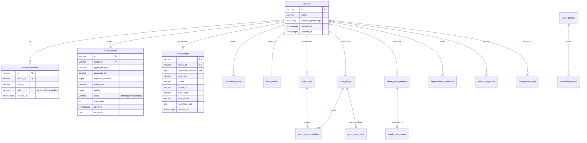

### 5.1 Tabellen nach Zweck

| Gruppe | Tabellen | RLS | Bemerkung |
|---|---|---|---|
| **Organisation** | `tenants`, `tenant_members` | ✅ | `tenants` ist die *einzige*, deren PK der Discriminator ist |
| **Replikation** | `outbox_events` | ✅ + Worker-Policy | siehe §6 |
| **Beweis** | `audit_ledger` | ✅ | Hash-Kette, append-only (Migration 009) |
| **Sperren** | `revocation_entries` | ✅ | plus eine Enforcement-Read-Policy |
| **SCIM** | `scim_users`, `scim_groups`, `scim_group_members`, `scim_group_roles`, `scim_tokens` | ✅ | `scim_tokens`: **ein** Token pro Tenant (PK = `tenant_id`) |
| **Notfall** | `break_glass_requests`, `break_glass_grants` | ✅ | |
| **Support** | `impersonation_sessions` | ✅ | |
| **Freigabe** | `release_approvals` | ✅ | |
| **Idempotenz** | `idempotency_keys` | ✅ | PK `(tenant_id, key)` |
| **Sessions** | `token_families`, `consumed_tokens` | — | Refresh-Rotation, nicht mandantenscoped |
| **Routing** | `tenant_directory` | — | PII-frei, *vor* jedem Scope, deshalb bewusst ohne RLS |
| **Dedup** | `processed_events` | — | |

`tenant_directory` und `tenants` sind ausdrücklich **nicht dasselbe**: das eine beantwortet
*„welche Zelle bedient diesen Mandanten"* (läuft, bevor ein Scope existiert), das andere
*„welche Organisation existiert und wie heißt sie"*.

### 5.2 Row Level Security — die Muster

Der Regelfall:

```sql
CREATE POLICY rls_tenant_members_tenant_isolation ON tenant_members
    USING (tenant_id = current_setting('app.tenant_id', true));
```

Drei bemerkenswerte Ausnahmen:

**1. Eine Organisation anlegen kann nicht mandantenscoped sein** — sie *erzeugt* den Scope:

```sql
CREATE POLICY rls_tenants_create ON tenants FOR INSERT WITH CHECK (true);
```

Was das kein Loch sein lässt, steht darüber: `admin.tenant.create` verlangt L2, und die Zeile allein
gewährt nichts. Mitgliedschaft tut es, und die wird unter dem gerade erzeugten Scope geschrieben.

**2. Kein DELETE-Policy auf `tenants`.** Ohne Policy für ein Kommando verweigert RLS es —
**die Abwesenheit ist die Regel.**

**3. Der Outbox-Worker liest mandantenübergreifend**, und nur er:

```sql
CREATE POLICY rls_outbox_events_worker_read ON outbox_events ...   -- Rolle identity_outbox_worker
CREATE POLICY rls_outbox_events_worker_mark ON outbox_events ...
```

Das ist die gefährlichste Stelle des Schemas: **unter jeder anderen Rolle *filtert* RLS, statt
abzulehnen** — die Abfrage liefert null Zeilen und keinen Fehler. Ein Daemon auf der falschen Rolle
meldet also für immer gesunde leere Stapel. Deshalb prüft `sync.VerifyDrainRole` beim Start
`current_user` gegen `identity_outbox_worker` und startet sonst nicht.

### 5.3 Datenbankrollen

| Rolle | Darf |
|---|---|
| `identity_api` | `SELECT, INSERT, UPDATE` auf `tenants`; `+DELETE` auf `tenant_members`; `SELECT, INSERT` auf `outbox_events` |
| `identity_outbox_worker` | die beiden Worker-Policies auf `outbox_events` |

Kein `DELETE` auf `tenants` und kein `UPDATE` auf `audit_ledger` — durchgesetzt in *beiden*
Schichten, Grant und Policy.

### 5.4 Die Audit-Kette

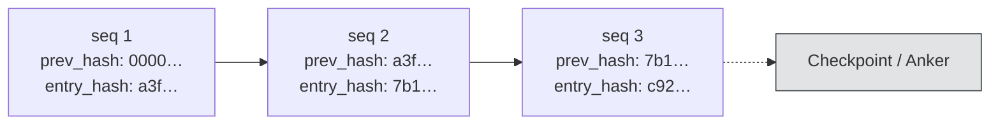

`UNIQUE (tenant_id, sequence_number)` — die Kette ist pro Mandant. `canonical_json` steht in der
Zeile, damit die Verifikation nicht neu serialisieren muss: ein Postgres-Roundtrip verändert sonst
Zeitstempel-Präzision, und die Kette wäre danach nicht mehr prüfbar.

---

## 6. Der Schreibpfad: Mitgliedschaft → Tupel

Die einzige Stelle, an der Postgres und OpenFGA sich berühren. Bewusst **asynchron**.

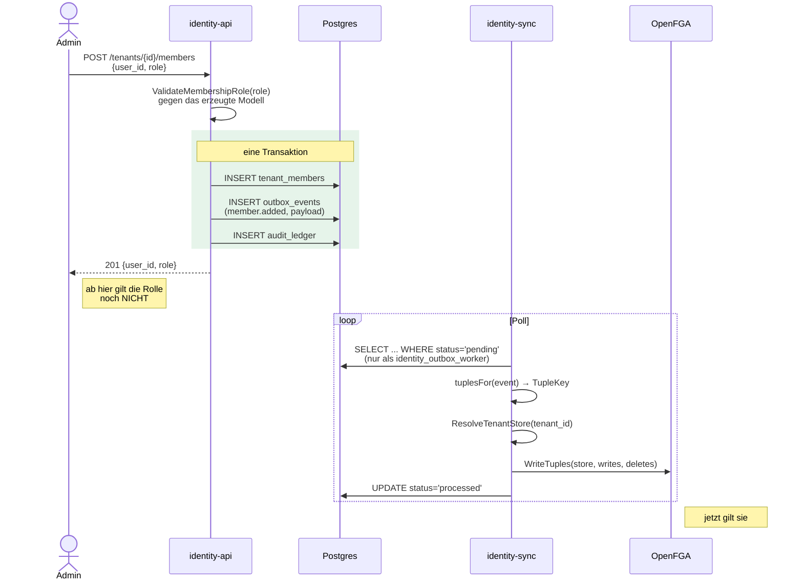

**Warum kein FGA-Write in der Transaktion:** das wäre ein verteilter Schreibvorgang ohne Atomarität
— entweder existiert die Zeile ohne das Tupel oder das Tupel ohne die Zeile, und welches, hängt
davon ab, wo es scheiterte.

### 6.1 Die Ereignisse

```go
const (
    EventMemberAdded       = "member.added"
    EventMemberRemoved     = "member.removed"
    EventMemberRoleChanged = "member.role_changed"
)

type MemberEventPayload struct {
    UserID       string `json:"user_id"`
    Role         string `json:"role"`
    PreviousRole string `json:"previous_role,omitempty"`
}
```

`PreviousRole` ist nötig, weil eine Rollenänderung in OpenFGA ein **Löschen plus Schreiben** ist —
ein Ereignis, auf das der Empfänger nicht handeln kann, ist kein Ereignis. Und der Aufrufer darf es
**nicht** setzen: das ist die Antwort der Datenbank, nicht des Aufrufers.

Der Typ ist in `identity/api` **und** in `identity/sync` ausbuchstabiert, absichtlich: die
HTTP-Fläche darf nicht in den Sync-Daemon gezogen werden. Ein Vertragstest hält die zwei
Schreibweisen zusammen.

### 6.2 Die Projektion

```go
object := spolicy.TenantObjectType + ":" + tenantID   // "tenant:org_a1b2"
user   := spolicy.MemberSubjectType + ":" + payload.UserID

member.added        → write {user, role, object}
member.removed      → delete {user, role|previous_role, object}
member.role_changed → write {user, new, object} + delete {user, previous, object}   // ein Aufruf
```

Ein Aufruf bei der Rollenänderung, damit das Mitglied nie kurz in beiden oder in keiner Rolle ist.

### 6.3 Dead Letter Queue

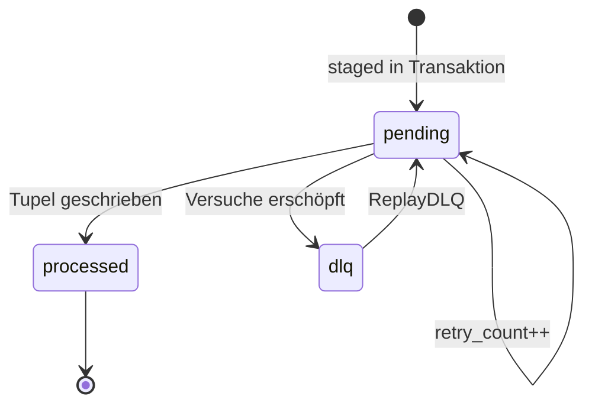

`status`, `retry_count`, `failed_at`, `last_error` stehen **in der Zeile** (Migration 017). Vorher
lag die DLQ in einer Prozess-Map und die Zeile wurde `processed` — beide Hälften falsch in dieselbe
Richtung, und `GetDLQCount` meldete auf jeder Instanz `0`, die nicht selbst etwas verworfen hatte.

Der Index für den heißen Pfad ist partiell über `status = 'pending'`: tote Briefe sammeln sich
sonst im selben Index und werden bei jedem Scan übersprungen.

---

## 7. Der Lesepfad und die API-Strukturen

### 7.1 Von der Anfrage zur Entscheidung

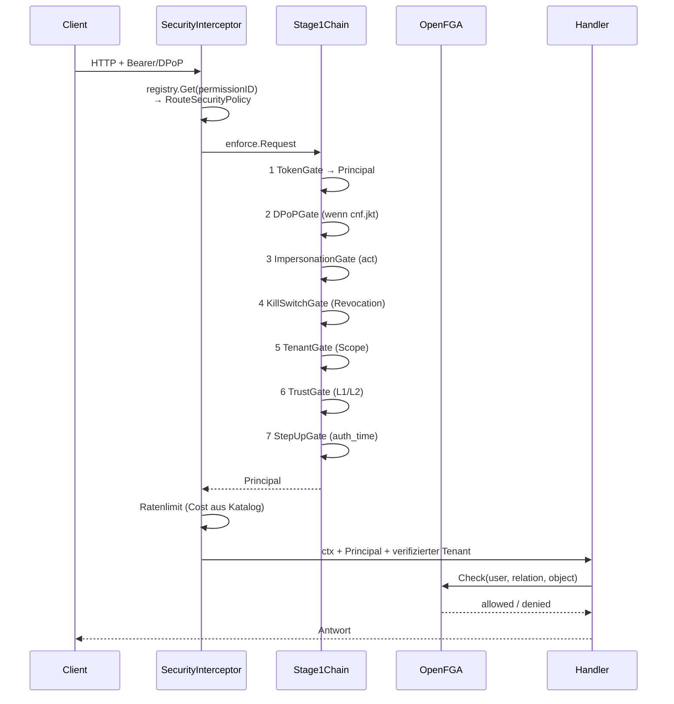

Stage 1 sind die **In-Memory-Gates** (Token, Besitz, Scope, Assurance). Stage 2 ist der
**FGA-Check** im Handler. Die Reihenfolge der Gates ist selbst eine Sicherheitseigenschaft und
steht als `standardGateOrder` neben dem zusammengebauten Chain, damit ein Test sie halten kann.

### 7.2 Der Principal

Das Ergebnis von Stage 1, und die einzige Form, die alle Dienste lesen:

```go
type Principal struct {
    URN         string      // toob:human:shared:org_123:usr_456
    ActorType   ActorType   // human | service_account | workload | device | operator
    OrgID       string      // Zitadel-Org aus dem Token-Scope
    DisplayName string      // nur zum Anzeigen — autorisiert nichts
    TrustLevel  TrustLevel  // L1 | L2 — eine stärkere Handlung ist L2 + frischer Step-Up
    ActURN      string      // Operator-URN bei Impersonation (RFC 8693)
    JKT         string      // cnf.jkt — macht das Token sender-constrained
    AuthTime    time.Time
    ExpiresAt   time.Time
}
```

Nur `human` und `operator` können überhaupt über L1 liegen:

```go
func (a ActorType) HasAuthenticatorAssurance() bool {
    return a == ActorHuman || a == ActorOperator
}
```

Ein Client-Zertifikat beweist Schlüsselbesitz — das ist Authentifizierung, sagt aber nichts über
*Authenticator-Assurance*. Beide auf eine Skala zu legen, ließ ein Gerätezertifikat ein Gate
erfüllen, das für eine menschliche Dual-Passkey-Freigabe gedacht war.

### 7.3 Der Permission-Katalog

Generiert aus YAML (`policy/`), gelesen von Interceptor, Auditor und Ratenlimiter. Das ist die
zentrale Steuerstruktur der API-Schicht:

```go
type PermissionDefinition struct {
    ID                   string   // "admin.role.update"
    Resource             string   // "tenant"    → FGA-Objekttyp
    Relation             string   // "admin"     → FGA-Relation
    MinTrustLevel        string   // "L1"|"L2"
    StepUp               bool
    StepUpMaxAge         string
    Sensitivity          string
    Audit                string   // Auditklasse
    Cost                 int      // Ratenlimit-Budget
    ImpersonationAllowed bool
    RequiresSignature    bool     // detached JWS erforderlich
    Description          string
    ActorType            string   // human | partner-token | …
    RateLimitClass       string
}
var PermissionCatalog = map[string]PermissionDefinition{ /* … */ }
```

`ActorType` entscheidet, ob die Trust-Level-Felder überhaupt etwas bedeuten: ein
Partner-Bearer-Token (SCIM) ist kein verifizierter Principal, und eine Permission für ihn dürfte
keine Assurance behaupten. `FleetPolicyRegistry` überspringt solche Einträge, statt zu paniken —
sonst wäre es die Generator-Regel ein zweites Mal, an der falschen Stelle.

### 7.4 Der Wire-Vertrag

`identity/ports/ports.go` ist die einzige Quelle dafür, was jeder Endpunkt nimmt und zurückgibt.
`api/routes.go` deklariert die andere Hälfte (welcher Pfad, welche Permission, wie der Tenant
gescoped wird), verbunden über das Route-Pattern.

```go
const APIVersion = 1

type Contract struct {
    Request  any
    Response any
    Pending  string   // "noch nicht deklariert" ≠ "nimmt/gibt nichts"
}
var Surface = map[string]Contract{ /* 27 Routen */ }
```

Die drei Zustände sind unterschieden, damit *„noch nicht aufgeschrieben"* nicht mit *„hat keinen
Body"* verwechselt wird — genau so bleibt eine undeklarierte Fläche undeklariert.
`TestSurface_CoversEveryRoute` vergleicht in beide Richtungen gegen `api.Routes()`.

Versionsregeln: `port:"required"` hinzufügen, ein Feld entfernen/umbenennen oder einen Typ ändern
ist **breaking** → `APIVersion` erhöhen. Ein `port:"optional"` hinzufügen ist es nicht.

Die deklarierten Typen:

```go
type CreateTenantRequest struct { Name string `json:"name" port:"required"` }

type UpdateTenantRequest struct {                       // Zeiger: fehlend ≠ leer
    Name              *string   `json:"name,omitempty"`
    AllowedGitHubOrgs *[]string `json:"allowed_github_orgs,omitempty"`
}

type Tenant struct {
    ID, Name          string
    AllowedGitHubOrgs []string   // required, weil fehlend und leer Gegenteiliges bedeuten
    CreatedAt, UpdatedAt time.Time
}

type MemberRequest      struct { UserID, Role string }
type Member             struct { UserID, Role string; CreatedAt time.Time }
type MemberListResponse struct { Members []Member }     // Envelope, kein nacktes Array
type MemberRoleResponse struct { UserID, Role string }
type SCIMTokenResponse  struct { Token string `json:"token_returned_once"` /* … */ }
```

Neun Endpunkte stehen noch auf `Pending`, alle mit derselben Begründung: die Antwort trägt einen
Typ, den ein anderes Paket besitzt (`revocation.Entry`, `approval.ReleaseApproval`,
`audit.AuditEntry`, `authz.ExplainAnswer`). Den zu re-exportieren würde den Vertrag an einen Struct
binden, der sich aus eigenen Gründen ändert.

---

## 8. Alles zusammen

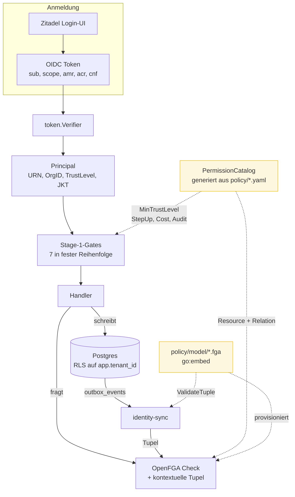

Die gelben Kästen sind **generierte bzw. eingebettete Artefakte** — sie sind der Grund, warum
dieselbe Regel nicht an vier Stellen anders lautet. Der Katalog speist den Interceptor *und* den
FGA-Check; das Modell provisioniert den Store *und* validiert jedes Tupel vor dem Schreiben.

---

## 9. Was in diesem Modell gebaut, aber nicht verdrahtet ist

Damit niemand darauf aufbaut, ohne es zu wissen:

| Struktur | Zustand |
|---|---|
| **Actions-v2-Executions** | Target wird angelegt, Signaturprüfer stimmt — **keine Execution gebunden**. Die 14 Regeln sind gelöscht (Q3); die Routentabelle in `identity/target/routes.go` ist leer, bis das Gerätesignal (T-3.8.2) gemessen ist |
| `identity/sync/jit.go` — `FederatedUser` | JIT für föderierte Kunden-IdP-Nutzer; setzt einen **bestehenden** `TenantID` voraus |
| `celldir` — `TenantEntry`, `CellCoordinates`, `ProfileType` | Zellrouting-Modell (`shared_org`/`dedicated_instance`/`isolated_cell`); eigener Meilenstein |
| Zwölf In-Memory-Stores | Platzhalter für persistente Speicher (Sprint 3) — u. a. `JITProvisioner.seenFederatedUsers`, `approval.MemoryApprovalStore` |

---

## 10. Dateiverzeichnis

| Struktur | Datei |
|---|---|
| FGA-Modell (4 Module) | `toob-infra/policy/model/{core,registry,fleet,marketplace}.fga`, `fga.mod` |
| Modell-Einbettung | `toob-infra/policy/model/model.go` |
| FGA-Vokabular, Rollenrang | `toob-infra/shared/policy/fga_vocabulary.go` |
| Permission-Katalog (generiert) | `toob-infra/shared/policy/generated.go` |
| Tupel, Check-Request | `toob-infra/identity/authz/client.go` |
| Postgres-Schema | `toob-infra/identity/migrations/*.up.sql` |
| Principal | `toob-infra/identity/principal/principal.go`, `urn.go` |
| Audit-Eintrag | `toob-infra/identity/audit/entry.go`, `chain.go` |
| Outbox | `toob-infra/identity/outbox/`, `identity/sync/membership.go` |
| Wire-Vertrag | `toob-infra/identity/ports/ports.go` |
| Route-Tabelle | `toob-infra/identity/api/routes.go` |
| Gate-Kette | `toob-infra/identity/enforce/gate.go` |
| Zitadel-Policies | `toob-infra/identity/internal/zitadel/policies.go` |
| Zitadel-Projekte/Rollen | `toob-infra/identity/internal/zitadel/provisioner.go` |
| Sign-in-App, Hook-Target | `toob-infra/identity/internal/zitadel/oidcapp.go`, `hooks.go` |
