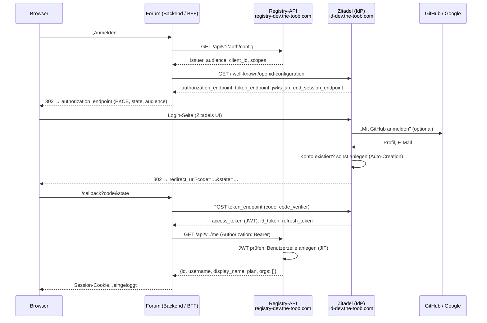

# Registrieren und Anmelden auf L1 — die Integration für ein Frontend

Stand 2026-09-07. Dieses Dokument beschreibt den kürzesten vollständigen Weg, mit dem eine
Web-Anwendung (z. B. das Forum) Personen über unsere Identity-Plattform registriert und anmeldet,
und was sie danach mit dem Token anfangen kann. Es ist die praktische Ergänzung zu
[identity_login.md](identity_login.md), das die Architektur erklärt.

**L1** heißt: die Person hat sich angemeldet, aber ohne phishing-resistenten Faktor. Das reicht für
alles, was ein Forum braucht — lesen, schreiben, ein Profil haben. Passkeys (L2) und frische
Zeremonien (Step-Up) sind erst für Registry-Publishing und Verwaltungsaktionen nötig und werden hier
nur an der Stelle erwähnt, an der ein Frontend sie später einhängen würde.

---

## 1. Die Beteiligten in einem Bild



Drei Hosts, drei Aufgaben:

| Host | Aufgabe | Was das Frontend dort tut |
|---|---|---|
| `id-<env>.the-toob.com` | Zitadel: Konten, Login-Seite, Token | Weiterleiten, Code einlösen, JWKS lesen |
| `registry-<env>.the-toob.com` | Registry-API: Benutzer, Orgs, Pakete | `auth/config`, `me`, alles Fachliche |
| `accounts-<env>.the-toob.com` | Identity-API: Governance, SCIM, Freigaben | für L1 **nicht nötig** |

`<env>` ist `dev`, `staging` oder `prod`. Nichts davon hart einbauen: die Registry sagt dem
Frontend unter `GET /api/v1/auth/config`, wo der IdP ist.

---

## 2. Registrierung — es gibt keinen Registrierungs-Endpunkt, und das ist so gewollt

Zwei Dinge, die ein Frontend wissen muss:

1. **Beim IdP ist Selbstregistrierung mit Passwort gesperrt.** Die Login-Policy steht auf
   `AllowRegister: false`, und der Edge-Proxy (Caddy) antwortet auf `/ui/login/register*` und
   `/ui/login/password*` mit **403**. Ein „Registrieren"-Link und ein „Passwort vergessen"-Link
   auf IdP-Ebene sind deshalb sinnlos.
2. **Ein Konto entsteht beim ersten Social Login.** GitHub und Google sind als Identity Provider
   deklariert (`identity/internal/zitadel/idps.go`) mit `isAutoCreation: true` und
   `isCreationAllowed: true`: wer sich auf Zitadels Login-Seite für „Mit GitHub anmelden" entscheidet
   und dort noch kein Konto hat, bekommt eines, ohne Formular. Das ist die Registrierung.

Der Registry-Benutzer entsteht danach von selbst: beim ersten Aufruf mit einem gültigen Token legt
die Registry die Benutzerzeile an (`EnsureFromIdentity` in `registry/internal/server/postgres/users.go`).
Er hat keine Organisation, keinen Plan über `free` hinaus, und das ist der Normalfall.

**Für ein Forum heißt das:** der Button heißt „Anmelden", nicht „Registrieren". Wer noch nie da war,
ist nach dem ersten Login da.

> **Nicht gemessen (P5 in `plan7_backlog.md`):** ob der Callback des Social Logins
> (`/ui/login/login/externalidp/callback`) und die anschließende Auto-Creation an Caddys
> Register-Sperre vorbeikommen. Die Sperre greift auf `/ui/login/register*`; Zitadels UI könnte bei
> der Auto-Creation eine Seite unter diesem Präfix anzeigen. Das ist der erste Test, den das Forum
> gegen `dev` fahren sollte (§7). Fällt er, ist die Sperre auf Caddy-Seite so zu verengen, dass der
> externe IdP-Pfad frei bleibt — nicht die Policy zu lockern.

---

## 3. Voraussetzung: eine OIDC-Anwendung für das Forum

Ein Token wird *für eine Anwendung* ausgestellt. Es gibt zwei, beide im Zitadel-Projekt `registry`,
beide vom Provisionierer angelegt und bei jedem Lauf per Name adoptiert:

| Anwendung | Typ | Redirect | Client-ID liegt in Vault unter |
|---|---|---|---|
| `toob-cli` | native, Loopback-Redirects, Device-Grant | `http://127.0.0.1/callback` | `secret/data/identity/oidc-client` |
| `toob-forum-web` | Web, PKCE, **ohne Secret** | `https://<forum-domain>/api/auth/callback`, Post-Logout `https://<forum-domain>/` | `secret/data/projects/community/oidc-client` |

Beide Einträge tragen dieselbe `audience` (die Projekt-ID), deshalb nimmt die Registry ein Token der
Forum-App genauso an wie eines der CLI. `zitadel-provision --apply-forum-app --forum-domain …`
legt die Forum-App an; der Deployer ruft das im Identity-Lauf mit dem `CommunityDomain` der
Topologie auf, und `forum-api` liest die Client-ID aus dem zweiten Pfad. Ein Forum-Job, der auf
„no secret exists at secret/data/projects/community/oidc-client" wartet, wartet auf den
Identity-Lauf, nicht auf Handarbeit.

Die Redirect-URI zeigt auf den **BFF**, nicht auf eine Seite: `forum-api` beginnt den Login,
hält PKCE-Verifier und State serverseitig, löst den Code ein und setzt das Session-Cookie. Der
Browser sieht nie ein Token (§5.1). Der Vertrag dafür ist `openapi.yaml` im Website-Repository,
Abschnitt „BFF Authentication Endpoints".

---

## 4. Der Login-Ablauf, Schritt für Schritt

### 4.1 Konfiguration holen

```
GET https://registry-dev.the-toob.com/api/v1/auth/config
```
```json
{
  "issuer":   "https://id-dev.the-toob.com",
  "audience": "3210987654321",
  "client_id": "…toob-cli…",
  "scopes":   ["openid", "profile", "email", "offline_access", "urn:zitadel:iam:user:resourceowner"]
}
```

- `issuer` → `GET {issuer}/.well-known/openid-configuration`. Das `issuer`-Feld im Dokument **muss**
  dem angefragten gleichen, sonst abbrechen.
- `audience` ist die Zitadel-Projekt-ID. Sie steht später in `aud` des Tokens.
- `scopes` **vollständig übernehmen.** `urn:zitadel:iam:user:resourceowner` ist Pflicht: die Registry
  liest die Organisation der Person aus dem Claim `urn:zitadel:iam:user:resourceowner:id` und weist
  ein Token ohne ihn ab (`ErrMissingOrgClaim`). `offline_access` bringt den Refresh-Token.

### 4.2 Zum IdP weiterleiten

```
GET {authorization_endpoint}
  ?response_type=code
  &client_id=<Forum-Client-ID>
  &redirect_uri=https://forum-dev.the-toob.com/auth/callback
  &scope=openid profile email offline_access urn:zitadel:iam:user:resourceowner
  &state=<zufällig, 32 Byte, serverseitig gemerkt>
  &code_challenge=<BASE64URL(SHA256(code_verifier))>
  &code_challenge_method=S256
  &audience=<audience aus auth/config>
```

- **Redirect, kein iframe.** Die Login-Seite sendet `frame-ancestors 'none'`.
- `audience` sorgt dafür, dass das Token für die Registry gilt und nicht nur für Zitadels eigenen
  Userinfo-Endpunkt.
- `code_verifier` und `state` gehören zur Session des Browsers, der die Anfrage gestartet hat, und
  werden genau einmal benutzt.

Die Login-Seite ist Zitadels eigene. Sie zeigt „Mit GitHub anmelden" / „Mit Google anmelden" (die
deklarierten IdPs) und den Passkey-Login für Konten, die einen haben. Es gibt nichts zu gestalten
und nichts einzubetten.

### 4.3 Callback und Code einlösen

```
POST {token_endpoint}
Content-Type: application/x-www-form-urlencoded

grant_type=authorization_code
&code=<code>
&redirect_uri=https://forum-dev.the-toob.com/auth/callback
&client_id=<Forum-Client-ID>
&code_verifier=<code_verifier>
```

Antwort: `access_token` (JWT), `id_token`, `refresh_token`, `expires_in` (900 s), `token_type`.

Vorher `state` vergleichen; bei Abweichung abbrechen, nichts einlösen.

### 4.4 Der Beweis: `GET /api/v1/me`

```
GET https://registry-dev.the-toob.com/api/v1/me
Authorization: Bearer <access_token>
```
```json
{
  "id": "toob:human:shared:<orgId>:<userId>",
  "username": "…",
  "display_name": "Ada Lovelace",
  "plan": { "…": "free" },
  "orgs": []
}
```

Erst wenn das `200` kommt, ist die Person „eingeloggt". Dieser Aufruf prüft die ganze Kette —
Signatur, Aussteller, Audience, Ablauf, Org-Claim — und seit Stage 2 auch die Relation des Katalogs
(`registry.account.read` = Mitglied der eigenen Organisation, die das Token selbst belegt) gegen den
Autorisierungs-Store. Beim ersten Mal legt er die Benutzerzeile an. `orgs: []` ist bei einer neuen
Person der Normalfall, kein Fehler.

Die Organisation in der URN ist die Zitadel-Organisation der Person. Für alle, die sich über GitHub
oder Google registriert haben, ist das dieselbe; eine eigene bekommt nur ein Enterprise-Kunde, den
Staff als Tenant anlegt. Ein Forum muss davon nichts wissen — die URN ist der Schlüssel, der Rest
ist Herkunft.

`id` ist die **URN** der Person und der stabile Schlüssel, unter dem das Forum sie führen sollte.
Nicht `username` (kann sich ändern), nicht die E-Mail (kann sich ändern, ist beim Social Login nicht
garantiert verifiziert).

---

## 5. Was das Forum mit dem Token tut

### 5.1 Wo das Token liegt

Nicht im Browser. Das Forum hält Access- und Refresh-Token serverseitig in seiner Session und gibt
dem Browser ein Cookie:

- `__Host-forum-session`, `HttpOnly`, `Secure`, `SameSite=Strict`, kein `Domain`-Attribut.
- Anti-CSRF: Doppel-Submit-Token oder `Origin`-Prüfung auf jedem zustandsändernden Request.
- Idle-Timeout 15 min, Maximallebensdauer 12 h; beides serverseitig.

Das ist das BFF-Muster (Backend for Frontend). Es lag als Paket in `identity/bff` und ist
absichtlich gelöscht: es gehört in den Prozess, der das Frontend ausliefert, und das ist das Forum.
Access-Token im `localStorage` widersprechen dem Grund, aus dem IdP und Anwendung getrennte Hosts
haben.

### 5.2 Zwei Wege, das Token zu prüfen

**Weg A — das Forum fragt die Registry.** Für jede Anfrage, die einen angemeldeten Benutzer braucht,
ruft das Forum `GET /api/v1/me` mit dem Token auf (mit Cache pro Session, z. B. 60 s). Einfach,
kein Krypto-Code, und die Registry ist die eine Stelle, die Sperren und Widerrufe kennt.

**Weg B — das Forum prüft das JWT selbst.** Für Backends, die nicht bei jeder Anfrage über das Netz
wollen:

| Prüfung | Wert |
|---|---|
| Signatur | JWKS unter `{issuer}/oauth/v2/keys`, `kid` aus dem Header, Schlüssel rotieren → cachen mit Neuladen bei unbekanntem `kid` |
| `iss` | exakt `issuer` aus `auth/config` |
| `aud` | enthält `audience` aus `auth/config` |
| `exp`, `iat` | mit höchstens 60 s Toleranz |
| `sub` | Zitadel-Benutzer-ID; URN wie in §4.4 daraus bilden oder einmal über `/me` holen und speichern |

Weg B sieht keinen Widerruf. Wer ihn wählt, sollte trotzdem beim Login einmal `/me` rufen (§4.4) und
den Refresh (§5.3) als regelmäßigen Kontrollpunkt nehmen.

### 5.3 Refresh

Access-Token leben 15 Minuten. Vor Ablauf:

```
POST {token_endpoint}
grant_type=refresh_token&refresh_token=<…>&client_id=<Forum-Client-ID>
```

Serialisiert pro Session (ein Refresh gleichzeitig), und den alten Refresh-Token behalten, wenn die
Antwort keinen neuen enthält. Schlägt der Refresh mit `invalid_grant` fehl, ist die Sitzung zu Ende:
lokale Session löschen, zum Login.

### 5.4 Logout

Lokale Session löschen, dann `GET {end_session_endpoint}?id_token_hint=<id_token>&post_logout_redirect_uri=…`.
Serverseitig gibt es nichts zu invalidieren.

---

## 6. Fehler, die ein L1-Frontend behandeln muss

Jede Fehlerantwort der Registry und der Identity-API ist **RFC 9457 Problem Details** mit
`Content-Type: application/problem+json`:

```json
{
  "type": "https://toob.boot/errors/unauthorized",
  "title": "unauthorized",
  "status": 401,
  "code": "unauthorized",
  "detail": "…"
}
```

`code` ist für Programme und kommt aus einer festen, sortierten Liste (`shared/errors`, im
OpenAPI-Dokument das Schema `ErrorCode`); der Status folgt aus dem Code, nicht umgekehrt.
`detail` ist für Menschen geschrieben und darf angezeigt werden.

| Status / `code` | Bedeutung | Reaktion |
|---|---|---|
| `401 unauthorized` | Token fehlt, abgelaufen, falscher Aussteller | Refresh versuchen, sonst Login |
| `401 step_up_required` mit `WWW-Authenticate: DPoP error="insufficient_user_authentication", acr_values="urn:toob:mfa:webauthn", max_age=N` | Step-Up verlangt (erst ab L2-Routen relevant) | **nicht ausloggen**; siehe §8 |
| `403 forbidden` / `insufficient_trust_level` | CI-Token auf einer Personen-Route; Route braucht L2, Person ist L1 | Hinweis „Passkey einrichten"; für ein Forum nicht erreichbar |
| `403 permission_denied` | Stage 2: die Person hält die Relation nicht, die die Route verlangt (z. B. Mitglied einer fremden Namespace) | dem Benutzer anzeigen; für `/me` kann es nicht auftreten |
| `429 rate_limited` + `Retry-After` | Budget der Person oder ihrer Org erschöpft | warten, wie im Header, dann wiederholen |
| `503 overloaded` + `Retry-After` | Prozess am Limit | einmal nach `Retry-After` wiederholen |
| `503 authz_unavailable` + `Retry-After` | der Autorisierungs-Store antwortet nicht; **kein** „nein" | wie `overloaded`: warten, wiederholen, nicht ausloggen |
| `400 validation_failed`, `402 quota_exceeded`, `409 conflict` | fachlich (Org-Name gegen die Regel, Quote des Plans, Name vergeben) | dem Benutzer anzeigen |
| `404 not_found`, `410 gone` | nicht vorhanden; zurückgezogen und kommt nicht wieder | dem Benutzer anzeigen |

---

## 7. Der Testplan gegen `dev`

In dieser Reihenfolge. Jeder Schritt hat eine erwartete Antwort; das Forum ist der erste echte Client
und misst damit gleich die offenen Punkte P3 und P5 aus `plan7_backlog.md`.

| # | Schritt | Erwartung | Misst |
|---|---|---|---|
| 1 | `GET registry-dev/api/v1/auth/config` | 200, fünf Scopes, `issuer = https://id-dev.the-toob.com` | — |
| 2 | Discovery, `jwks_uri` abrufen | 200, mindestens ein Schlüssel | — |
| 3 | Redirect zum IdP, „Mit GitHub anmelden", **neues** GitHub-Konto | Konto entsteht, Redirect mit `code` zurück | **P5**: kommt die Auto-Creation an der 403-Sperre vorbei? |
| 4 | Code einlösen | `access_token` ist ein JWT mit `aud` = `audience` | — |
| 5 | JWT dekodieren (nur ansehen) | Claim `urn:zitadel:iam:user:resourceowner:id` vorhanden, `amr` gesetzt | **P3**: liefert der Scope den Claim? und: **welche `amr`-Werte sendet Zitadel wirklich** (§9) |
| 6 | `GET /api/v1/me` | 200, `orgs: []` | JIT-Benutzer — und dass die Registry ihren Autorisierungs-Store erreicht: ein `503 authz_unavailable` hier ist der ungemessene Netzpfad Registry → OpenFGA, kein Frontend-Fehler |
| 7 | zweiter Login mit demselben GitHub-Konto | dieselbe `id` wie in 6 | Stabilität der URN |
| 8 | Refresh nach 14 min | neues Token, `/me` weiter 200 | — |
| 9 | Logout, danach `/me` mit altem Token | 200 bis `exp`, danach 401 | kein serverseitiger Widerruf — erwartet |
| 10 | `POST /api/v1/publish` mit dem L1-Token | `403 insufficient_trust_level` oder Step-Up-Challenge | die Rampe greift (§8) |

Schlägt 3 fehl, ist das ein Caddy-Thema und kein Frontend-Thema. Schlägt 5 beim Claim fehl, muss der
Scope-Name gegen die laufende Zitadel-Version geprüft werden. Zeigt 5 andere `amr`-Werte als
`webauthn`/`fido2`/`passkey`/`phr` für einen Passkey-Login, ist §9 fällig, **bevor** irgendjemand
L2 braucht.

---

## 8. Wo L2 später einhängt

Nichts davon ist für das Forum nötig, aber ein Frontend sollte die Stelle kennen:

- Eine L2-Route (z. B. Publish) antwortet einer L1-Sitzung mit `403 insufficient_trust_level`, eine
  Route mit Step-Up mit `401` und der `WWW-Authenticate`-Challenge (§6).
- Die richtige Reaktion ist eine erneute Weiterleitung zum IdP mit `prompt=login`,
  `acr_values=urn:toob:mfa:webauthn` und `max_age=N` aus der Challenge — die CLI macht genau das
  (`cli/toob-cli/internal/oidc/authcode.go`, `StartBrowserStepUp`).
- Ob Zitadel dabei einen Passkey **einrichten** lässt, wenn die Person noch keinen hat, ist die
  offene Messung **P6**. Falls nicht, braucht das Frontend einen eigenen „Passkey hinzufügen"-Schritt
  über Zitadels User-API, bevor die Person an eine L2-Route stößt.

---

## 9. Offener Punkt: Zitadels `amr`-Vokabular

Der Verifier erkennt L2 an den RFC-8176-Werten `webauthn`, `fido2`, `passkey`, `phr`
(`policy/authn.yaml`). Zitadel dokumentiert für `amr` seine eigenen Werte: `pwd`, `otp`, `mfa` und
`user` — Letzteres für „User Presence", also Passkey und U2F. Wenn Zitadel für einen Passkey-Login
`["user", "mfa"]` sendet, erreicht **kein echter Login L2**, und jede L2-Route bleibt für Menschen
geschlossen. Schritt 5 des Testplans zeigt es. Die Korrektur ist ein Eintrag in `authn.yaml`
(`user`, mit Begründung „Zitadel: Passkey/U2F, origin-gebunden") und `go generate ./shared/policy/` —
klein, aber nur nach Messung, nicht nach Vermutung.

TOTP-Apps (Microsoft Authenticator, Google Authenticator) bleiben bewusst L1: ein sechsstelliger Code
lässt sich durch einen Phishing-Proxy durchreichen, ein Passkey nicht. Ein Forum braucht L2 ohnehin
nicht; wer Pakete veröffentlicht, richtet einen Passkey ein.

---

## 10. Checkliste für den ersten Sprint

- [ ] OIDC-App `forum` im Projekt `registry` (Web, PKCE, HTTPS-Redirect) — dev über Konsole, danach Provisionierer (§3)
- [ ] `auth/config` und Discovery beim Start laden, `issuer` vergleichen
- [ ] PKCE + `state`, Redirect (kein iframe), alle fünf Scopes, `audience`
- [ ] Callback: `state` prüfen, Code einlösen, `GET /api/v1/me`, URN speichern
- [ ] Session-Cookie `__Host-…`, Token serverseitig, CSRF-Schutz
- [ ] Refresh vor Ablauf, serialisiert; Logout mit `end_session_endpoint`
- [ ] Problem Details lesen; `429`/`503` mit `Retry-After` behandeln (`authz_unavailable` ist kein „nein"); Step-Up-Challenge nicht als Logout deuten
- [ ] Testplan §7 gegen `dev` fahren und die Ergebnisse von P3, P5 und den `amr`-Werten in `plan7_backlog.md` eintragen

---

## 11. Die Definition für das Frontend

Die Registry liefert die OpenAPI-3.1-Definition dieser Fläche selbst aus, mit den Werten ihrer
Umgebung eingesetzt:

```
GET https://registry-dev.the-toob.com/api/v1/openapi/login.yaml
```

Die Quelle liegt in
[`toob-infra/registry/internal/ports/openapi/login.yaml`](../toob-infra/registry/internal/ports/openapi/login.yaml),
neben den Go-Typen, die die Handler kodieren. Sie beschreibt das OIDC-Security-Scheme mit den fünf
Scopes, `GET /api/v1/auth/config`, `GET /api/v1/me`, `GET /api/v1/orgs/mine`, `POST /api/v1/orgs`,
die Schemas (`Me`, `Plan`, `Membership`, `Organization`, `OrganizationName` mit der Regel aus
`org_names.yaml`) und die Fehlerantworten samt `Retry-After` und Step-Up-Challenge. `servers` und
`openIdConnectUrl` sind die dieser Registry; die Beispiele für `issuer`, `audience` und `client_id`
sind die echten Werte der Umgebung.

Die Datei ist von Hand geschrieben, aber nicht auf Vertrauen: `TestLoginSpec_*` im Router-Paket
prüft bei jedem Testlauf, dass jede Operation eine Route ist und ihre Sichtbarkeit stimmt, dass das
`ErrorCode`-Enum die vollständige Taxonomie ist, dass jedes Objekt-Schema Feld für Feld dem Go-Typ
entspricht, den der Handler kodiert, und dass die Enums für Rollen und Plan-Stufen die Konstanten
sind. Wer einen Handler ändert und die Datei nicht, sieht es dort.
