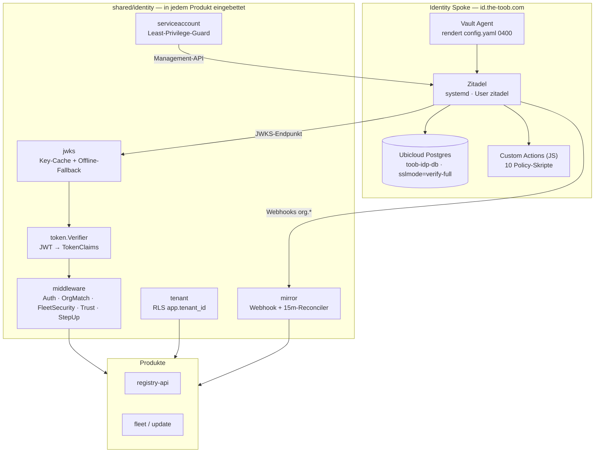
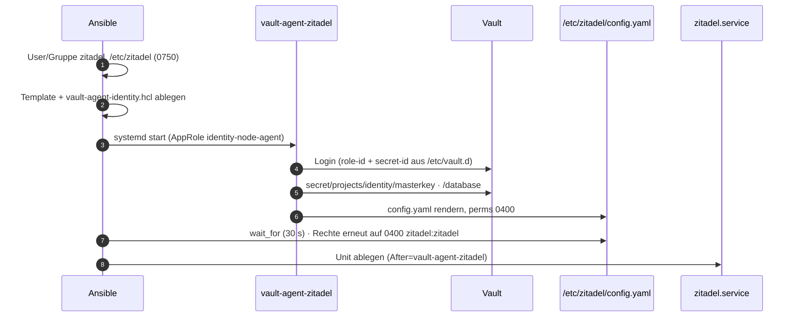
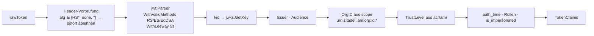
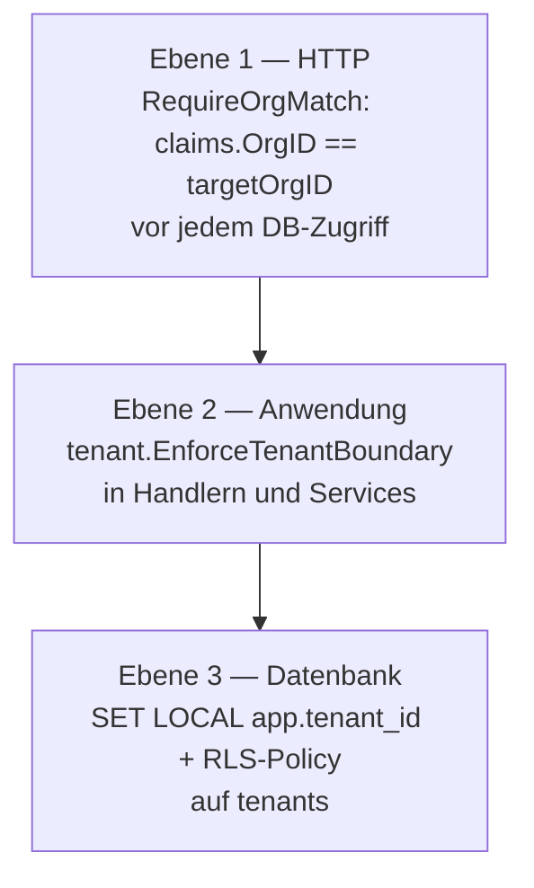
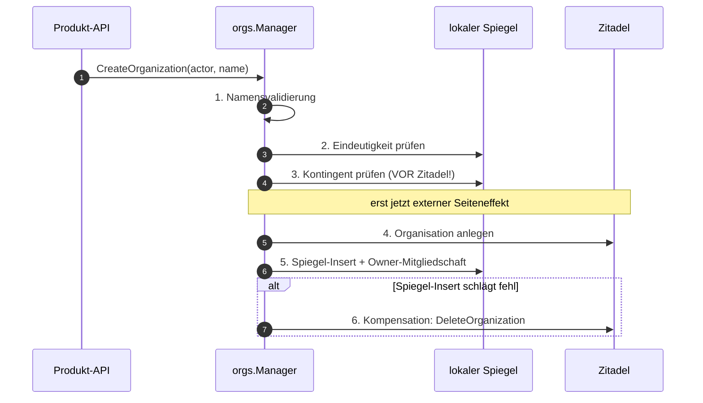
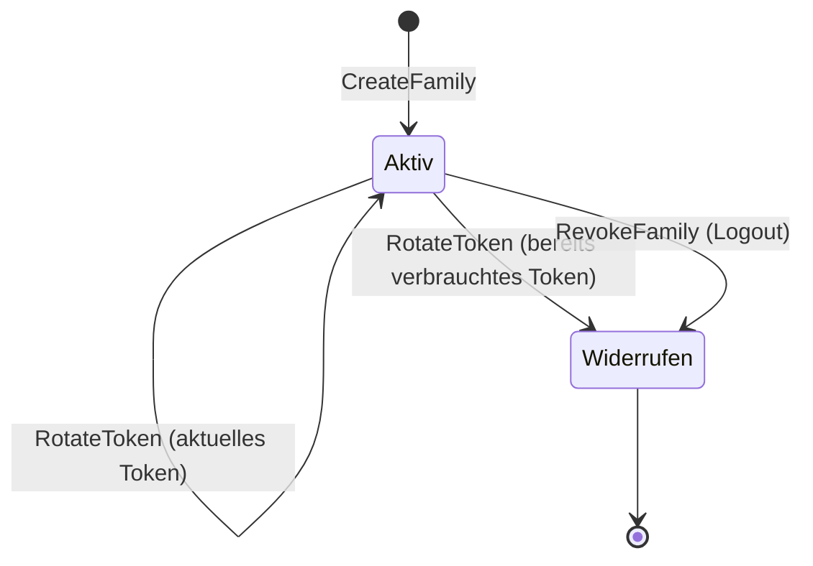
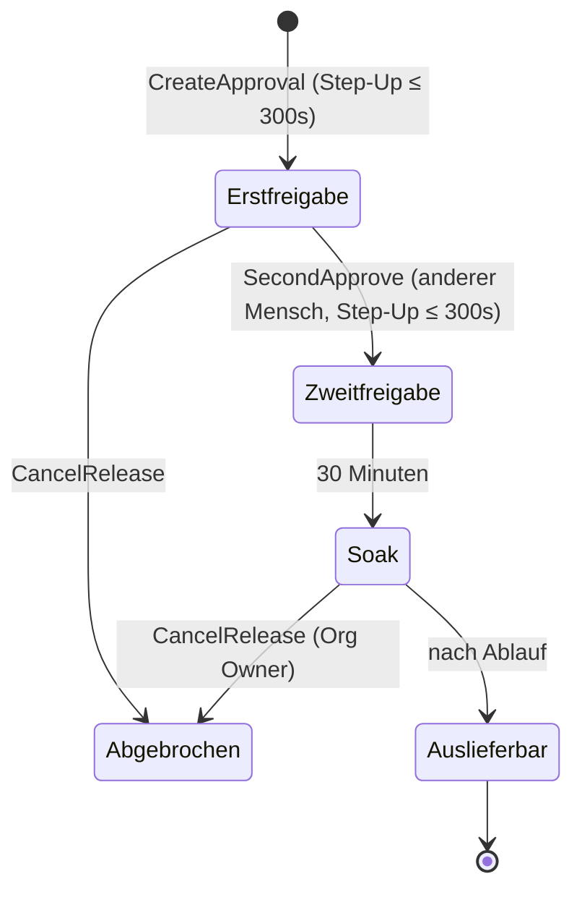

# Toob Identity & Shared — Architekturdokumentation

> **Scope:** Dieses Dokument beschreibt den Spoke **`identity`** (Zitadel-Deployment, Policies, Custom Actions) und die geteilte Bibliotheksschicht **`shared/`** — insbesondere `shared/identity/`, die Vertrauens- und Autorisierungsgrundlage aller Produkte.
>
> Ergänzt: `toob-platform-architektur.md` (verwaltende Ebene) und `toob-registry-architektur.md` (Paket-Registry).
>
> **Grundlage:** Ausschließlich statische Analyse des übergebenen Codes. Wo Code und ältere Dokumentation auseinandergehen, gilt der Code. Nicht im Material enthaltene Teile (`shared/plan`, `shared/x/*`, `shared/signing`, `shared/errors`) sind als *[nicht übergeben]* markiert.

---

## Inhaltsverzeichnis

1. [Das mentale Modell](#1-das-mentale-modell)
2. [Zwei Hälften: Zitadel und die Go-Vertrauensschicht](#2-zwei-hälften-zitadel-und-die-go-vertrauensschicht)
3. [Infrastruktur-Fußabdruck des Identity-Spokes](#3-infrastruktur-fußabdruck-des-identity-spokes)
4. [Node-Bringup und Masterkey-Injektion](#4-node-bringup-und-masterkey-injektion)
5. [Instance-Policies und Custom Actions](#5-instance-policies-und-custom-actions)
6. [Das Rollenmodell](#6-das-rollenmodell)
7. [Die Token-Pipeline](#7-die-token-pipeline)
8. [TrustLevel und Step-Up](#8-trustlevel-und-step-up)
9. [Die Middleware-Schichten](#9-die-middleware-schichten)
10. [Mandantentrennung in drei Ebenen](#10-mandantentrennung-in-drei-ebenen)
11. [Mirror und Reconciler](#11-mirror-und-reconciler)
12. [Organisations-Lebenszyklus als SAGA](#12-organisations-lebenszyklus-als-saga)
13. [Session- und Refresh-Token-Rotation](#13-session--und-refresh-token-rotation)
14. [Service Account mit Least Privilege](#14-service-account-mit-least-privilege)
15. [Support-Impersonation](#15-support-impersonation)
16. [Release-Freigabe: Dual Control und Soak](#16-release-freigabe-dual-control-und-soak)
17. [DPoP — Token-Bindung](#17-dpop--token-bindung)
18. [Föderation: Kunden-IdP und Workload-Identity](#18-föderation-kunden-idp-und-workload-identity)
19. [Anti-DoS und Anomalieerkennung](#19-anti-dos-und-anomalieerkennung)
20. [Audit und Alerting](#20-audit-und-alerting)
21. [Die übrigen shared-Pakete](#21-die-übrigen-shared-pakete)
22. [Befunde, Inkonsistenzen und Risiken](#22-befunde-inkonsistenzen-und-risiken)
23. [Glossar](#23-glossar)

---

## 1. Das mentale Modell

Zitadel ist die **einzige Wahrheit über Identität**. Kein Produkt speichert Passwörter, Faktoren oder Rollen; alle Anwendungen erhalten ausschließlich signierte JWTs und spiegeln daraus abgeleitete Organisations- und Mitgliedsdaten lesend in ihre eigene Datenbank.

Die Härtung geschieht auf zwei Wegen: **deklarativ** über Instance-Policies, die org-seitiges Übersteuern verbieten (`preventOrgOverride`), und **imperativ** über Custom Actions in JavaScript, die einzelne Übergänge abfangen — TOTP für privilegierte Rollen verbieten, Selbstbedienungs-Recovery sperren, Einladungen auf 72 Stunden und `viewer` begrenzen, Rollenerhöhungen an Owner-Freigabe mit frischem Step-Up binden.

Auf Anwendungsseite übersetzt `shared/identity/token` einen JWT in `TokenClaims` mit Subject, Organisations-ID, Governance-Rolle, Produktrollen, **TrustLevel** (L1/L2/L3) und `auth_time`. Diese fünf Werte sind das Rohmaterial für jede weitere Entscheidung.

Darauf setzt eine Kette von HTTP-Middlewares, die zunehmend spezifischer wird: Signatur prüfen → Mandant abgleichen → deklarative Endpunkt-Policy erfüllen → TrustLevel ausreichend → Step-Up frisch genug. Der Mandantenabgleich läuft dabei bewusst **vor** jedem Datenbankzugriff.

Für Operationen mit Produktionswirkung reicht Authentifizierung nicht: Freigaben brauchen zwei verschiedene Menschen, eine 30-Minuten-Abkühlphase und einen kryptografischen Nachweis, der Artefakt-Digest, Kanal und beide Freigebende bindet.

---

## 2. Zwei Hälften: Zitadel und die Go-Vertrauensschicht



Die entscheidende Eigenschaft dieser Aufteilung: **Die Verifikation ist offline.** Produkte holen die öffentlichen Schlüssel einmal und verifizieren danach lokal. Fällt Zitadel aus, laufen Verifikation, Paket-Download und Geräte-Check-in unverändert weiter; nur neue interaktive Logins und Schreiboperationen gegen die Zitadel-Management-API scheitern. Genau das prüft `TestZitadelOutage_JWTVerificationSucceedsWithCachedJWKS`.

---

## 3. Infrastruktur-Fußabdruck des Identity-Spokes

`platform/deploy/terraform/projects/identity/main.tf` komponiert dieselben drei Bausteine wie die Registry, aber mit vollständig getrennten Ressourcen:

| Modul | Konfiguration |
|---|---|
| `project-baseline` | Netz `10.20.0.0/16`, Subnetz `10.20.1.0/24`, `cx23`, zwei Knoten: `id-fsn1` = `10.20.1.10`, `id-hel1` = `10.20.1.11` |
| `ubicloud-postgres` | **Eigene** Instanz `toob-idp-db`, `standard-2`, 64 GB, HA nur in Produktion |
| `object-storage` | **Eigener** Bucket `toob-idp-backups-${environment}` |

Die Trennung ist bewusst: Identity teilt weder Datenbank noch Backup-Bucket noch Netzsegment mit der Registry (`10.0.0.0/16`). Ein kompromittierter Registry-Knoten erreicht die Zitadel-Datenbank nicht auf dem Netzweg.

Der Restore-Test (`scripts/test-restore-idp-db.sh`) hat einen eigenen Ablauf: neuesten Dump aus S3 holen, in einen transienten `postgres:16.1`-Container laden, Zitadel-Schema prüfen (`eventstore`- und `public`-Tabellen, Suche nach `events|users|orgs`) und einen Prometheus-Textfile-Zeitstempel schreiben.

---

## 4. Node-Bringup und Masterkey-Injektion

Der Zitadel-Masterkey ist die kritischste Einzelressource des gesamten Systems — mit ihm sind alle in der Datenbank verschlüsselten Geheimnisse lesbar. Die Ansible-Rolle behandelt ihn entsprechend:



**Kein Masterkey über Umgebungsvariablen oder CLI-Flags** — der Kommentar im Template stellt das explizit fest. Der Unterschied ist real: Umgebungsvariablen sind über `/proc/<pid>/environ` und in Prozesslisten sichtbar, eine `0400`-Datei nicht.

Die systemd-Unit ist in die Plattform-Observability eingehängt: `OnFailure=notify-failure@%n.service` schreibt eine Prometheus-Textfile-Metrik, `ExecStartPost=-/bin/rm -f …service_failure_%n.prom` räumt sie nach erfolgreichem Start wieder ab. Das ist dasselbe Muster wie in der `common`-Rolle der Plattform.

Die Datenbankverbindung ist auf `SSL.Mode: verify-full` mit `RootCert: /etc/zitadel/db-ca.pem` konfiguriert — die strengste Stufe, inklusive Hostnamensprüfung.

---

## 5. Instance-Policies und Custom Actions

### 5.1 Deklarative Basis

`zitadel-config.yaml.tpl` setzt beim ersten Instanz-Start:

| Bereich | Einstellung |
|---|---|
| Login | `AllowRegister: false`, `DisallowPasswordReset: true`, `HidePasswordIfUserNotFound: true`, `IgnoreUnknownUsernames: true`, `ForceMFA: true`, `MFAInitSkipPossible: false`, `PasswordlessAllowed: true`, `PasswordlessType: 1`, `HidePasswordScreen: true`, `AllowDomainDiscovery: false` |
| Passwort | 16 Zeichen, alle vier Klassen, `MaxAgeDays: 90` |
| Lockout | 5 Passwort-, 5 OTP-Versuche |
| Domain | `ValidateOrgDomains: true` |

`HidePasswordIfUserNotFound` und `IgnoreUnknownUsernames` zusammen verhindern Account-Enumeration: Die Antwort ist für existierende und nicht existierende Konten identisch.

`provision-instance-policies.sh` legt dieselben Werte anschließend nochmals per Admin-API fest, diesmal mit `preventOrgOverride: true` — Organisationen können die Instanz-Policy nicht lockern. Dazu die OIDC-Policy: Access-Token 900 s, Refresh-Token 28 800 s (8 h), Idle-Expiration 1800 s, `refreshTokenRevocation: true`, Cookies `Secure`/`HttpOnly`/`SameSite=Lax`.

### 5.2 Die zehn Custom Actions

| Datei | Kontrolle | Wirkung |
|---|---|---|
| `enforce-webauthn-only-for-privileged.js` | IDP-011 | TOTP-Registrierung und -Login für `owner`/`admin`/`release-manager`/`operator` verboten |
| `secure-factor-registration.js` | IDP-011c | Ab dem zweiten Faktor erfordert Hinzufügen/Entfernen eine WebAuthn-Assertion; Alarm an Nutzer und Org-Owner |
| `enforce-dual-authenticator-requirement.js` | IDP-012 | Privilegierte Rollen brauchen ≥ 2 aktive WebAuthn-Authentikatoren |
| `enforce-permanent-l3-no-downgrade.js` | IDP-012 | Wer je L3 erreicht hat, bekommt das Metadatum `ever_l3`; Passwort-Login danach **dauerhaft** gesperrt; fällt die Zahl unter 2, wird das Konto suspendiert statt degradiert |
| `enforce-no-self-service-reset.js` | IDP-020 | Passwort-Reset für privilegierte Konten abgewiesen, Verweis auf das Vier-Schritt-Verfahren |
| `enforce-break-glass-audit.js` | IDP-022 | Jeder `IAM_OWNER`-Login erzwingt WebAuthn und löst sofort einen CRITICAL-Alarm aus |
| `enforce-invite-rules.js` | IDP-031 | 72-h-TTL, E-Mail-Bindung, Einmalverwendung (`invite_consumed`), Anfangsrolle zwangsweise `viewer` |
| `enforce-org-name-rules.js` | IDP-032 | Namensregeln inklusive Reserved-Liste |
| `enforce-role-elevation-owner-approval.js` | IDP-033 | Privilegierte Rollen nur durch Owner mit `auth_time` ≤ 300 s |
| `enforce-github-upstream-policy.js` | IDP-050 | GitHub-Login nur mit `email_verified`; privilegierte Rollen brauchen zusätzlich einen lokalen Passkey |

Der Ansatz ist durchdacht: Die Grenze zwischen „was Zitadel kann" und „was das Produkt prüfen muss" liegt dort, wo Zitadel den Zustand kennt. Faktoranzahl, Rollenzuweisung und Einladungs-Metadaten kennt nur Zitadel — also gehören diese Prüfungen dorthin.

> **Wichtig:** Der Deployment-Pfad dieser Actions ist unvollständig und die Flow-Bindung fehlt. Siehe Befunde 1 und 2.

---

## 6. Das Rollenmodell

`provision-projects-and-roles.sh` legt drei Zitadel-Projekte an:

| Projekt | Rollen | Bedeutung |
|---|---|---|
| `governance` | `owner`, `admin`, `member` | Organisationsverwaltung |
| `registry` | `reader`, `publisher` | Paketzugriff |
| `fleet` | `viewer`, `operator`, `release-manager` | Geräteflotte, Rollouts, Firmware-Signierung |

Die Trennung von `operator` (darf ausrollen) und `release-manager` (darf signieren) ist die Umsetzung der Aufgabentrennung: Wer eine Firmware freigibt, soll sie nicht auch ausliefern können.

`shared/identity/roles` bildet das in Go ab und ergänzt drei Prädikate:

```go
func IsPrivileged(role ProductRole) bool   // operator, release-manager, publisher
func RequiresL3Trust(role ProductRole) bool // nur release-manager
func CanElevateRole(caller GovernanceRole, target ProductRole, stepUpAgeSec int) error
```

`CanElevateRole` verlangt für privilegierte Zielrollen zwingend `RoleOwner` **und** `stepUpAgeSec ≤ 300` — dieselbe Regel wie die Custom Action, hier als zweite, serverseitige Durchsetzung.

`RequiresL3Trust` markiert nur den `release-manager`: Firmware-Signierung erfordert zwei registrierte Hardware-Schlüssel.

---

## 7. Die Token-Pipeline

### 7.1 JWKS-Client

`shared/identity/jwks` ist der Schlüssel zur Ausfallresilienz:

- **Hintergrund-Sync** alle 15 Minuten (Default)
- **Cache-Miss-Refresh** bei unbekanntem `kid`, aber **rate-limitiert auf einen Versuch pro Minute**. Der Test `TestJWKS_RateLimitedCacheMiss` feuert 1000 Anfragen mit falschem `kid` und erwartet höchstens einen HTTP-Request — ohne diese Drossel wäre ein gefälschter `kid` ein Amplification-Vektor gegen Zitadel.
- **Offline-Fallback**: Schlägt der Abruf fehl, bleiben die vorhandenen Schlüssel gültig, `offlineFallback` wird gesetzt, und nach einer Stunde ohne Erfolg wird pro Fehlversuch ein `slog.Error` geschrieben.
- **Fail-Closed bei unbekanntem kid**: Ein nicht gecachter Schlüssel führt zu `ErrKeyNotFound`, nicht zu einer Umgehung.

Unterstützt werden RSA (`n`/`e`) und EC (`x`/`y`); andere `kty`-Werte werden beim Parsen übersprungen und protokolliert, statt den gesamten Key-Set-Import scheitern zu lassen.

### 7.2 Verifier



Die **Algorithmus-Vorprüfung** ist die wichtigste Zeile: `alg: none` und alle HMAC-Verfahren werden abgelehnt, bevor die JWT-Bibliothek überhaupt zum Zug kommt. Damit ist der klassische Angriff, den öffentlichen RSA-Schlüssel als HMAC-Geheimnis zu verwenden, ausgeschlossen. `jwt.WithValidMethods` prüft dasselbe ein zweites Mal.

Fehlt die Organisations-ID im `scope`, wird der Token abgelehnt (`ErrMissingOrgClaim`) — es gibt keinen mandantenlosen Zustand.

Ein **Fuzz-Test** (`FuzzVerify`) mit Seed-Korpus aus gültigen, abgeschnittenen, leeren und `alg:none`-Tokens stellt sicher, dass der Parser unter beliebiger Eingabe nicht paniert.

---

## 8. TrustLevel und Step-Up

Drei Stufen, abgeleitet aus `acr` oder ersatzweise `amr`:

| Stufe | Bedeutung | Zugriff |
|---|---|---|
| L1 | Passwort + TOTP | nur aggregierte Statistiken |
| L2 | ein Passkey | volle Lesezugriffe, granulare Gerätedaten, SBOM |
| L3 | zwei Passkeys | zusätzlich Schreibrechte für privilegierte Rollen |

Orthogonal dazu steht **Step-Up**: nicht *wie stark* jemand authentifiziert ist, sondern *wie frisch*. `RequireStepUp(maxAge)` prüft `auth_time` und antwortet bei Überschreitung mit einem maschinenlesbaren Hinweis:

```
HTTP 401
WWW-Authenticate: Bearer error="step_up_required", max_age="300", acr="urn:zitadel:iam:mfa:l2"
{"error":"step_up_required","max_age_seconds":300,"required_acr":"urn:zitadel:iam:mfa:l2", …}
```

Der Client bekommt damit alles, was er für eine gezielte Re-Authentifizierung braucht, statt nur ein nacktes 401. Analog liefert `RequireTrustLevel` `error="insufficient_trust_level", required_trust_level="L2"`.

---

## 9. Die Middleware-Schichten

### 9.1 RequireAuth

Extrahiert den Bearer-Token (case-insensitives Präfix), verifiziert ihn und legt die Claims unter `ClaimsContextKeyVal` ab. Fehler werden mit `WWW-Authenticate` **und** JSON-Body beantwortet.

### 9.2 RequireOrgMatch — der Vor-Datenbank-Riegel

```go
if claims.OrgID != targetOrgID {
    slog.Error("SECURITY ALARM: Cross-tenant access attempt blocked by pre-database middleware (AUTH-024)", …)
    // 403 mit token_org_id, target_org_id, message
}
```

Das Ziel-Org wird über einen austauschbaren `OrgIDResolver` bestimmt (Header `X-Toob-Org-ID` oder Query-Parameter). Entscheidend ist die Position: Der Abgleich passiert **vor** jedem Datenbankzugriff und jeder Policy-Auswertung. Damit gibt es keinen Zeitkanal, über den sich die Existenz fremder Ressourcen ableiten ließe, und keine Chance, dass ein vergessener `WHERE org_id = …`-Filter Daten preisgibt.

### 9.3 RequireFleetSecurity — deklarative Endpunkt-Policies

Ein Registry aus `RouteSecurityPolicy`-Einträgen beschreibt pro Endpunkt: erforderliche Governance-Rolle, Produktrolle, TrustLevel, Ressourcentyp, Datengranularität und ob Step-Up nötig ist.

**Fail-Closed bei fehlender Registrierung:** Ist ein Endpunkt nicht registriert, antwortet die Middleware mit `500` und `unregistered_security_policy` statt durchzulassen. Ein vergessener Policy-Eintrag wird damit sofort sichtbar, statt eine stille Lücke zu hinterlassen. Doppelte Registrierung ist ebenfalls ein Fehler.

Die Prüfreihenfolge:

1. Policy vorhanden? → sonst 500
2. Claims vorhanden? → sonst 401
3. `OrgID` gesetzt? → sonst 403
4. Granulare Daten und `TrustLevel == L1`? → 403 `granular_data_access_denied`
5. `IsImpersonated`? → 403 `impersonated_step_up_forbidden`
6. Step-Up erforderlich und `auth_time` zu alt? → 401 `step_up_required`
7. TrustLevel ausreichend? → sonst 403
8. Governance-Rolle ausreichend (Hierarchie owner > admin > member)? → sonst 403

Dass Impersonation **vor** der Step-Up-Prüfung geblockt wird, ist richtig herum: Eine Support-Sitzung soll gar nicht erst die Möglichkeit bekommen, sich durch Re-Authentifizierung Zugang zu erarbeiten.

---

## 10. Mandantentrennung in drei Ebenen



`tenant.SetTenantContext` hat eine bemerkenswerte Einschränkung, die im Code ausdrücklich als Sicherheitsgarantie formuliert ist:

> Die Tenant-ID wird **ausschließlich** aus den verifizierten JWT-Claims (`claims.OrgID`) gelesen, **niemals** aus HTTP-Parametern, Headern oder Query-Strings.

Fehlt der Claim, wird `ErrMissingTenantClaim` zurückgegeben — die Transaktion läuft nicht ohne Mandantenkontext an. Gesetzt wird über eine parametrisierte Abfrage:

```sql
SELECT set_config('app.tenant_id', $1, true)
```

Der dritte Parameter `true` bedeutet `is_local` — die Einstellung gilt nur für die aktuelle Transaktion und kann nicht in eine gepoolte Verbindung „hineinlecken". Die RLS-Policy aus Migration 036 vergleicht dagegen: `id = NULLIF(current_setting('app.tenant_id', true), '')`.

Die Tests `TestTenantIsolation_CollidingIdentifiers` prüfen den Fall zweier Mandanten mit identischen Paketnamen und identischer Hardware-ID — und bestehen ausdrücklich darauf, dass Cross-Tenant-Zugriffe **403** liefern und nicht 404, weil ein 404 über Antwortzeiten Rückschlüsse auf Existenz erlauben würde.

---

## 11. Mirror und Reconciler

Die Produktdatenbanken halten Organisationen und Mitgliedschaften nur als Kopie. Zwei Mechanismen halten sie aktuell:

**Webhook-Pfad (schnell).** `mirror.WebhookHandler` prüft HMAC-SHA256 konstantzeitig, dedupliziert über `event_id`, misst die Latenz gegen `event.Timestamp` und verarbeitet `org.added`, `org.member.added`, `org.member.changed`, `org.member.removed`. Ein wiederholt zugestelltes Ereignis liefert `ErrEventDuplicate`, kein zweites Schreiben.

**Reconciler-Pfad (vollständig).** Alle 15 Minuten wird der komplette Zitadel-Zustand geholt und gegen den lokalen Spiegel verglichen. Jede Abweichung wird korrigiert und gezählt:

```go
slog.Warn("mirror: reconciled state drift (corrected member role)",
    slog.String("org_id", …), slog.String("old_role", …), slog.String("new_role", …))
```

Das ist die richtige Antwort auf verlorene Webhooks: Man verlässt sich nicht darauf, dass jedes Ereignis ankommt, sondern gleicht periodisch ab. `MirrorMonitor` macht die Gesundheit messbar — Lag > 5 Minuten löst Alarm aus, > 10 Korrekturen in einem Durchlauf ebenfalls (ungewöhnlich viel Drift deutet auf ein Problem der Webhook-Zustellung oder auf Manipulation hin).

Ergänzend entzieht Migration 033 der DB-Rolle `api` die Schreibrechte auf `organizations` und `organization_members` und gibt sie nur der Rolle `sync`. Selbst ein Bug im Produktcode kann den Spiegel damit nicht beschreiben.

---

## 12. Organisations-Lebenszyklus als SAGA

`shared/identity/orgs.Manager.CreateOrganization` hält eine strikte Reihenfolge ein:



Zwei Details machen den Unterschied:

**Das Kontingent wird vor dem Zitadel-Aufruf geprüft.** `TestOrgManager_PreZitadelQuotaCheck` verifiziert, dass bei Kontingentüberschreitung `createCalls` unverändert bleibt — sonst würde jeder abgelehnte Versuch eine Waisen-Organisation in Zitadel hinterlassen.

**Kompensierende Rollbacks.** Scheitert der lokale Spiegel-Insert (Platte voll, Constraint-Verletzung), wird die bereits erzeugte Zitadel-Organisation wieder gelöscht. Scheitert auch die Kompensation, gibt es ein `SECURITY CRITICAL`-Log — der einzige Fall, in dem manuelles Aufräumen nötig wird, ist damit wenigstens sichtbar.

`ProvisionPersonalOrganization` legt beim ersten Login eine Organisation mit dem Benutzernamen an (Fallback `user-<id>`, falls der Name die Regeln verletzt) und ist idempotent.

---

## 13. Session- und Refresh-Token-Rotation

`shared/identity/session` implementiert **Token-Familien mit Reuse-Detection**:



Jede Familie hält den Hash des aktuellen Tokens und die Hashes aller verbrauchten. Wird ein verbrauchtes Token erneut vorgelegt, ist das der Beweis für einen Replay: Entweder der Angreifer nutzt ein gestohlenes altes Token oder der legitime Client nutzt eines, das der Angreifer bereits rotiert hat. In beiden Fällen ist unklar, wer der Echte ist — also wird die **gesamte Familie** widerrufen und ein Alarm ausgelöst. Der Test bestätigt, dass danach auch das eigentlich gültige neueste Token abgewiesen wird.

Tokens werden nie im Klartext gehalten, nur als SHA-256; erzeugt werden sie mit 32 Byte aus `crypto/rand`.

---

## 14. Service Account mit Least Privilege

Der `product-service-account` darf Kundenorganisationen anlegen und Mitglieder verwalten — aber keine Sicherheitsrichtlinien ändern. `shared/identity/serviceaccount` setzt das als Pfad-Blockliste durch:

```
/admin/v1/policies   → Login-, Passwort-, Lockout-Policies
/admin/v1/idps       → Upstream-IdP-Konfiguration
/admin/v1/iam        → Instanz-IAM
/system/v1           → System-API
```

Ein Treffer liefert `ErrForbiddenOperation` plus `SECURITY ALARM`-Log. Der Negativtest deckt alle sechs Kategorien einzeln ab.

Zweite Regel: **Zustandsändernde Aufrufe ohne menschlichen Auftraggeber sind verboten.** Jeder nicht-GET-Aufruf braucht eine `ActorID`, die als `X-Toob-Actor-ID` mitgeschickt und geloggt wird. Damit lässt sich im Zitadel-Audit-Log jede Aktion des Maschinen-Accounts auf einen Menschen zurückführen, statt bei „Service Account" zu enden.

---

## 15. Support-Impersonation

`shared/identity/impersonation` bindet Support-Zugriffe an vier Bedingungen:

| Regel | Durchsetzung |
|---|---|
| Begründung ist Pflicht | `ErrReasonRequired` bei leerem `reason` |
| Maximal 4 Stunden | `ErrDurationExceeded` |
| Ausschließlich `viewer` | Rolle wird im Konstruktor hart gesetzt, nicht übergeben |
| Keine privilegierten Aktionen | `CanExecuteOperation` verweigert bei `isPrivileged` |
| Org-Owner werden benachrichtigt | `OwnerNotifier`-Callback beim Start |

`EnforceNoStandingGrants` verbietet zusätzlich, dass Mitarbeitende dauerhafte Rollen in Kundenorganisationen halten — Zugriff gibt es nur als befristete, protokollierte, sichtbare Sitzung.

Ergänzt wird das durch die Middleware: Ein Token mit `IsImpersonated` wird von `RequireFleetSecurity` bei jeder Step-Up-pflichtigen Operation abgewiesen, unabhängig von der Rolle im Token.

---

## 16. Release-Freigabe: Dual Control und Soak

`shared/identity/approval` ist die strengste Kontrolle im gesamten System:



Vier ineinandergreifende Bedingungen:

1. **Frischer Step-Up** für beide Freigaben (`MaxStepUpAgeSeconds = 300`)
2. **Vier-Augen-Prinzip**: `approverID == FirstApproverID` liefert `ErrSelfApprovalForbidden` mit `SECURITY VIOLATION`-Log
3. **30-Minuten-Soak** (`ErrSoakPeriodActive`) — ein Zeitfenster, in dem ein Org-Owner die Freigabe noch stoppen kann, bevor auch nur ein Byte ausgeliefert wird
4. **Kryptografischer Nachweis**: `GenerateSigningProof` bildet einen HMAC über `ReleaseID : ArtifactDigest : TargetChannel : FirstApprover : SecondApprover`

Der letzte Punkt ist der interessanteste. Der Nachweis bindet die Freigabe an ein **konkretes Artefakt** und einen **konkreten Kanal**. Wer nach der Freigabe den Digest austauscht, hält einen Nachweis, der nicht mehr verifiziert — der Test manipuliert genau das und erwartet `false`.

---

## 17. DPoP — Token-Bindung

`shared/identity/dpop` implementiert RFC 9449 in Teilen: Es parst den `DPoP`-Header, prüft `typ: dpop+jwt`, berechnet den JWK-Thumbprint nach RFC 7638, vergleicht HTTP-Methode (`htm`) und URI (`htu`) mit dem tatsächlichen Request, prüft die Frische (`iat` ≤ 60 s) und gleicht den Thumbprint gegen den im Token gebundenen `jkt` ab.

`VerifyTokenBinding` behandelt einen leeren `boundJKT` als „Token ist nicht DPoP-gebunden" und lässt durch — eine bewusste Abwärtskompatibilität für Tokens ohne Bindung.

> **Wichtig:** Die Signatur des DPoP-Proofs wird nie geprüft. Siehe Befund 3.

---

## 18. Föderation: Kunden-IdP und Workload-Identity

### 18.1 Kunden-IdPs

Kunden dürfen ihren eigenen IdP anbinden — aber `ValidateCustomerIdPAuth` verlangt für privilegierte Operationen einen phishing-resistenten Faktor im `amr`-Claim (`phr`, `fido2`, `hwk`, `webauthn`, `pop`). Liefert der Kunden-IdP nur `pwd`/`otp`, wird ein lokaler Passkey-Step-Up erzwungen. Lesende Operationen bleiben unter der Kundenrichtlinie erlaubt.

Das löst ein reales Problem elegant: Man kann Kunden nicht vorschreiben, wie sie intern authentifizieren, aber man kann verlangen, dass Aktionen mit Auswirkung auf ausgelieferte Firmware ein bestimmtes Sicherheitsniveau erreichen.

### 18.2 Workload-Identity

`WorkloadExchangeEngine` validiert GitHub-Actions-OIDC-Claims gegen Repository, Git-Ref und **Workflow-Namen**. Der Workflow-Name ist die wichtigste Prüfung: Ohne sie könnte ein Angreifer mit Schreibrechten auf das Repository einen eigenen Workflow anlegen, der ein gültiges OIDC-Token für dasselbe Repo erhält.

Darüber steht eine absolute Grenze:

```go
if cleanChannel == "production" || cleanChannel == "prod" {
    return ErrWorkloadProductionPromotionForbidden
}
```

**Maschinen können nicht nach Produktion befördern.** Damit ist die Freigabekette aus Abschnitt 16 nicht durch CI umgehbar — genau der Angriffspfad, der bei Lieferketten-Vorfällen typischerweise ausgenutzt wird.

---

## 19. Anti-DoS und Anomalieerkennung

### 19.1 Progressive Verzögerung statt Sperre

`shared/identity/ratelimit` löst ein bekanntes Dilemma. Klassische Account-Sperren nach N Fehlversuchen sind selbst ein Angriffswerkzeug: Wer die E-Mail-Adresse des Owners kennt, kann ihn aussperren. Die Antwort hier:

| Fehlversuche | Verzögerung |
|---|---|
| 1–3 | 200 ms |
| 4–9 | 1 s |
| 10–99 | 5 s |
| ≥ 100 | 10 s (Deckel) |

Alarme bei 10, 100 und 1000 — aber **keine Sperre**. Der Deckel bei 10 Sekunden verhindert, dass die Verzögerung selbst zum DoS wird (Verbindungen und Application-Timeouts blockieren). Ein erfolgreicher Login setzt den Zähler zurück. Der Test simuliert 1000 Fehlversuche und prüft anschließend, dass der legitime Owner sich sofort ohne Verzögerung anmelden kann.

### 19.2 Anomalien

`shared/identity/audit.AnomalyDetector` erkennt zwei Muster:

- **AiTM-Proxy-Verdacht**: drei aufeinanderfolgende fehlgeschlagene WebAuthn-Assertions. Genau das ist die Signatur eines Reverse-Proxy-Phishings — die Assertion bindet sich an den Proxy-Origin und wird vom echten Server wegen Relying-Party-Mismatch verworfen.
- **Ungewöhnliches ASN** bei privilegierten Konten: Das erste gesehene ASN wird als Baseline registriert, jedes neue löst einen Alarm aus.

Beide setzen `ForceStepUp: true` statt zu sperren — konsistent mit der Rate-Limiting-Philosophie.

---

## 20. Audit und Alerting

`shared/audit` besteht aus drei Teilen:

**AuditEntry** — unveränderlicher Datensatz mit Action, Actor, IP, Ressource, Metadaten, Komponente. Die Konstanten decken den Release-Lebenszyklus ab (`release.trigger`, `.cancel`, `.yank`, `.mirror`, `.publish`, `.tag`, `.deprecate`, `.unyank`).

**AlertEngine** — Schweregrad-Matrix über acht sicherheitsrelevante Ereignisse:

| CRITICAL | HIGH |
|---|---|
| `iam_owner_login` | `authenticator_registered` |
| `mfa_policy_changed` | `privileged_role_granted` |
| `refresh_token_reused` | `account_recovery_started` |
| `upstream_idp_config_changed` | `impersonation_started` |

Die Auswahl ist stimmig: CRITICAL sind Ereignisse, die die Sicherheitsgrundlage selbst verändern oder einen laufenden Angriff belegen; HIGH sind Ereignisse, die Persistenz oder Rechteausweitung ermöglichen.

**LokiClient** — pusht Einträge mit `X-Scope-OrgID` an Loki, also mandantengetrennt. Labels: `project`, `environment`, `action`, `actor_id`.

---

## 21. Die übrigen shared-Pakete

### 21.1 `shared/boundaries_test.go`

Ein Test, der per AST-Analyse alle `.go`-Dateien durchgeht und Modulgrenzen prüft: `shared` darf weder `platform`, `registry` noch `update` importieren; `platform` nicht `registry`/`update`; `update` nicht `registry`. Dieselben Regeln stehen als `depguard`-Konfiguration in `.golangci.yml` — die doppelte Absicherung greift auch dann, wenn jemand den Linter überspringt.

### 21.2 `shared/metrics`

Vier Metrikgruppen im Namespace `toob`:

| Metrik | Typ | Erhebung |
|---|---|---|
| `toob_build_info{version,commit}` | Gauge | einmalig |
| `toob_http_requests_total{method,route,status}` | Counter | pro Request |
| `toob_http_request_duration_seconds{method,route}` | Histogram | pro Request |
| `toob_db_pool_*` | Gauge | pull, pro Scrape |
| `toob_queue_depth{type}` | Gauge | pull, mit 2-Sekunden-Timeout |

`NormalizePath` ersetzt dynamische Segmente durch Platzhalter, damit Paketnamen und Job-IDs nicht als Prometheus-Label-Kardinalität explodieren. Nicht erkannte Pfade werden zu `"unknown"` — ein Bot-Scan kann die Kardinalität also nicht hochtreiben.

### 21.3 `shared/storage`

`ObjectStore`-Interface plus `S3Store` auf Basis von `minio-go`, funktioniert gegen AWS S3 und Hetzner Object Storage. Alle Operationen sind in `retry.Do` gekapselt. Zwei Details:

- `PutStream` versucht, die Größe über `io.Seeker` zu bestimmen, um bei kleinen Dateien den Multipart-Upload zu vermeiden.
- `DeleteObject` listet **alle Versionen** des Schlüssels und löscht jede einzeln — nötig, weil der Bucket versioniert ist und ein einfaches Delete nur eine Löschmarkierung setzen würde. Für widerrufene Pakete ist genau das der Unterschied zwischen „nicht mehr sichtbar" und „nicht mehr abrufbar".

### 21.4 `shared/vault`

AppRole-Client mit selbstverwaltetem Token-Lebenszyklus:

- **HTTPS erzwungen**, TLS 1.3 Minimum, optionaler CA-Pin als alleiniger Trust Anchor
- **SecretID wird nach dem Login verworfen** — sie liegt nur auf dem Stack des Aufrufers, nicht auf der Struct
- **Erneuerung bei 50 % der TTL**, mindestens aber nach einer Minute
- **Kein Re-Login bei Erneuerungsfehler** (die SecretID ist ja weg) — stattdessen exponentieller Backoff bis 5 Minuten und `slog.Error`. Ein dauerhafter Fehler erfordert einen Prozessneustart mit frischer SecretID.
- **Fehlermeldungen sind bereinigt**: Response-Bodies von Vault werden nach `io.Discard` verworfen statt in Fehlertexte übernommen

`NewClientWithToken` deckt den Nomad-Fall ab: Ist das übergebene „Token" ein existierender Dateipfad, wird die Datei gelesen und alle 30 Sekunden auf Rotation geprüft.

---

## 22. Befunde, Inkonsistenzen und Risiken

Die Sicherheitsarchitektur dieser Schicht ist konzeptionell stark — Vier-Augen-Prinzip mit Soak-Fenster, Reuse-Detection auf Token-Familien, SAGA-Rollback, Vor-Datenbank-Mandantenprüfung und progressive Verzögerung statt Sperre sind allesamt Entscheidungen, die man selten so sauber umgesetzt sieht. Die folgenden Befunde betreffen überwiegend die Lücke zwischen dieser Konzeption und ihrer tatsächlichen Wirksamkeit im Betrieb.

### 🔴 Kritisch

**1. Vier der zehn Custom Actions werden nie auf die Knoten kopiert.**

`roles/zitadel/tasks/main.yml` kopiert nach `/usr/local/bin/`:

```
enforce-webauthn-only-for-privileged.js      ✓
enforce-dual-authenticator-requirement.js    ✓
enforce-no-self-service-reset.js             ✓
secure-factor-registration.js                ✓
enforce-permanent-l3-no-downgrade.js         ✓
enforce-break-glass-audit.js                 ✓
enforce-invite-rules.js                      ✗ fehlt
enforce-org-name-rules.js                    ✗ fehlt
enforce-role-elevation-owner-approval.js     ✗ fehlt
enforce-github-upstream-policy.js            ✗ fehlt
```

`provision-instance-policies.sh` versucht in den Schritten 10–13, genau diese vier hochzuladen, prüft aber mit `if [ -f "$SCRIPT_FILE" ]` und überspringt still. Damit sind **IDP-031** (Einladungsregeln, 72-h-TTL, Zwangsrolle `viewer`), **IDP-032** (Org-Namen), **IDP-033** (Owner-Freigabe für Rollenerhöhung) und **IDP-050** (GitHub-E-Mail-Verifikation) auf Zitadel-Seite nicht aktiv.

Für IDP-033 gibt es mit `roles.CanElevateRole` eine Go-seitige Entsprechung; für die anderen drei existiert keine zweite Durchsetzung.

**2. Keine der Actions ist an einen Flow-Trigger gebunden.**

`provision-instance-policies.sh` ruft ausschließlich `POST /admin/v1/actions` auf — das *erzeugt* eine Action. Zitadel führt eine Action aber erst aus, wenn sie zusätzlich an einen Flow-Trigger gebunden wird (in Zitadel v2 über die Management-API, etwa `POST /management/v1/flows/{flowType}/trigger/{triggerType}/actions`). Ein solcher Aufruf fehlt vollständig.

Erschwerend: Die vier nicht ausgerollten Skripte enden mit `flow.appendAndExecute(...)`, die sechs ausgerollten definieren nur eine Funktion. Zwei unterschiedliche Aufrufkonventionen im selben Verzeichnis deuten darauf hin, dass die Skripte gegen unterschiedliche (oder vermutete) API-Versionen geschrieben wurden. Ich empfehle, die tatsächliche Action-API-Oberfläche der eingesetzten Zitadel-Version zu verifizieren — insbesondere ob `api.fail`, `api.appendEvent`, `api.setUserMetadata`, `api.setUserState` und `api.appendError` überhaupt existieren *[nicht belegt]*.

Zusatzhinweis: Mehrere Skripte nutzen `Array.prototype.flat()` (ES2019). Läuft die Action-Engine auf goja, sollte geprüft werden, ob `.flat()` verfügbar ist — andernfalls schlägt die Rollenermittlung fehl und `isPrivileged` bleibt `false`, was die Kontrolle stillschweigend deaktiviert.

**Nettoeffekt aus 1 und 2:** Der IDP-Kontrollkatalog ist als Code vorhanden, im Betrieb aber vermutlich wirkungslos. Da alle Skripte `allowedToFail: false` setzen, wären Fehler bei aktiver Bindung wenigstens sichtbar — ohne Bindung passiert gar nichts.

**3. Der DPoP-Proof wird nie kryptografisch verifiziert.**

`ParseAndVerifyDPoPHeader` zerlegt den Proof in drei Teile, dekodiert Header und Claims — und ignoriert `parts[2]`, die Signatur:

```go
parts := strings.Split(dpopRaw, ".")
if len(parts) != 3 { return nil, ErrInvalidDPoPProof }
// Header und Claims werden dekodiert …
// parts[2] wird nie verwendet
```

Der Thumbprint wird aus dem JWK berechnet, das der Angreifer selbst im Header mitliefert. Damit ist die Bindung wertlos: Wer ein Access-Token abgreift, liest den `jkt`-Wert, konstruiert ein JWK, das auf denselben Thumbprint hasht — oder kopiert schlicht das JWK aus einem beobachteten legitimen Proof — und setzt `htm`/`htu`/`iat` passend. Ohne Signaturprüfung besitzt er keinen privaten Schlüssel und braucht auch keinen.

DPoP existiert ausschließlich, um genau diesen Diebstahl zu verhindern. In der jetzigen Form bietet es keinen Schutz.

Nachrangig, aber im selben Zusammenhang: Es gibt keinen `jti`-Replay-Cache (das 60-Sekunden-Fenster erlaubt beliebige Wiederverwendung innerhalb einer Minute), und der `htu`-Vergleich fällt über `strings.HasSuffix(reqURI, claims.HTU)` auf ein schwächeres Kriterium zurück.

**4. Sämtlicher Sicherheitszustand liegt prozesslokal im Arbeitsspeicher.**

Betroffen sind:

| Paket | Zustand |
|---|---|
| `session.Manager` | Token-Familien, verbrauchte Token-Hashes |
| `approval.Engine` | Freigaben, Soak-Fenster, Abbrüche |
| `impersonation.Manager` | aktive Support-Sitzungen |
| `ratelimit.ProgressiveLimiter` | Fehlversuchszähler |
| `audit.AnomalyDetector` | ASN-Baseline, WebAuthn-Fehlerzähler |
| `mirror.WebhookHandler` | Dedup-Cache |

Beide Produktknoten laufen laut Terraform doppelt (`id-fsn1`/`id-hel1`, `api-fsn1`/`api-hel1`), die Nomad-Jobs mit `count = 2`. Konsequenzen:

- **Refresh-Token-Reuse-Detection versagt**, wenn Replay und Original auf verschiedenen Instanzen landen — der zweite Knoten kennt die Familie gar nicht und antwortet `ErrInvalidRefreshToken` statt die Familie zu widerrufen. Der Angriff wird zum Fehlschlag statt zum Alarm.
- **Die Vier-Augen-Freigabe ist umgehbar**: `CreateApproval` auf Knoten A, `SecondApprove` auf Knoten B schlägt mit „release approval request not found" fehl — die Freigabe ist also nicht umgehbar, aber schlicht **nicht funktionsfähig** hinter einem Load Balancer ohne Sticky Sessions.
- **Rate Limiting halbiert sich** effektiv pro Knoten; ein Neustart setzt alles zurück.
- **Der Dedup-Cache verliert seine Wirkung** nach Neustart und über Knotengrenzen — dasselbe Webhook-Ereignis wird doppelt verarbeitet.

Für Reuse-Detection und Freigaben ist gemeinsamer, persistenter Zustand (Postgres oder Redis) keine Optimierung, sondern Funktionsvoraussetzung.

**5. Kein Zustand wird je aufgeräumt.**

`session.families`, `approval.approvals`, `impersonation.sessions`, `mirror.dedupCache`, `ratelimit.accounts` (nur bei Erfolg gelöscht) und `audit.userASNs`/`webauthnFailures` wachsen unbegrenzt. Der Dedup-Cache speichert einen Zeitstempel, wertet ihn aber nie aus. Bei kontinuierlichem Betrieb ist das ein Speicherleck; bei gezielten Fehlversuchen mit wechselnden Benutzer-IDs ein DoS-Vektor gegen den Prozess selbst.

Der Rate-Limiter der Registry löst dasselbe Problem korrekt (`evictBadly` mit LRU-Verdrängung bei 100 000 Einträgen) — dieses Muster fehlt hier durchgängig.

### 🟠 Hoch

**6. `TrustLevel` L2 ist über `amr: ["mfa"]` erreichbar — auch mit TOTP.**

```go
if s == "webauthn" || s == "passkey" || s == "mfa" {
    if hasWebAuthn { hasSecondFactor = true }
    hasWebAuthn = true
}
if hasWebAuthn && hasSecondFactor { return TrustLevelL3 }
if hasWebAuthn { return TrustLevelL2 }
```

`mfa` wird wie ein WebAuthn-Faktor behandelt. Eine Passwort-plus-TOTP-Anmeldung, die `amr: ["pwd","mfa"]` liefert, erreicht damit **L2** — und L2 schaltet nach IDP-011 granulare Gerätedaten, Seriennummern, SBOM-Digests und Erase-Counts frei. Genau das soll die Trennung verhindern.

Zusätzlich liefert `["webauthn","mfa"]` **L3**, obwohl nur ein einziger Passkey vorhanden ist. Der Test `TestVerifier_ValidToken` schreibt dieses Verhalten fest.

Korrekt wäre, `mfa` aus der Liste zu entfernen und L3 nur bei zwei *unterschiedlichen* phishing-resistenten Faktoren zu vergeben — die Logik aus `federation.IsPhishingResistantAMR` (die `phr`, `fido2`, `hwk`, `webauthn`, `pop` kennt und `mfa` bewusst nicht) ist dafür bereits vorhanden und sollte wiederverwendet werden.

**7. Ein JWT ohne `exp` läuft nie ab.**

Der Parser wird ohne `jwt.WithExpirationRequired()` konstruiert. Fehlt `exp`, prüft `jwt/v5` nichts und der Token ist unbegrenzt gültig. `TokenClaims.ExpiresAt` bleibt in diesem Fall die Nullzeit, ohne dass jemand darauf reagiert.

**8. Drei divergierende Implementierungen der Organisationsnamensregel.**

| Ort | Länge | Konsekutive Bindestriche | Reserved-Liste |
|---|---|---|---|
| `registry/internal/validate.ValidateOrgName` | 3–30 | verboten | 23 Einträge |
| `shared/identity/orgs.ValidateName` | 3–32 | **erlaubt** | **keine** |
| `enforce-org-name-rules.js` | 3–30 | verboten | 29 Einträge |

Das Regex in `shared/identity/orgs` lautet `^[a-z0-9][a-z0-9-]{1,30}[a-z0-9]$` und akzeptiert damit `esp--alliance` sowie `admin` — beides wird von den anderen beiden Stellen abgelehnt. Da `orgs.Manager` der Pfad ist, über den Organisationen tatsächlich in Zitadel angelegt werden, ist das die *permissivste* und zugleich *wirksamste* Variante. Der Test `TestOrgManager_NameValidation` prüft keinen der beiden Abweichungsfälle.

**9. Zwei unvereinbare Governance-Rollen-Vokabulare.**

| Quelle | Rollen |
|---|---|
| Zitadel-Projekt `governance` | `owner`, `admin`, `member` |
| `shared/identity/roles.GovernanceRole` | `owner`, `admin`, `member` |
| `registry/internal/domain.OrgRole` | `owner`, **`maintainer`**, `member` |
| `shared/identity/orgs.OrgRole` | `owner`, **`maintainer`**, `member` |

Der Mirror schreibt die von Zitadel gelieferte Rolle unverändert in `organization_members.role`. Kommt dort `admin` an, greift in der Registry weder `CanManageMembers()` noch `CanManageRoles()` — beide prüfen auf `owner`/`maintainer`. Ein Zitadel-Admin wäre in der Registry damit faktisch ein einfaches Mitglied. Umgekehrt liefern die Custom Actions für `maintainer` keine Treffer in ihren `privilegedRoles`-Listen.

**10. `provision-projects-and-roles.sh` erfasst die Projekt-ID falsch.**

```bash
create_project_if_missing() {
    echo "Ensuring project exists: $name..."   # geht nach stdout!
    ...
    echo "$project_id"
}
GOV_PROJECT_ID=$(create_project_if_missing "governance")
```

Die Kommandosubstitution fängt **beide** `echo`-Ausgaben ein. `GOV_PROJECT_ID` enthält damit `"Ensuring project exists: governance...\n<id>"`. Die anschließende Prüfung `[ -n "$GOV_PROJECT_ID" ]` ist trotzdem wahr, und die Rollen-URLs werden mit dem verunreinigten Wert gebaut:

```
/management/v1/projects/Ensuring project exists: governance...
<id>/roles
```

Alle `add_role_if_missing`-Aufrufe schlagen damit fehl — aber weil jeder `curl` mit `|| echo "NOTICE: Role already exists"` abgeschlossen ist, sieht das Log wie ein Erfolg aus. Die Log-Zeilen gehören nach `>&2`.

**11. Fehler in der Provisionierung sind systematisch unsichtbar.**

Beide Skripte laufen mit `set -euo pipefail`, aber praktisch jeder `curl -s -f` endet auf `|| echo "WARNING: …"`, was den Abbruch verhindert. Zusätzlich rufen die Ansible-Tasks sie mit `failed_when: false` auf, und beide Skripte beenden sich mit `exit 0`, wenn `/etc/zitadel/admin-token` fehlt. Ein vollständig fehlgeschlagenes Policy-Provisioning erzeugt damit einen grünen Ansible-Lauf.

Da die Skripte die Kernhärtung setzen (`preventOrgOverride`, OIDC-TTLs), sollte mindestens eine abschließende Verifikationsstufe existieren, die die gesetzten Policies zurückliest und bei Abweichung hart scheitert.

**12. `provision-service-account.sh` wird nie ausgeführt, und sein zentraler Schritt ist leer.**

Das Skript liegt in `files/`, wird aber weder kopiert noch aufgerufen. Selbst wenn es liefe, enthält Schritt 2 — die Vergabe der minimalen Rollen — ausschließlich Kommentare:

```bash
# 2. Grant minimal roles: ORG_OWNER / ORG_MEMBER_ADD on created orgs only (NO INSTANCE ADMIN ROLES)
# Note: Machine user has NO IAM_OWNER or LOGIN_POLICY_ADMIN roles.
```

Damit hat der `product-service-account` — sofern er überhaupt existiert — keine explizit vergebenen Rechte. Der Go-seitige `serviceaccount`-Guard blockiert zwar Policy-Endpunkte im Produktcode, ersetzt aber keine serverseitige Rechtevergabe: Ein anderer Client mit demselben Token unterliegt dem Guard nicht.

**13. `/etc/zitadel/db-ca.pem` wird nie abgelegt.**

Das Template setzt `SSL.Mode: verify-full` mit `RootCert: /etc/zitadel/db-ca.pem`. Keine Ansible-Task kopiert diese Datei. Zitadel wird beim Start entweder scheitern oder — je nach Verhalten — auf eine schwächere Verifikation zurückfallen. Die Registry-Seite löst dasselbe Problem über die `common`-Rolle, die `ubicloud-ca.pem` verteilt; für den Identity-Knoten fehlt der entsprechende Schritt.

**14. Der Masterkey hat keinen Fail-Closed-Pfad.**

```yaml
Masterkey: "{{ with secret "secret/data/projects/identity/masterkey" }}{{ .Data.data.masterkey }}{{ end }}"
```

Kein `{{ else }}`. Ist das Secret nicht lesbar, rendert Vault Agent einen **leeren String**, und die Datei wird trotzdem geschrieben. Die Datenbankfelder darunter haben Fallbacks (`{{ else }}127.0.0.1` bzw. `placeholder`) — ausgerechnet der kritischste Wert nicht. Vault Agent würde bei einem Template-Fehler abbrechen, bei einem leeren Rendering aber nicht.

### 🟡 Mittel

**15. `metrics.NormalizePath` ist gegenüber dem Router veraltet.**

Die statische Fast-Path-Liste enthält Routen, die es nicht mehr gibt (`/api/v1/auth/github`, `/api/v1/auth/github/callback`, `/api/v1/auth/rotate-key`, `/api/v1/admin/promote`, `/api/v1/admin/organizations`) und vermisst aktuelle: `/api/v1/orgs*`, `/api/v1/me`, `/api/v1/releases/{component}/{version}/download/{filename}`, `/api/v1/worker/release-claim`, `/api/v1/worker/release-jobs/{id}/*`, `/api/v1/publish/jobs/{id}/stream`, `/webhook/push`, `/webhook/release`.

Alles Nichtzutreffende landet unter `"unknown"`. Der gesamte Release-Download-Verkehr und der halbe Worker-Verkehr sind damit in `toob_http_requests_total` nicht unterscheidbar — genau die Endpunkte, deren Latenz und Fehlerrate am meisten interessieren.

Der `admin/organizations`-Zweig ist zudem in sich widersprüchlich: Der Fall `n == 5 && segments[4] == "members"` kann bei diesem Pfadaufbau nicht eintreten.

**16. `S3Store.PutStream` kann beim Retry stillschweigend Leeres hochladen.**

```go
err := retry.Do(ctx, retry.DefaultConfig(), func() error {
    if seeker, ok := data.(io.ReadSeeker); ok { seeker.Seek(0, io.SeekStart) }
    _, err := s.client.PutObject(ctx, s.bucket, objectKey, data, size, …)
    return err
})
```

Ist `data` kein `Seeker` (etwa ein `http.Request.Body` oder ein Netzwerk-Reader), wird beim zweiten Versuch ein bereits erschöpfter Reader übergeben — das Ergebnis ist ein Objekt der Länge 0, das als Erfolg gemeldet wird. In der Registry werden zwar durchweg `bytes.Reader` übergeben, aber das Interface verspricht mehr. Ein `if !ok { return err }` beim ersten Fehlschlag wäre ehrlicher.

**17. `aws s3 api` statt `aws s3api` im Restore-Test.**

```bash
LATEST_DUMP=$(aws s3 api list-objects-v2 … || echo "None")
```

`aws s3 api` ist kein gültiges Unterkommando. Der Aufruf scheitert, `LATEST_DUMP` wird `"None"`, und das Skript beendet sich mit der Meldung „No IDP database dumps found … Verification skipped (fresh env)" und **Exit-Code 0**. Der monatliche Restore-Test meldet damit dauerhaft Erfolg, ohne je etwas wiederhergestellt zu haben.

**18. Die Schema-Validierung des Restore-Tests kann nicht fehlschlagen.**

```bash
if echo "$TABLES" | grep -qE "events|users|orgs"; then
  echo "Validation success: …"
else
  echo "WARNING: Standard Zitadel tables missing, verifying fallback schema..."
fi
```

Der `else`-Zweig gibt eine Warnung aus und läuft weiter; die Prometheus-Metrik `last_idp_db_restore_success_timestamp_seconds` wird anschließend unbedingt geschrieben. Ein Restore mit leerem Schema wird als Erfolg gemeldet.

**19. `is_impersonated` ist ein Custom-Claim ohne erkennbare Quelle.**

`RequireFleetSecurity` blockiert impersonierte Sitzungen anhand von `claims.IsImpersonated`. Weder das Zitadel-Config-Template noch eine Custom Action noch das Provisionierungsskript setzen einen entsprechenden Claim. Solange Zitadel ihn nicht emittiert, ist die Sperre wirkungslos *[nicht belegt]* — der `impersonation.Manager` verwaltet Sitzungen zwar korrekt, aber sein Zustand fließt nicht in die Token-Ausstellung ein.

**20. Zwei unterschiedliche TrustLevel-Vergleiche.**

`RequireTrustLevel` nutzt eine explizite Gewichtstabelle, `RequireFleetSecurity` schreibt `claims.TrustLevel < policy.RequiredTrustLevel` — ein lexikografischer String-Vergleich, der bei `"L1" < "L2" < "L3"` zufällig richtig herum ausgeht. Eine vierte Stufe oder eine Umbenennung würde die Prüfung stillschweigend brechen. Beide sollten dieselbe Hilfsfunktion verwenden.

**21. `extractRoles` ist bei mehreren Governance-Rollen nichtdeterministisch.**

Die Funktion iteriert über eine Map und überschreibt `govRole` bei jedem Treffer. Hält ein Nutzer sowohl `owner` als auch `admin`, entscheidet die zufällige Map-Reihenfolge über das Ergebnis. Die höchste Rolle zu gewinnen wäre die naheliegende Semantik.

**22. `LokiClient` schreibt `environment: production` fest.**

Die Stream-Labels sind hartkodiert:

```go
"project": "identity", "environment": "production",
```

Audit-Ereignisse aus dev und staging landen damit im Produktions-Label-Raum. Bei aktivierter Loki-Mandantentrennung über `X-Scope-OrgID` fällt das nicht sofort auf, verfälscht aber jede umgebungsbezogene Auswertung.

**23. `AlertEngine` schreibt nur Logs.**

Die Klassifikation nach CRITICAL/HIGH mündet ausschließlich in `slog.Error`/`slog.Warn`. Es gibt keine Anbindung an Alertmanager oder den Discord-Webhook der Plattform. Die Ereignisse erreichen über Grafana Alloy zwar Loki, ein Alarm entsteht daraus aber nur, wenn zusätzlich eine Loki-Ruler-Regel existiert — dafür liegt im Material kein Beleg vor *[nicht belegt]*. Für IDP-022 („Break-Glass-Alarm binnen 60 Sekunden") ist das die entscheidende offene Stelle.

**24. Der Mirror-Lag-Alarm reagiert nur auf Webhooks.**

`MirrorMonitor.RecordSyncSuccess` wird ausschließlich in `HandleEvent` aufgerufen; der `Reconciler` aktualisiert seinen eigenen atomaren Zähler, berührt `DefaultMonitor` aber nicht. In einer ruhigen Phase ohne Organisationsänderungen überschreitet der Lag nach fünf Minuten die Schwelle und löst Alarm aus, obwohl der Spiegel nachweislich frisch ist. Der Reconciler sollte `RecordSyncSuccess` bzw. `RecordCorrections` ebenfalls auf dem gemeinsamen Monitor aufrufen.

### 🔵 Niedrig

**25. `boundaries_test.go` verbietet nicht, dass `registry` auf `platform` zugreift.** Die Regeltabelle deckt `shared`, `platform` und `update` als Quellen ab, `registry` fehlt. Ob das beabsichtigt ist, geht aus dem Code nicht hervor.

**26. `vault.Client.login` setzt `ContentLength` nicht.** Der Request wird mit `nil`-Body erzeugt und der Body erst in der Retry-Closure gesetzt; `GetBody` bleibt `nil`. Funktioniert, aber verhindert transparente Wiederholung durch die HTTP-Schicht.

**27. `TestMirrorMetrics_LagAlarmTriggeredOn5MinExceeded` prüft nichts.** Der Test legt eine Variable `staleTime` an, verwendet sie nur in einem `_ =`-Ausdruck und assertiert lediglich `status.LagSeconds >= 0`. Der eigentliche Schwellenwertfall bleibt ungetestet.

**28. Zwei parallele `Verifier`-Konfigurationstypen.** `token.VerifierConfig` (`Issuer`, `Audience`) ist definiert, wird aber nirgends verwendet; genutzt wird `token.Config` (`ExpectedIssuer`, `ExpectedAudience`). Ein Aufrufer, der den falschen Typ erwischt, bekommt keinen Compilerhinweis auf die Absicht.

**29. Der Anomalie-Detektor lernt sein erstes ASN kommentarlos an.** Das erste beobachtete ASN eines privilegierten Kontos wird als Baseline registriert. Erfolgt die allererste Anmeldung bereits durch einen Angreifer, wird dessen Netz zur Referenz und die spätere legitime Anmeldung löst den Alarm aus.

---

## 23. Glossar

| Begriff | Bedeutung |
|---|---|
| **AMR** | Authentication Methods References (RFC 8176) — welche Verfahren bei der Anmeldung verwendet wurden |
| **ACR** | Authentication Context Class Reference — Sicherheitsniveau der Anmeldung |
| **AiTM** | Adversary-in-the-Middle — Echtzeit-Phishing über einen Reverse-Proxy |
| **Break-Glass** | Notfallkonto (`IAM_OWNER`) im Safe, dessen Nutzung stets Alarm auslöst |
| **Custom Action** | JavaScript-Skript in Zitadel, das an einen Flow-Trigger gebunden Übergänge abfängt |
| **DPoP** | Demonstrating Proof-of-Possession (RFC 9449) — bindet ein Token an einen privaten Schlüssel |
| **Dual Control** | Vier-Augen-Prinzip: zwei verschiedene Menschen müssen freigeben |
| **jkt** | JWK-Thumbprint (RFC 7638) — Fingerabdruck eines öffentlichen Schlüssels |
| **JWKS** | JSON Web Key Set — die öffentlichen Signaturschlüssel des IdP |
| **Mirror** | Lesende Kopie der Zitadel-Organisationsdaten in der Produktdatenbank |
| **preventOrgOverride** | Zitadel-Flag, das Organisationen das Übersteuern einer Instance-Policy verbietet |
| **Reconciler** | Periodischer Vollabgleich, der verlorene Webhook-Ereignisse ausgleicht |
| **RLS** | Row Level Security — zeilenbasierte Zugriffskontrolle in PostgreSQL |
| **SAGA** | Verteilte Transaktion mit kompensierenden Rückabwicklungen statt Rollback |
| **Soak-Fenster** | 30-Minuten-Abkühlphase nach der Zweitfreigabe, in der noch abgebrochen werden kann |
| **Step-Up** | Erneute, frische Authentifizierung unmittelbar vor einer heiklen Aktion |
| **Token-Familie** | Kette rotierender Refresh-Tokens; Wiederverwendung widerruft die gesamte Kette |
| **TrustLevel** | L1 Passwort+TOTP · L2 ein Passkey · L3 zwei Passkeys |
| **Workload Identity** | OIDC-Token einer CI-Pipeline statt eines langlebigen Maschinen-Secrets |